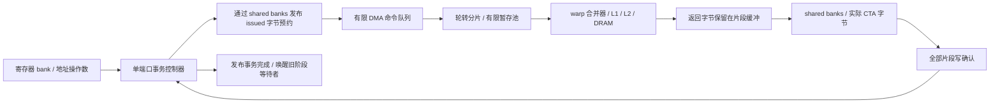

# 异步搬运与事务屏障的时序通路

`simt-run --timing` 现已执行全部五条自定义异步指令：`MB_INIT`、`MB_EXPECT`、`MB_ARRIVE`、`MB_WAIT`、`CP_ASYNC`。global→shared 的每个载荷字节都经过缓存层次和 shared bank 端口；源数据不在指令发射时用宿主内存快照代替。

默认仍使用下述 C++ 时序后端。启用 `--register-rtl --collector-rtl` 已将事务表、查找与计数、发布握手、CTA 回收及前端阶段等待/唤醒换为 [实际 RTL](RTL_TRANSACTION_TABLE.md)；DMA 片段与 shared bank 服务仍由 C++ 推进。下方早期实验保留原参数和结果，不能作为当前 RTL 的周期数据。

这是有限资源的研究型 DMA/事务屏障模型，不是 NVIDIA 原电路复刻。它在 CPU 上模拟数据与时钟，模型周期不代表 RTX 4070 SUPER、SM100 或 SM120 的实际延迟。

## 从地址提交到数据可见



一条 CP_ASYNC 包含 global 源地址、shared 目标地址、屏障地址和 1..4096 B 长度。其执行顺序是：

1. 等待本 warp 较早指令完成，经真实寄存器读端口收集地址。一个 SM 的控制器同时只处理一个管理/查询/完成任务。
2. 验证整个源/目标范围、单线程发起条件及尚未发起的预期字节预算。先更新私有下一状态，再通过 shared 端口写入不透明记录。
3. 记录写确认后，命令进入有限 DMA 队列，提交指令可以退休；它不占用载荷寄存器，其他指令可以继续执行。
4. 每 SM 每拍最多准入一个片段，在有剩余数据的命令之间轮转。片段先发真实 global 请求，拿到返回字节后才向 shared 发写请求。
5. shared 写确认后释放片段暂存。整条命令的全部片段完成后，重新申请控制器，扣减 `remaining bytes` 与 `issued outstanding bytes`。
6. 完成记录的全部 word 写确认后，才发布新的逻辑状态、释放 DMA 命令额度，并唤醒已完成阶段的等待者。

因此，“CP_ASYNC 退休”“shared 载荷最后一次写确认”“事务完成发布”是三个不同事件。目标字节按片段逐步可见，不提供整个 4 KiB 拷贝的原子可见性；只有正确等待后才保证所有预期载荷可用。

## 有限资源与仲裁

| 参数 | 默认值 | 约束与作用 |
|---|---:|---|
| `--async-depth` | 8 | 每 SM 命令额度，范围 1..64；发布完成后归还 |
| `--async-fragments` | 4 | 每 SM 共享片段池，范围 1..64；读请求至写确认期间持有 |
| `--async-chunk` | 128 B | 每片段上限，范围 1..128；不是每拍保证带宽 |
| `--mbarrier-slots` | 16 | 每 SM 事务表额度，范围 1..1024；所有驻留 CTA 共享 |
| `--mbarrier-latency` | 2 拍 | 每次控制状态更新/不同地址查询的处理延迟，不包含 shared 写延迟 |

源和目标都满足 4 B 对齐且剩余长度允许时，片段使用最多 32 lane × 4 B 请求，大小向下取整到 4 B。否则走最多 32 lane × 1 B 路径，处理非对齐和尾部；不会读写目标边界之外的保护字节。片段中只保存实际返回的最多 128 B 载荷，命令不会保存整个源区副本。

DMA、普通 LDS/STS、Tensor 描述符和 shared 操作数访问使用同一个 SM shared 仲裁器及有限请求队列。各 CTA 的实际字节隔离，端口竞争共享。global 读则使用原有 coalescer、MSHR、缓存 bank 和 DRAM 控制器；重复来源可以命中 L1。

已就绪的 DMA 完成任务在新指令启动前申请控制器。队列已满的 CP_ASYNC 不能持有该控制器，否则它会阻止旧命令归还额度。片段池满时保留已有事务并重试，不重发已经接受的请求。

所有容量、控制端口数、仲裁顺序和延迟均为项目设计假设。当前每拍检查全部在途片段的响应；没有声称这就是某代 NVIDIA 的物理完成总线宽度。

## 事务表、记录保护与等待

逻辑表记录 `phase / expected arrivals / remaining arrivals / remaining bytes / issued outstanding bytes`。每次更新先准备私有下一状态，随后将八个 word 经 shared banks 发布，得到确认后才切换逻辑表。记录布局沿用 [张量功能规范](TENSOR.md)。它是项目的可审查编码，不是 NVIDIA mbarrier 的内存布局。

MB_INIT 在写记录之前就预约其保护范围，普通 store 和 DMA 不能趁初始化尚未发布而覆盖它。初始化也拒绝与已接受的普通写、在途 DMA 目的范围相交。事务表没有驱逐或动态扩容；耗尽会报告 `mbarrier_table_full`，CTA 退休时统一归还条目。当前没有 invalidate/reinitialize 指令。

MB_WAIT 每段控制延迟查询一个不同屏障地址，相同地址的参与 lane 共享查询。查询使用有限逻辑表的控制端口，不额外读取 shared 字节。C++ 后端在退休时提交后续 PC 并发布等待状态；完成发布会重新检查等待者。RTL 后端在查询响应时直接更新前端等待存储，退休时只推进 PC；boundary 在退休前阻止新发射，阶段完成信号可以在两者之间唤醒线程，退休不会用旧快照覆盖它。新阶段若已发布则立即继续。

只有到达计数与剩余字节都归零，阶段才递增。载荷先完成时仍须等待到达；到达先完成时仍须等待载荷。未来令牌、到达溢出、超出预期字节预算均报错。重复阶段必须传播新令牌。

即使全部 lane 都在等待或已经 EXIT，DMA 和控制器仍推进。CTA 必须等全部在途拷贝完成才归还 shared/warp/寄存器资源；没有搬运能够满足的剩余字节会导致死锁诊断，或在全部线程退出时报告 `incomplete_async_transaction`。

## 功能模式及 PTX 差异

默认功能模式保留原来的“提交时捕获源字节、三次调度机会后提交”规则。时序模式按真实请求服务时刻取数，无同步源覆盖可能产生不同结果。正确同步的无竞争程序应获得相同输出；不能把功能模式的快照视为 DMA 的硬件原子性保证。

官方 [PTX `cp.async`](https://docs.nvidia.com/cuda/parallel-thread-execution/#data-movement-and-conversion-instructions-cp-async) 定义 4/8/16 B 搬运、相应 completion mechanism 和缓存限定符。这里的单发起者、1..4096 B 字节命令与自定义事务记录不是该指令的精确实现。未实现 `commit_group/wait_group`、`.cg` 绕过 L1、零填充参数、TMA 描述符/多维索引、proxy fence 或 PTX 非阻塞 MMA/commit 协议。当前 CTA 屏障/FENCE 不替代 MB_WAIT 的事务完成条件。

## 实验与验证

```sh
cmake --build build
ctest --test-dir build -R timed_async_execution --output-on-failure
python3 examples/hardware_async.py
python3 examples/run_workloads.py --timing --out artifacts/timed
```

DMA 示例保存输入镜像、机器码、完整命令、状态/trace 和逐字节验证结果至 `artifacts/async/`。2026-10-29 默认研究参数下：

| 实验 | 已验证载荷 | 模型周期 | 观察 |
|---|---:|---:|---|
| 片段池 1 | 4096 B | 3356 | 每次等待一个片段读写完成 |
| 片段池 4 | 4096 B | 2147 | 在途片段可重叠 |
| 片段池 8 | 4096 B | 2147 | 继续增大缓冲不保证提速，下游仍有限 |
| 命令队列 1，四次拷贝 | 1024 B | 764 | 492 次命令容量拒绝，能够完成并归还额度 |
| 命令队列 8，四次拷贝 | 1024 B | 617 | 峰值 4 个在途命令 |

上述单次 4 KiB 默认实验中，CP 指令在 cycle 42 退休，DMA 完成记录在 cycle 2140 发布。计时属于本模拟器，不是实卡性能测量。

新增 29 项 Python 检查：复用六项事务契约和四项组合负载，另有 19 项时序/容量/负例检查。包含 18 组对齐/尾部/最大长度、20 组固定种子随机片段边界，逐字节比较载荷及保护区；同时覆盖队列饱和、L1 重用、多 CTA 隔离、阶段复用、多个等待地址、到达与载荷先后顺序、两类初始化/普通 store 竞争，以及 EXIT 排空。

原小型 Transformer 未替换异步指令路径，实际完成 1 次 2176 B 搬运、8 个有效 MMA 命令、2304 次乘积，验证 32 个输出，最大绝对误差约 `1.07e-7`，共 5637 模型周期。`op_counts` 还计入另一 warp 上谓词关闭的指令，因此 CP_ASYNC/MMA 发射计数分别为 2/16，不能与有效命令数混淆。

`hardware.async_config` 保存实际参数，`hardware.async` 按 SM 报告提交/完成数、实际读写字节、片段数、容量拒绝与阶段推进。`fragment_stalls` 计数片段池处于满状态的周期；它不等于关键路径上的损失周期。trace 新增 `barrier_publish`、`barrier_wait_checked` 和 `copy_submitted/read_submit/read_complete/write_submit/write_complete/complete`，沿用原始动态指令编号和 PC。

源码分为 `async_launch.cpp`（准入/保护）、`async_barrier.cpp`（事务状态机）、`async_dma.cpp`（分片数据流）、`async_report.cpp`（报告）。原子/local 的后续接入见 [相应文档](HARDWARE_ATOMIC_LOCAL.md)，持久 CP/copy/Graph 已接入并完成 DMA/Tensor 图重放，见 [HARDWARE_HOST.md](HARDWARE_HOST.md)。剩余 RTL 和校准见 [总计划](HARDWARE_PLAN.md)。
