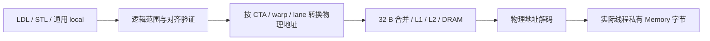
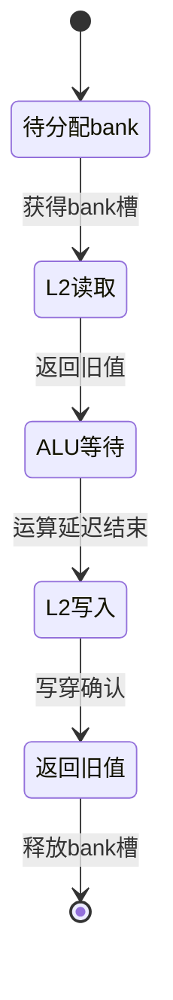

# Local memory 与整数原子的时序实现

`--timing` 已接入 LDL/STL、通用 local 地址、ATOM/RED。至此自定义 ISA 的 59 个 opcode 都有时序执行路径；这不代表支持 NVIDIA 的全部指令或完整 GPU 硬件。主机 CP/Graph 仍待接入同一套时钟和持久缓存。

## Local 的地址与真实字节

local 的“私有”指逻辑归属，不意味着一个无延迟的独立 SRAM。官方 [CUDA 编程指南](https://docs.nvidia.com/cuda/cuda-programming-guide/02-basics/writing-cuda-kernels.html) 说明 local 位于设备内存，同一 warp 的相同相对地址可合并访问。本项目采用明确的字交错映射，经过与 global 相同的缓存和 DRAM 单元：



每线程逻辑窗口仍为项目原有的 16 KiB。令 `a` 为线程内字节偏移，物理地址为：

```text
4 GiB + (CTA_ID * 32 + warp_ID) * 512 KiB
      + floor(a / 4) * 128 + lane_ID * 4 + a % 4
```

这让 32 lane 的同偏移 32 位字连续排列，形成四个 sector；不同偏移可能形成更多 sector。CTA_ID×32 为每个 CTA 预留最大 32 warp 的地址范围，是项目地址布局选择，不是 NVIDIA 地址散列。ISA 仍使用 32 位 global 地址，新物理 local 范围与整个 global 窗口隔离，不能由普通 LDG/STG 访问。

`LocalAddressSpace` 在 CTA 准入时登记其实际 `Cta.local` 存储指针。DRAM 完成才解码并读写这些字节，没有单独的影子副本，也不会在指令退休时绕过缓存补写。读取命中返回 cache 中的字节。未使用 lane 的整 sector 取数返回零，但拒绝向这些 lane 写入。

部分 warp、非对齐检查、子字扩展和末尾 16 KiB 边界保持原语义。一个通用 LD/ST 的参与 lane 可以分别访问 global/shared/local，执行器先拆成各空间请求，再等待全部响应。local 和 global 共享缓存容量、MSHR 和 DRAM 资源；local store 也沿用保守的写穿策略。

CTA 的物理映射在本次 kernel 内保持唯一，已退休 CTA 的存储保留供状态检查。该机制避免物理 warp 槽复用时读到上一个 CTA 的旧 cache 数据，但不是动态显存分配器、TLB 或页表。没有加入编译器自动 spill，程序需显式使用 LDL/STL。

## Global 原子的读改写状态机

ATOM 返回旧值，RED 丢弃返回值。两者都要求 4 B 对齐，支持原有十种 32 位整数模式：add、exchange、CAS、and/or/xor、unsigned min/max、signed min/max。整数加法按 2³² 绕回，CAS 比较值与替换值都经寄存器端口收集。



默认 8 个 global atomic bank，映射为 `floor(physical_address / 32) % banks`。每 bank 同时一个 lane 的 RMW，持有槽位直到写确认；这也是保守的整个 bank 锁，因此同一 sector 内不同 word 也不会并发。不同 bank 可同时推进，较早请求及较小 lane 优先。

每个 job 保存请求编号、lane、旧值、计算结果、状态、完成时钟及内存 ticket。先读实际 L2 sector，取出当前 word；等待 ALU 延迟；再带 4 B byte mask 写回同一 sector，经过现有 L2→DRAM 写穿通路。全部 lane 都完成后，旧值向量才能返回并竞争寄存器写回端口。重复地址的 lane 不合并为一次更新，也不广播同一个旧值。

全局原子操作沿用已有一致性边界：较早普通请求先排空，所有 L1 失效；连续原子请求可共同占用 atomic bank 阵列，后续普通读写等待该批完成。新的普通 store 将批次分隔。这样可以保证跨 SM 原子唯一性以及后续读不会命中陈旧 L1，但会牺牲不相关地址的并行度。

当前写穿/no-write-allocate 策略意味着同址连续原子可能反复访问 DRAM。它没有实现真实 GPU 的 L2 内驻留更新、dirty sector、写合并或完整弱内存顺序，不能拿当前原子延迟直接预测 NVIDIA 硬件。

## Shared 原子与其他访问共用 bank

shared 原子直接进入现有 `BankedShared`，使用相同的请求队列和 32 个 bank。bank 映射仍为 `floor(address / 4) % 32`，每 bank 一个在途 RMW 槽。

读阶段实际取得旧值，预约 bank；ALU 等待期间，该 bank 对普通 LDS/STS、DMA、Tensor shared 读及事务记录写都不可用；到期写入新值，写阶段同样占用一拍端口。最后一个 lane 写完后，再等待 shared 普通返回延迟，才确认整个请求。

每条请求保留 CTA 存储归属。不同 CTA 的相同 shared 偏移仍各自独立，但竞争同一 SM 的物理 bank。共享读的广播规则不适用于原子读改写。对不透明 mbarrier 记录的原子写入同样会被拒绝；初始化不能覆盖未完成原子请求的目的范围。

## 参数、数值与时钟证据

| 参数 | 默认 | 范围与含义 |
|---|---:|---|
| `--atomic-banks` | 8 | 1..64，仅配置 global 原子 bank 数 |
| `--atomic-depth` | 8 | 1..64，global 在途 warp 请求；未取响应继续占用额度 |
| `--atomic-latency` | 4 | 正整数，global/shared 原子 ALU 等待拍数 |
| shared 原子 bank / 队列 | 32 / 8 | 沿用 shared 资源，每 bank 一个 RMW 槽 |

这些端口数量、地址映射、锁粒度、仲裁和延迟都是研究模型假设。官方 [原子语义说明](https://docs.nvidia.com/cuda/cuda-programming-guide/05-appendices/cpp-language-extensions.html) 说明原子的读改写性质，不提供这些具体电路参数；本项目也没有实现其完整 CUDA API、数据类型和作用域。

```sh
cmake --build build
ctest --test-dir build -R 'hardware_atomic_local|timed_memory_execution' --output-on-failure
python3 examples/hardware_memory_ops.py
```

示例在 `artifacts/memory-ops/` 保存机器码、完整命令、寄存器/内存快照、硬件 trace 和验证摘要。2026-10-29 的实际结果：

| 32 lane 实验 | 模型周期 | 具体观察 |
|---|---:|---|
| local 相同偏移，读取两次 | 133 | 4 次 DRAM sector read，第二次 4 个 L1 hit |
| local lane×4 偏移，读取两次 | 606 | 32 次 DRAM sector read，第二次 32 个 L1 hit |
| global atomic 全部同址 | 2815 | 旧值严格为 0..31，最终 word=32 |
| global atomic 步长 32 B | 1081 | 旧值均为零，各 word=1，bank 可重叠 |
| shared atomic 全部同址 | 179 | 32 次串行 RMW，64 次 bank 读/写服务 |
| shared atomic 连续字 | 24 | 32 bank 并行，仍为 32 次 RMW、64 次服务 |

9 项 C++ 检查覆盖精确 shared 原子时钟、普通 store 排斥、多 CTA 归属、未取响应容量、跨 SM L1 失效、普通 store 与原子的顺序、local 真实读写与 inactive lane，以及 240 个混合 load/store/add/xor 请求的独立标量差分。

17 项 Python 检查执行真实 ISA，包括原有 185 个跨 SM 唯一票号、CAS/十种模式及 local 隔离；另有 6×48 条随机原子程序、local 冷热/分散/边界/槽复用、混合通用地址、有限队列、bank/延迟参数、ALU 重叠、替换值 WAR、谓词及记录保护。

Debug、Release、ASan+UBSan 均通过 18 套件、220 项检查（181 项 Python、39 项 C++），未报告 sanitizer 错误。硬件统计的 `global_atomic.completed` 是 lane 操作数，`bank_stalls` 累加等待 lane 的拒绝次数，不能解释为 kernel 损失周期。`atomic_submit`、`local_submit` 与原有 memory_complete/retire 事件可以定位指令级时间线。

源码主要为 `hardware/local.cpp`、`hardware/atomic_{queue,execute}.cpp`、`hardware/shared_atomic.cpp` 和 `timing/atomic.cpp`。完整剩余目标见 [HARDWARE_PLAN.md](HARDWARE_PLAN.md)。
