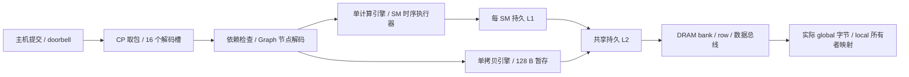

# 持久设备、命令处理器与主机拷贝时序

`Device(timing=True)` 将命令处理器、拷贝引擎、Graph 和全部 kernel 接到同一设备时钟。L1/L2、DRAM 控制器状态与实际字节数据跨 kernel 保留。默认 `Device()` 仍运行功能模式。两个模式都在 CPU 上运行，自定义主机协议不是 CUDA、PCIe 或 NVIDIA GPFIFO。

```python
from simt_lab.host import Device

with Device(timing=True, hardware_trace=True) as device:
    buffer = device.allocate(256)
    device.h2d(buffer, bytes(range(256))).wait()
    assert device.d2h(buffer, 256).result() == bytes(range(256))
    print(device.stats()['hardware'])
```

原生程序接受 `simt-device 2 64 --timing --hardware-trace`。Python 启动器传递相同选项，原来的命令协议和 kernel 参数布局保持兼容。各 kernel 的 ISA、warp、CTA、Tensor 和异步执行单元仍由已有时序执行器执行，不调用功能执行器代替计算。

## 数据归属与设备时钟



`HardwareContext` 由设备持有，负责物理解码、缓存、DRAM 和时钟。kernel 只持有本次启动的线程寄存器、CTA、shared/TMEM、scoreboard、流水线和阵列状态。kernel 退出会回收这些启动资源，但保留缓存；每个 SM 的 L1 与共享 L2 的命中、替换和 DRAM 开行状态因此可以影响下一次启动。

每次 `tick()` 按以下顺序执行：

1. 设备 tick 加一，CP 最多取一个已发布命令。
2. 共享 Graph 解码器最多展开一个节点，调度器最多启动或取消一个任务。
3. 持久内存层次推进一个时钟。
4. 拷贝引擎处理链路/内存返回，计算引擎处理该时钟的 SM 进度。
5. 汇总图完成状态，按原规则发布监控快照。

计算和拷贝同时运行时，内存时钟也只推进一次；空闲时显式 `progress(n)` 同样推进 n 个模型时钟。查询、分配、实例化、提交和 doorbell 不隐式推进时钟。没有后台实时运行线程；主机的 `progress()`、`wait()` 和 `synchronize()` 驱动推进。

单独的 `simt-run --timing` 自己持有一个私有 HardwareContext，保持原 CLI 行为。两次独立 CLI 进程不会共享缓存。

## CP 和 Graph 的容量边界

主机环容量可配置，默认 64。取走命令释放环槽，但已取走且尚未完成的公开任务另占一个解码槽，时序模式固定 16 个；槽满时停止取包。该槽保留到任务完成，Graph 的槽保留到所有分支完成。

每拍最多一次启动/取消；无依赖等待的空节点也消耗一次调度机会。被依赖阻塞的任务不阻塞其他 stream 的就绪任务。只有一个计算引擎和一个拷贝引擎，因此支持计算/拷贝重叠，尚不支持同时执行多个 kernel。

Graph 实例化仍保存主机提交时的不可变模板。启动先预约全部节点句柄，使非拓扑编号的依赖合法；其后每拍最多一个节点从 queued 进入 waiting。这个限制由所有正在运行的 Graph 共享。每个模板最多 512 节点，CP 解码槽进一步约束同时存在的活图数量。预约句柄和保留模板不是同一拍执行全部节点。

重放、节点参数更新、单/多 stream capture、失败传播和资源 pin 规则沿用 [HOST.md](HOST.md)。捕获本身不推进模拟设备；执行重放时才发生实际内存与计算操作。节点失败时独立分支仍可执行，父图等全部已预约节点结束后发布错误。

所有已完成任务、模块和图模板仍保留到进程退出，历史存储不是硬件队列；长期运行的宿主内存会随历史增长。两个 trace 分别有 100,000 项上限，丢弃计数显式报告。

## 主机拷贝的真实数据通路

拷贝引擎只保留一个 128 B 暂存块和一个待完成的层次请求。所有设备端读写经过同一个 L2/DRAM：

| 命令 | 数据流及完成条件 |
|---|---|
| H2D | 提交时的宿主数据快照 → 主机链路等待 → 暂存 → L2/DRAM 写确认 |
| D2H | L2/DRAM 读返回 → 暂存 → 主机链路等待 → 结果数组 |
| D2D | L2/DRAM 读返回 → 暂存 → L2/DRAM 写确认 |
| FILL | 在暂存块生成字节 → L2/DRAM 写确认 |

读绕过 L1；写沿用内存层次的保守一致性协议：等待较早请求，失效全部 L1，向 L2 发写请求，较新流量等待写确认。L2 仍是 write-through/no-write-allocate 模型。因此 H2D 不是直接改底层 Memory，也不能遗留旧 L1 数据；D2H 不绕过缓存读取一个“正确答案”副本。

字对齐的数据块最多 32 lane × 4 B，即 128 B；非对齐路径最多 32 lane × 1 B，即 32 B。尾部使用更小块。暂存块在链路等待、端口反压和内存返回期间保持占用，下一块不能覆盖它。

主机链路采用明确的研究假设：每块延迟 `8 + ceil(bytes / 16)` 个模型时钟；这是建立延迟与 16 B/clock 服务速率，不是测得的 PCIe 延迟或带宽。H2D 在提交设备写请求前等待；D2H 在收到设备字节后等待。不同块不流水重叠，当前实现不代表高性能真实 copy engine。

重叠 D2D 按方向逐块执行，目标起址高于源且区间重叠时从尾部开始；其他情况从头开始。这样在没有并发数据竞争时保持 memmove 结果，但不再像功能模式那样在启动时拍下整个源的快照。未同步的源修改没有快照或 CUDA 内存模型保证。

H2D 命令的全部宿主字节和 D2H 的结果数组属于接口存储，不是额外设备暂存容量。D2H 的公开 `data` 字段只在整个任务完成后出现。

## 分配复用、local 物理地址与故障恢复

分配/释放是时钟之外的管理操作：其清零仍直接更新分配存储，但先失效所有 L1/L2 中相交的 sector。它保留无关 sector 和在途填充，不必排空整个设备。如果原始未声明资源访问仍在使用相同 sector，则拒绝清零并返回 `invalidate_busy_range`；正常声明的缓冲区会先由 `buffer_in_use` 规则保护。

local 存储在各 kernel 内仍属于真实 CTA 线程。持久上下文为每次启动预约新的 64 位物理 warp 编号范围；地址为：

```text
4 GiB + (launch_local_base + CTA * 32 + warp) * 512 KiB
      + floor(thread_offset / 4) * 128 + lane * 4 + thread_offset % 4
```

kernel 结束后解除其底层指针映射。旧的 clean local 缓存行可以保留，但新的 kernel 永远使用不同 tag，不能误读前次线程的私有字节。编号空间有限，耗尽会明确报错，不静默复用。

内存请求带有所有者编号，kernel 与拷贝引擎各自占有自己的响应。kernel 报错后停止发射，先进入 `recovering=true` 的运行状态；继续推进设备时钟，使已经接受的 global/local/atomic 请求真正完成，再消费该 kernel 的响应、释放线程存储和资源引用。这个过程不会消费另一引擎的响应。

尚未提交的操作不再发起；已提交的写和原子不回滚。shared/TMEM/阵列的私有待完成状态在 kernel 销毁时一并销毁。计算引擎在全局请求排空之前保持占用，后续 kernel 不会与悬空 local 指针相遇。此规则是可验证的软件错误恢复协议，不是 NVIDIA fault/replay 或上下文切换机制。

## 报告与复现

- `stats.mode` 区分 functional/timing。时序设备的 `stats.hardware.cycles == stats.ticks`。
- `stats.hardware` 是全设备累计的缓存/DRAM 统计，包含拷贝和所有 kernel。
- kernel `query().hardware.cycles` 是本次启动经过的模型时钟；`clock_start/end` 和 trace 使用绝对设备时钟。
- kernel 的 issue/retire、Tensor、shared、DMA 统计属于本次启动；缓存/DRAM/全局原子统计是设备累计值，报告标为 `memory_counters_scope=device_cumulative`。完成后保存快照，后续任务不会改写已完成报告。
- 错误 kernel 的硬件周期包含排空时间。`started/finished` 是设备服务 tick，kernel 的 `clock_start` 位于启动 tick 推进时钟之前。

```sh
cmake --build build
ctest --test-dir build -R 'hardware_context_lifetime|timed_host_and_graph' --output-on-failure
python3 examples/hardware_host.py
python3 examples/host_graph.py --timing --hardware-trace --out artifacts/timed-host-graph
```

`hardware_host.py` 保存每类负载的上传镜像、实际地址/launch、机器码、汇编、两次下载字节、kernel 硬件报告和整个设备的 CP/copy trace。工作负载构造器只增加 global 基址参数；Transformer 搬入 shared 后的布局和算法保持不变。

2026-10-29，同一双 SM 设备运行示例的实际结果：

| 实验 | 本模型结果 |
|---|---|
| 两次只读 kernel | 冷 62 拍，热 17 拍；第二次增加 0 次 DRAM 读取 |
| Vector Graph，两次重放 | 每次验证 257 值；kernel 1,944 拍；整个图 5,512/5,500 拍 |
| Reduction Graph，两次重放 | 每次验证 3 个整数和；kernel 1,252 拍；整个图 2,697 拍 |
| GEMM Graph，两次重放 | 每次验证 96 值，最大绝对误差 2.98e-7；kernel 2,233 拍；图 3,414 拍 |
| Transformer Graph，两次重放 | 每次验证 32 值，最大绝对误差 1.07e-7；kernel 5,621 拍；图 7,656 拍 |

Transformer 每次实际搬入 2,176 B，并在阵列中完成 2,304 次乘加。以上周期受本实验的缓存/开行初态和启动配置影响，不能和单独 CLI 的周期直接归因比较，也不预测 4070 SUPER 的耗时。

新增四项 C++ 检查覆盖相邻 sector、在途 fill、按所有者排空和 local 生命周期；33 项 Python 检查包含原有 20 项主机/Graph 契约和 13 项持久硬件场景，包括并发时钟、链路等待、有限展开、CP 反压、重叠搬运、故障排空、三次 DMA/Tensor 图重放和四类完整负载。整体三种构建结果见 [VALIDATION.md](VALIDATION.md)。

统一时钟和跨 kernel 缓存已接入。独立缓存/scoreboard/bank 仲裁 [RTL](RTL.md) 已验证，但尚未成为本主机设备的执行后端。Tensor RTL、完整 RTL 连接、实机参数校准、PTX 异步矩阵协议与完整硬件审计仍待完成，见 [HARDWARE_PLAN.md](HARDWARE_PLAN.md)。
