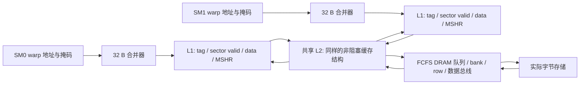

# 逐周期存储单元：当前实现与剩余接入

这些单元已经实现真实数据流和逐拍资源约束，位于 `src/hardware/`。现已接入 `simt-run --timing` 的 load/store、Tensor 操作数、异步搬运及 local/整数原子路径，详细范围见 [SM 时序执行](HARDWARE_SM.md)、[Tensor 通路](HARDWARE_TENSOR.md)、[DMA 通路](HARDWARE_ASYNC.md) 和 [local/原子通路](HARDWARE_ATOMIC_LOCAL.md)。`Device(timing=True)` 的主机 CP/copy/Graph 已接入同一层次，并跨 kernel 保留缓存，见 [持久设备时序](HARDWARE_HOST.md)。默认功能模式仍使用原功能内存，整个硬件目标尚未完成。

## 数据通路



`MemoryHierarchy::submit(sm, WarpAccess)` 提交最多 32 个 lane 的实际读写。`tick()` 推进 DRAM、L2、各 L1 和 warp 请求；`take(ticket)` 只有完成时返回逐 lane 数据。响应没有被取走时仍占队列容量。所有读取值从 sector 返回字节组装，不绕过缓存重新读取后端 Memory。

## L1 到底由什么实现

当前 C++ 模型明确包含以下硬件结构的状态。另有可综合的 [sector 缓存 RTL](RTL.md)，实现实际数据阵列、tag/valid、MSHR、LRU、有界响应及逐拍失效扫描；已通过可选 [L1/L2 RTL 后端](RTL_CACHE_BACKEND.md) 接入这里的存储层次。单请求端口和较小缺失队列与下面 C++ 模型的端口及时间不能直接等同。

1. **tag 阵列**：按 `(address / line_bytes) % set_count` 选组，同组比较所有 way 的 tag。默认 L1 为 64 KiB、128 B/line、4-way，共 128 组。这是可配置研究参数，未声称恢复 NVIDIA 的真实地址 hash。
2. **data 阵列**：每个 way 保存一整行的实际字节。128 B 行分成四个 32 B sector，分别保存有效位；tag 命中而目标 sector 无效，仍需向下游取数。
3. **bank 端口**：按 sector 地址 modulo bank 数选择 bank。每 bank 每拍接受一个请求，fill 使用独立的每 bank 每拍一个写入端口；端口冲突造成反压。
4. **MSHR**：记录缺失 sector、目标行、下游 ticket 和等待者。相同 sector 的多次读取合并为一个下游事务，等待者和 MSHR 均有容量上限。
5. **替换与预约**：LRU 选择未被预约的 way；存在未完成 fill 的整行不能被替换，避免返回数据写入错误 tag。
6. **返回队列**：命中与 fill 都经过配置的返回延迟；结果未被消费者取走时不能无限接收新任务。

命中直接使用 data 阵列。测试会在一次 fill 后故意修改底层 Memory，确认命中仍返回旧缓存字节；只有显式失效后才取得新的字节。这证明它不是仅统计 hit/miss 的装饰层。

## 写入与一致性规则

缓存采用 write-through/no-write-allocate：写入使对应缓存 sector 失效，携带 byte mask 向下游传递，在 DRAM 完成时修改字节。下游队列满时保留 MSHR 并重试，不丢请求或重复写入。

目前 `MemoryHierarchy` 选择保守而明确的全局写顺序：写入开始前排空较早的读取，使全部 L1 失效，写入绕过 L1，经 L2 完成后才允许较新的请求。local 物理请求也经过该层次。global 原子先排空普通流量，连续原子批次共享 bank 阵列，后续普通请求等待其完成；两个 SM 的旧 L1 不会掩盖写结果。它牺牲并行性，**不是 NVIDIA 的实际一致性协议或弱内存模型**；主机 copy engine 接入时仍需验证相应顺序。

主机直接修改 backing memory 必须先排空并执行 `invalidate()`；忙碌时拒绝失效。内部接口不是并发宿主线程共享内存协议。

## DRAM 与 shared memory

DRAM 控制器具有有限请求/响应容量、独立 bank 当前打开行、bank 可用时间及共享总线可用时间。FCFS 每拍最多启动一个命令，行命中只付 CAS，关闭行增加 activate，行冲突再增加 precharge；传输还需占 burst 总线。它暂不含刷新、bank group、读写 turnaround 和完整 GDDR6X 约束。

测试使用 `tRCD=3、tCL=2、tRP=4、tBURST=1` 的可手算配置：cycle 0 提交，首个冷行读在 cycle 7 完成；下一次行命中在 11 完成；接着同 bank 换行在 22 完成。此结果只验证本控制器规则。

`BankedShared` 保存真实 shared 字节，默认 32 banks、每 bank 每拍一个 32 位字。同字读取（包括子字）广播；不同字但同 bank 的请求分拍执行。不同 lane 写同字采用确定的逐 lane 顺序，不把数据竞争定义成真实 CUDA 的确定行为。队列与返回延迟有上限。

默认 C++ 时序执行时，同一 SM 的多个 CTA 使用各自的实际 shared 存储，全部请求经过同一个 `BankedShared` 仲裁器。启用 collector RTL 后，现已替换为 [64 KiB 共享 SRAM 与 bank 电路](RTL_SHARED.md)：所有 CTA 使用同一物理容量，实际数据、广播、冲突选择、返回和整数原子均来自电路，C++ Memory 仅作为写端口观测。CTA 退休须等返回消费。constant 仍使用单 bank 同字广播模型，未实现独立 constant cache。

## 验证与运行

```sh
cmake --build build
./build/test-hardware-memory
ctest --test-dir build --output-on-failure
```

17 项单元/组合检查覆盖冷行/行命中/行冲突精确时序、延迟写可见性、响应容量、真实缓存字节、独立 sector、LRU、MSHR 合并和限额、被预约 way、bank 冲突、下游反压、写后读、四/五/32 sector 合并、子字与掩码、shared 广播和串行冲突、跨 SM 共享 L2 和陈旧 L1 失效。

随机差分另外包含在一个检查中：320 个混合大小、掩码、两 SM 读写请求，独立参考为普通字节向量；比较每次读回及最终全部 2048 字节。Debug、Release、ASan+UBSan 都通过，原 75 项功能检查也保持通过。

剩余工作仍以 [总计划](HARDWARE_PLAN.md) 为准。SM/Tensor/异步/local/原子流水线、持久 CP/copy/Graph 和 NVML 已有各自的增量验收，不能由存储单元测试替代；关键模块 RTL 已有增量，完整 RTL 层次连接和参数校准仍未完成。

指令缓存补充现已绕过数据 L1 接入同一 L2/DRAM，并使用高位独立只读代码区；DRAM 总读取计数包含代码和数据，另提供实际 `instruction_reads` 与 `data_reads`。映射、失败排空和剩余 C++ 连接见 [INSTRUCTION_MEMORY_HIERARCHY.md](INSTRUCTION_MEMORY_HIERARCHY.md)。
