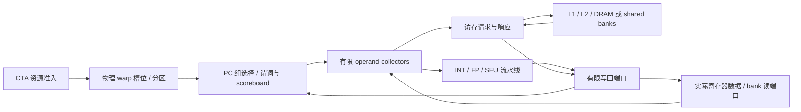

# SM 时序执行：数据、依赖和资源限制

`simt-run --timing` 已将基础 ISA 接入实际的 SM 流水线和存储模型。默认功能模式保持原有语义。两者都在 CPU 上执行；时序模式的 `hardware.cycles` 是本项目研究架构的时钟，未校准为 RTX 4070 SUPER、SM100 或 SM120 的周期预测。

当前接入范围覆盖自定义 59 个 opcode：整数/标量浮点、谓词、控制流/重聚、warp 集合操作、global/shared/local/constant 的 load/store、通用地址、CTA 屏障和 fence，以及 [Tensor/TMEM](HARDWARE_TENSOR.md)、[CP_ASYNC/mbarrier](HARDWARE_ASYNC.md) 和 [local/整数原子](HARDWARE_ATOMIC_LOCAL.md)。这不是 NVIDIA 的完整指令集或硬件实现；各模块的模型假设、测试范围与未实现部分分别列明。

启用 `--register-rtl --collector-rtl` 时，[跨 warp 调度器](RTL_WARP_SCHEDULER.md) 已通过 RTL 保存候选优先级、在途计数和串行化状态。每分区每拍只检查一个候选；拒绝后等待下一拍，不再通过软件循环尝试其他 warp。停顿统计采用实际候选事件，与默认 C++ 扫描的计数口径不同。[跨分区执行仲裁器](RTL_EXECUTION_ARBITER.md) 现已通过 RTL 实现 Tensor/异步候选轮转、Tensor 持有和发射间隔；指令存储/取指、依赖查询组合、CTA 资源分配及异步后台服务次序仍有 C++。

## 从一条指令到真实结果



每个分区每拍最多发射一个可运行 PC 线程组。普通指令发射后可以继续取指，但尚未写回的数据保持不可读。操作数经过寄存器读端口进入收集器，结果在流水线延迟结束后竞争写回端口。寄存器数据、收集器中的旧值、待写回结果分别保存，不能用一份可变 Warp 对象代替三者。

单拍顺序为：准入 → 推进存储/Tensor 阵列 → 推进事务控制器/DMA → 处理结果/写回 → 收集操作数 → 启动就绪执行 → 各分区发射 → 回收完成 CTA。因此本模型允许本拍写回的值被后续本拍阶段读取；不另加未声明的旁路延迟。

控制、集合和屏障指令在所属 warp 的较早指令排空后发射，提交时修改 PC/等待状态。不同 warp 可以继续前进。每 warp 当前最多一个在途访存，但不相关的 ALU 指令可以与它重叠。全局写继续采用存储层次中明确的保守排空/失效规则，未实现 NVIDIA 弱内存模型。

## 依赖和寄存器 bank

scoreboard 按寄存器和 lane 掩码记录尚未完成的写者，阻塞 RAW/WAW；不相交 lane 可独立前进。谓词同样保存写者掩码，必须先等待 guard 谓词完成才能决定实际参与 lane。

读者还持有引用计数，直到操作数真正通过物理读端口传入收集器后才释放。这样 `IMAD R8,R0,R4,R63` 因同 bank 冲突分两拍收集时，后面的 `MOVI R4,99` 不会提前覆盖旧 R4。它解决的是 WAR，而不是只在发射时读一份全寄存器快照。

默认每分区 4 个寄存器 bank，按寄存器号 modulo 映射，每 bank 每拍一个向量读端口和一个独立向量写端口。相同源寄存器只读取一次，R63 不占端口。不同执行流水线同时返回同一 bank 时，后返回者等待。谓词写回每分区每拍一个端口。

这些映射、端口和延迟都是可检查的模型选择，不是已经逆向证明的 NVIDIA 寄存器电路。默认 C++ 后端在收集好的操作数上计算，再等待写回。collector RTL 后端现将整数与普通浮点直接送入电路，浮点加乘具有实际四级数据寄存器并完成网表验证；SFU 多项式等电路仍未实现。

可选 [scoreboard RTL 后端](RTL_SCOREBOARD.md) 已将这些逐 lane 依赖接入实际电路，包括写者位、读者计数、谓词状态、同拍旁路和有限更新端口。用 `--timing --scoreboard-rtl` 或 `Device(timing=True, scoreboard_rtl=True)` 启用；寄存器数据另可启用 [寄存器 RTL](RTL_REGISTERS.md)，其逐 lane 写入、旁路、端口分组和槽复用已接入。另启用 [collector RTL](RTL_COLLECTOR.md) 可将普通源收集和读请求年龄仲裁接入电路；collector 到七类执行端口的选择和数据总线另见 [执行端口 RTL](RTL_DISPATCH.md)。该选项现在同时接入每分区 32 个完成槽、七类结果输入、写回年龄仲裁和 RF 直连，见 [写回 RTL](RTL_WRITEBACK.md)；[整数](RTL_INTEGER.md) 和 [普通浮点](RTL_FLOATING.md) 执行直接连接两个结果端口。谓词退休端现已直连 [谓词存储 RTL](RTL_PREDICATES.md)，guard 和 VOTE 不再从架构镜像取值。其余执行通路及部分输入选择仍有 C++，不能将这些选项称为完整 SM RTL。

## 多 CTA 驻留与参数

| 配置 | 默认值 | 当前含义 |
|---|---:|---|
| SM / partition | 2 / 每 SM 4 | 每 partition 独立发射与执行端口 |
| collectors | 每 partition 4 | 尚未启动执行的收集/就绪项占槽 |
| register bank | 每 partition 4 | 每 bank 每拍一读一写，向量粒度 |
| INT latency / interval | 4 / 1 | 执行延迟与接受下一条指令的间隔 |
| FP latency / interval | 6 / 1 | 同上 |
| SFU latency / interval | 16 / 4 | 同上 |
| warp / CTA 上限 | 48 / 24 | 仍须同时满足寄存器和 shared 容量 |
| SM 寄存器预算 | 65,536 个 32 位字 | 每线程固定保守预留 64 个寄存器，按完整 warp 分配 |
| SM shared / CTA shared | 64 KiB / 64 KiB | CTA 分配向上取整到 128 B |

固定 64 寄存器预算意味着单纯按寄存器算最多驻留 32 个完整 warp；48 是另一项容量上限，不能忽略更紧的限制。尚未实现编译器给出的每 kernel 寄存器用量及 spill。

默认每 CTA 预留全部 shared，因此每 SM 仍只驻留一个 CTA。运行小 shared kernel 时可传 `--shared-bytes 256`，真实启用多个 CTA 同驻留。它同时限制 CTA 可访问的 shared 地址范围，不只是更改统计值。每个 CTA 的字节互相隔离，但共享本 SM 的 bank 仲裁和队列容量。

准入先遍历各 SM，再填充额外槽位；资源不够时整体拒绝，不留下部分预约。EXIT 需等待所属 warp 在途指令完成，全部 warp 退出且 DMA 排空后才归还 CTA 的寄存器/shared/warp 槽、TMEM 列和事务表额度。`--warp-policy rr|min|max` 在每个分区内选择物理 warp 槽，默认轮转；`--policy` 仍选择 warp 内的 PC 线程组。

## 可复现实验

```sh
cmake --build build
ctest --test-dir build -R 'hardware_pipeline_units|timed_sm_execution' --output-on-failure
python3 examples/hardware_pipeline.py
```

示例生成 `artifacts/hardware/<实验>/kernel.bin`、`command.json`、`result.json` 和汇总。结果包含每条动态指令的 issue、operand_read、execute、memory_submit/complete、retire，以及 CTA 准入/回收事件。轨迹最多保留最近 100,000 项，溢出会增加 `dropped_trace`。

2026-10-29 本地默认配置的结果：

| 实验 | 模型时钟 | 可以验证的行为 |
|---|---:|---|
| 12 条依赖 IADD + EXIT | 63 | 每次后继等待前驱写回 |
| 12 条独立 IADD + EXIT | 19 | 相同指令数能够流水重叠 |
| shared 连续字读取 | 19 | 32 个 bank 可同拍服务 |
| shared 步长 128 B | 50 | 同 bank 的 32 个不同字多用 31 拍 |
| shared 同址广播 | 19 | 同字读取不逐 lane 串行化 |

`cold_load` 中，第一条 load 在 cycle 1 发射、65 写回；后面的独立 MOV 在 7 写回；依赖该 load 的 IADD 在 65 才发射。第二次同址读取走缓存。这里验证的是本模型数据通路和依赖约束，不是宣称真实显卡延迟为 65 周期。

7 项 C++ 检查覆盖 scoreboard 生命周期、lane 掩码、RMW、寄存器端口和 CTA 资源准入。35 项 Python 检查执行实际编码指令，覆盖以上结构冲突、多 CTA/部分 warp、共享规约、cache 写后读、guard、SFU、重聚/屏障、数值差分及明确错误。其中复用原整数独立参考的 80 个程序，并新增 12 个 120 条指令程序检验重叠依赖。

## 仍然没有完成的硬件

- Tensor 阵列、分拍供数和 TMEM bank 已实现，FP32 乘加电路及阵列 RTL 已接入；PTX 异步 MMA/commit 协议仍未实现。
- 编译器自动 spill、原生 PTX 指令与完整 async-group/TMA；显式 local 和自定义整数原子已接入时序通路。
- 指令 cache、TLB/页表、跨 SM 互连网络、真实弱内存一致性协议。
- 持久 CP/copy/Graph 与跨 kernel 缓存已通过 `Device(timing=True)` 接入，见 [HARDWARE_HOST.md](HARDWARE_HOST.md)；并发多 kernel、上下文切换与抢占仍未实现。
- 完整 SM 的 RTL 连接、执行控制电路、FPGA 下载、工艺面积/频率估计及真实 GPU 参数校准。scoreboard、读请求和写回年龄仲裁已经接入实际执行；早期循环 bank 仲裁模块仍独立，见 [RTL.md](RTL.md)。

完整剩余目标见 [HARDWARE_PLAN.md](HARDWARE_PLAN.md)。NVML 展示能力单独见 [NVIDIA_SMI.md](NVIDIA_SMI.md)，它不能证明上述执行硬件已完成。
