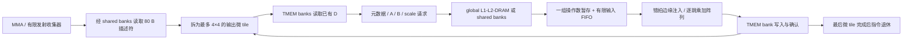
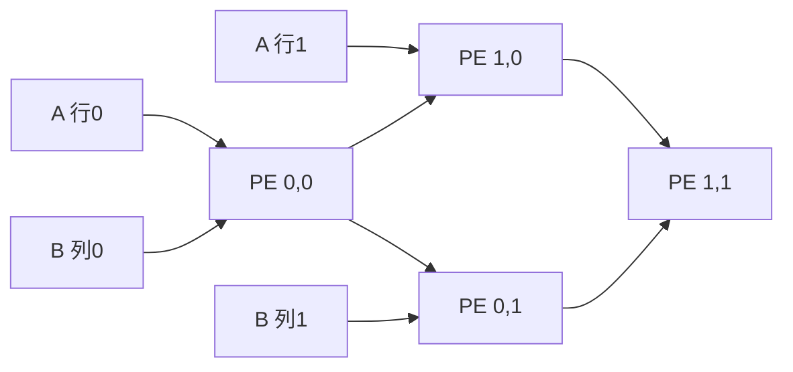

# Tensor 乘加阵列、供数和 TMEM 时序

`simt-run --timing` 已接入 TMEM_ALLOC、TMEM_FREE、LDT、STT 和 MMA。MMA 的结果现在由逐拍传输的操作数、有限乘加单元及 TMEM 写端口产生，不调用功能模式的 `matrix_multiply()`。现有五种格式、稀疏和块缩放均可运行，数学规则沿用 [TENSOR.md](TENSOR.md)。

这是本项目研究架构的 Tensor 数据通路，尚非 NVIDIA Tensor Core 的精确复刻或可综合电路。NVIDIA [PTX 的 Tensor Memory 与异步语义](https://docs.nvidia.com/cuda/parallel-thread-execution/#tensor-memory) 说明了特定目标的组织与同步要求，没有公开完整内部乘加阵列电路；本项目没有据此认定 NVIDIA 使用下述 4×4 阵列。SM100a/SM100f 的文档 TMEM 形状与本项目自定义的 128×256 逻辑窗口也不同。

## 前端、乘加单元和返回路径



每个 SM 有一个 Tensor 前端和一个阵列，同一时间一个 Tensor 命令占有该单元。其他已发射 Tensor 命令等待，仍占有限的 operand collector 槽；不会形成无界软件任务队列。同一 SM 的其他 warp 可以运行普通算术和内存指令，另一个 SM 具有独立阵列。

前端逐拍处理 start、descriptor、initial D、metadata、operands、feed、drain、store 和 complete 状态。一个微 tile 在每个 K 位置只读取一组最多 4 个 A 和 4 个 B；阵列消费旧数据时，前端可继续读取下一组。输入 FIFO 默认容量 2，满时保持原操作数并重试，不能丢失或重复乘积。源来自 global 时真正经过 sector cache、MSHR 和 DRAM；来自 shared 时与普通 LDS/STS 共享物理 bank 仲裁。描述符、scale、稀疏元数据也遵守对应端口容量和返回时序。

## PE 内部到底保存什么

默认 4 行 × 4 列，共 16 个 PE（处理单元）；可配置为 1–4 行、1–4 列。每个 PE 保存：

- 一份驻留输出累加器，以及块缩放使用的局部点积寄存器。
- A/B 传输寄存器及用于验证匹配关系的 K 序号。
- 一份待完成运算：结果位、到期时钟、运算阶段、块结束和整个流结束标志。

A 从每行左侧进入，向右每拍移动一个 PE；B 从每列上侧进入，向下每拍移动一个 PE。第 r 行和第 c 列分别延后 r、c 拍注入，因此同一 K 的 A/B 在 `(r,c)` 相遇。



默认乘加延迟 4 拍。一个 PE 在前一项累加写回后才能接受下一 K，边缘注入按这个依赖间隔限速。计算得到的位模式先保存在 pending 运算中，到期后才更新该 PE 累加器。浮点运算目前使用宿主 `std::fma` 保持规定的 binary32 融合舍入；INT8 解码为有符号值，累加保留低 32 位。尚未实现门级浮点乘法器、对阶/规格化/舍入电路。

最远 PE 也完成最后运算后，阵列才产生响应。未消费响应继续占用阵列，下一微 tile 不能覆盖它。单元测试独立推导：2×3 阵列、2 个 K、4 拍延迟，第一组在 cycle 1 注入，最后结果在 `1 + 4 + 1 + 2 + 4 = 12` 完成；提前取结果均失败。

## 稀疏与块缩放

2:4 元数据先经内存读取并校验，再恢复每行保留项的逻辑 K。不同 A 行可以保留不同位置。数据传输仍按逻辑 K 推进，缺失项携带禁用标志；对应 PE 不进行乘加，因此不会错误计算 `0 × NaN` 或 `0 × Inf`。

此实现尚未压缩传输时钟或实现 NVIDIA 的稀疏吞吐机制。`products` 只计实际保留乘积，`skipped` 计被禁用的 PE 运算；不能把产品数量减半描述成性能翻倍。

块缩放复用 PE 的执行资源：块内融合点积 → 缩放系数乘法 → 将缩放点积融合累加到 D，三段分别等待配置的运算延迟。块结束后延长注入间隔，防止下一块覆盖尚未完成的局部点积。scale 有限非负的检查以及 binary32 乘积舍入与功能模式一致。完整 MXFP4/NVFP4 scale 编码仍不在当前 ISA 中。

## TMEM 的容量、bank 与归属

每 CTA 保留原有 128×256 逻辑坐标及列优先地址 `(column*128+row)*4`。每 SM 另有默认 256 列的共享容量账本：不同驻留 CTA 的分配之和不能超额；释放或 CTA 退休归还容量。它不是“每 CTA 都获得无限独立物理容量”。逻辑数据保存在 CTA 的实际字节存储中，所有访问通过同一 SM 的 TMEM bank 仲裁器。

默认 16 banks、每 bank 每拍一个 32 位字，bank 为 `(byte_address/4) % bank_count`，返回延迟 2 拍。相同字读取广播，不同字落在同 bank 时串行。该映射是模型假设。由于列间距 128 个字，同一行跨列访问默认集中在一个 bank；不同的 row 可分布到多个 bank。

分配先预约列，再通过 bank 端口分批清零，全部写确认后才向 rd 返回列号。LDT/STT 同样产生真实请求，LDT 返回后仍竞争 SM 寄存器写回端口。MMA 初始化已有 D 和存放结果也使用这些端口，没有直接读取底层 TMEM 的旁路。

容量不足时当前自定义 ISA 报 `tensor_out_of_columns`，不会仿照某些 NVIDIA 分配指令自动挂起等待。这一差异属于公开语义边界。CTA 的已完成数据快照保留供检查，物理容量则已经归还。

## 完成与同步边界

本项目 MMA 对发起 warp 是阻塞指令：它等待本 warp 较早指令排空，Tensor 单元随后独立推进，最后一批 TMEM 写确认后才退休。其他 warp 可继续执行，因此可以观察算术与矩阵执行重叠。这种异步单元完成**不等于**已实现 PTX 的 `tcgen05.commit/mbarrier`、同线程非阻塞提交或跨 proxy fence。

输出按微 tile 写入，整个命令退休时才保证全部可用；不能假定中途观察整个 tile 是原子的。无同步的矩阵输入修改、TMEM 访问竞争不提供 CUDA 一致性保证。发生错误时也不保证回滚已完成的微 tile。普通生产/计算/消费程序仍须使用 CTA 屏障。

## 复现与证据

```sh
cmake --build build
ctest --test-dir build -R 'hardware_tensor_array|timed_tensor_execution' --output-on-failure
python3 examples/run_workloads.py --workload gemm --timing --out artifacts/timed
```

示例保留机器码、汇编、global 镜像、实际 launch.json、state.json 和 validation.json。配置写入 `hardware.tensor_config`，每 SM 分别报告乘积、跳过项、缩放阶段、FIFO 反压和 TMEM bank 服务/冲突。

`--hardware-trace` 增加 `tensor_memory_submit/complete`、`tensor_descriptor`、`tensor_tile_start`、`tensor_feed`、`tensor_array_complete`、`tensor_tile_store` 和 `tensor_complete`，可以从描述符读取追踪到最后一次写确认。

2026-10-29：相同 12×8×16 GEMM、3 个 CTA、2 个 SM，4×4 阵列为 2,245 模型周期，2×2 阵列为 3,811 模型周期；两者均验证 96 个输出，4×4 默认运行的最大绝对误差约 2.98e-7，共 1,536 次乘加。这里只比较本模型配置，不预测真实显卡吞吐。

6 项 C++ 阵列检查验证矩形波前精确时序、FIFO/未取响应容量、scale 三段、稀疏跳过、整数绕回、输入气泡/复用和融合舍入。19 项 Python 时序检查复用五种格式的独立有理数参考，并验证多行稀疏、NaN 缺失项、TMEM 端口与容量、多 warp 重叠、完整 GEMM，以及最大 32×32×256 描述符的 262,144 次实际乘加。

Debug、Release、ASan+UBSan 全部通过，整体当前为 15 个 CTest 套件、165 项检查。源码主要在 `src/hardware/tensor_array.cpp` 和 `src/timing/tensor_*.cpp`。

剩余完整硬件目标仍包括 local/原子/CP_ASYNC/mbarrier 时序通路、CP/copy/Graph 统一时钟与持久缓存、RTL、参数校准和最终逐项审计，见 [HARDWARE_PLAN.md](HARDWARE_PLAN.md)。
