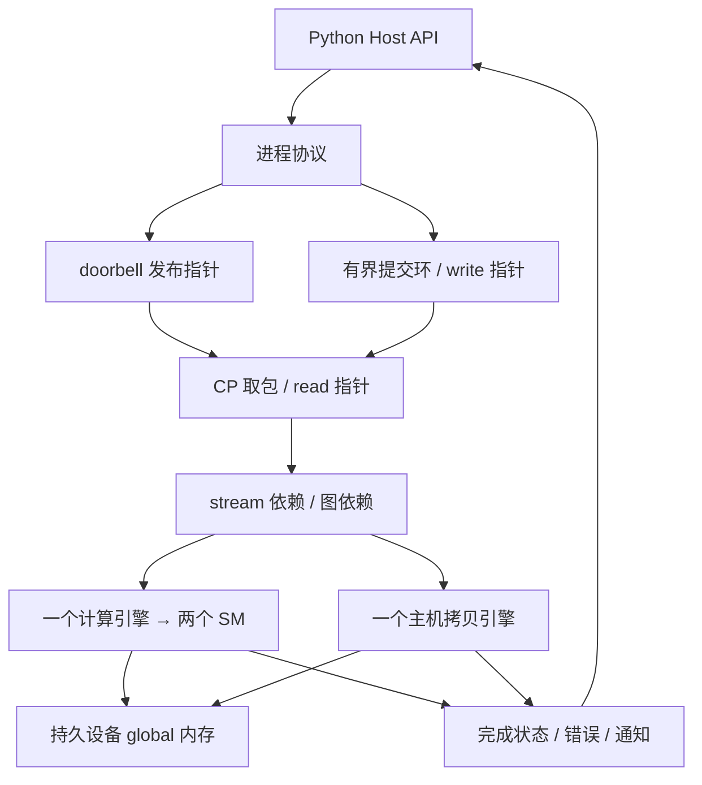

# 主机、命令处理器与 Graph

本扩展把原来“装载文件并执行一次”的 ISS 接到持久设备进程上。Python 主机可以分配内存、提交拷贝与 kernel、使用 stream/event、构建任务图并重复启动。所有 kernel 仍由 C++ ISA 执行器运行。

它实现 CUDA Graph 风格的核心功能语义，不提供 NVIDIA 的 `cudaGraph*` API/ABI、PTX、驱动或 PCIe 设备。启动后 `nvidia-smi` 和标准 `cudaGetDeviceCount()` 不会因此多出设备。

## 运行

```sh
cmake --build build
python3 examples/host_graph.py
ctest --test-dir build --output-on-failure
```

示例运行 65 元素向量加，实际派发三个 CTA 到两个模拟 SM。它比较普通提交、显式图重复启动、节点更新和跨 stream capture；产物在 `artifacts/host-graph/`。

普通 H2D(A)→H2D(B)→kernel→D2H 有 4 个公开队列包；同样的图实例每次重放只有 1 个公开队列包，由 CP 内部展开四个节点。这验证提交结构，没有测量或预测真实 CUDA 的性能收益。

## 各层职责



CP 是 C++ 软件功能模型；当前协议是 stdin/stdout 请求，不是 PCIe、MMIO 或真实 GPFIFO 格式。基本语义中，主机写入、doorbell 发布、CP 取走、任务完成是四个不同阶段。取走一个包会释放环形槽位，但不会释放任务使用的缓冲区。

一个计算引擎独占当前设备的 SM 执行一个 kernel；独立拷贝引擎每次服务最多 64 字节，可以与计算交错。没有实现多个 kernel 同时分割 SM。事件循环由 `progress()` 或等待接口显式推进，不依赖后台时钟；无主机推进调用时任务不会自行完成。

## 主机接口

导入路径需要包含 `python/` 和所选构建的 `generated/`。完整配置范例见 `examples/host_graph.py`。

| 接口 | 含义 |
|---|---|
| `Device(executable, sms=2, capacity=64)` | 创建持久 C++ 设备进程 |
| `allocate(size)` / `buffer.free()` | 分配/释放，256 字节对齐，64 MiB 分配域；待执行命令保留的缓冲区不能释放 |
| `buffer.at(offset)` | 保留所属分配的内部指针 |
| `load(program)` | 解码自定义机器码，返回可重复启动的 Kernel |
| `kernel.launch(args, blocks=..., threads=..., stream=...)` | 参数放入每次 kernel 独立的 constant memory，LDC 从偏移 0/4/8…读取 |
| `h2d` / `d2h` / `d2d` / `memset` | 异步提交主机上传、结果下载、设备内拷贝、字节填充 |
| `record_event(stream)` / `wait_event(event, stream)` | 完成标记和跨 stream 完成依赖 |
| `event.query()` | 只查询，不推进执行；拷贝未完成时不暴露部分结果 |
| `event.wait(max_ticks)` / `event.result()` | 发布队列并等待完成，下载结果为 bytes |
| `progress(ticks)` / `synchronize(max_ticks)` | 有界推进或等待全部公开提交完成 |
| `stats()` / `trace()` | 观察队列指针、引擎占用、通知与节点事件 |

stream 0 是普通有序 stream，没有 CUDA legacy default stream 的隐式全局同步。相同 stream 自动依赖前一任务完成；不同 stream 需要显式事件或 `wait_for=`。`Event` 是不可变完成句柄，不能重复 record 同一个可变 CUDA event 对象。

H2D 在构造操作时捕获源 bytes，修改原来的 bytearray 不改变已提交/已捕获操作。D2D 在拷贝开始时捕获源，允许重叠范围并提供 memmove 行为。D2H 在完成后返回不可变 bytes。这里没有 pinned host memory、UVA 或共享宿主指针。

buffer 作为 kernel 参数时自动保留其资源引用；对于 kernel 内硬编码的指针，调用方须用 `buffers=(...)` 显式声明资源。ISA 的 global 访问仍使用原先的稀疏地址空间，不对每次 kernel 访存自动检查 malloc 归属，也不自动发现竞争。

## Graph 功能

图是操作节点加完成依赖边；实例化保存操作与拓扑快照。此流程参考 [NVIDIA CUDA Graphs 的定义、实例化和执行模型](https://docs.nvidia.com/cuda/cuda-programming-guide/04-special-topics/cuda-graphs.html)，具体支持范围以这里的规范为准。

```python
graph = device.graph()
a = graph.add(device.op_h2d(input_buffer, input_bytes))
b = graph.add(kernel.operation((input_buffer, count, 7)), dependencies=(a,))
c = graph.add(device.op_d2h(input_buffer, count * 4), dependencies=(b,))
executable = graph.instantiate()
run = executable.launch(stream=1)
output_bytes = run.node_result(c)
```

- 节点支持 H2D、D2H、D2D、memset、kernel、empty；可组成 fork/join 和多个不连通分量。
- C++ 实例化检查依赖范围和环路，不要求节点编号已经按拓扑排序。
- 一个图启动只占一个提交包。CP 内部节点不增加主机环的 write/read 计数。
- 整张图的所有分支完成后才通知主机；每个内部节点也有独立状态和跟踪记录。
- 实例可重复启动；同一实例跨不同 stream 的启动也会串行化，避免同一实例并发执行。
- `executable.update(node, operation)` 可改变同类型节点的地址、输入数据或 kernel 参数；不改变拓扑，任何已提交重放尚未完成时都拒绝更新。
- 实例化不会长期锁住全部缓冲区，启动后才保留引用；释放缓冲区后不能再用旧 Python 句柄启动图，即使地址被重新分配。
- 图模板后续修改不影响已有实例。

## Stream capture

```python
with device.capture(streams=(1, 2)) as capture:
    device.h2d(buffer, input_bytes, stream=1)
    ready = device.record_event(stream=1)
    device.wait_event(ready, stream=2)
    done = kernel.launch((buffer, count, 7), stream=2)
    output = device.d2h(buffer, count * 4, stream=1, wait_for=(done,))
executable = capture.graph.instantiate()
result = executable.launch().node_result(output.node)
```

捕获过程中，提交调用只生成节点，设备队列和内存不改变。所有参与 stream 必须预先列出，第一个为起点，其他分支结束前必须通过依赖汇入起点。捕获内不能使用外部 Event、同步、查询、分配、装载模块等后端操作；不支持嵌套捕获或捕获图启动。异常退出恢复普通提交模式，不提交半张图。

尚未实现 CUDA Graph 的 child graph、host callback、条件节点、device-side graph launch、外部 semaphore、内存分配节点、整图拓扑更新，以及全部 CUDA capture mode。这里没有以 C++ 函数直接替代模拟 kernel 的“图执行捷径”。

## 失败与状态

状态为 `queued → waiting → running → complete/error`；前驱失败则后继进入 `cancelled`。独立分支继续执行，父图等待它们停止后才释放全部资源。错误不回滚已经完成的内存写入。

超时保留待执行任务，可增加预算继续等待。stream 的失败链和历史错误保留；`synchronize()` 会报告历史失败。需要新的独立 stream/图实例继续工作，结束错误会话可调用 `close(wait=False)`。正常 `with Device(...)` 退出会排空队列，异常退出中止该会话拥有的进程。

`tick` 表示服务机会，`instruction_steps` 表示 SIMT 指令组数；都不是硬件周期。trace 最多保留 100,000 条，丢弃数量通过 `dropped_trace` 报告。已完成 job、模块和图实例保留到设备进程关闭，便于查询；长时间运行时内存占用会随历史增长。

## 源码入口

- `include/simt/device.hpp`：命令、任务、图实例、资源归属与 CP 状态。
- `src/device.cpp` / `device_engines.cpp`：提交、完成、依赖调度与引擎推进。
- `src/device_graph.cpp`：DAG 检查、实例化、内部节点展开、整图完成。
- `src/protocol*.cpp` / `device_main.cpp`：进程接口与错误边界。
- `python/simt_lab/host.py` / `host_types.py`：主机 API、句柄与参数。
- `python/simt_lab/graph.py`：显式图、可执行实例、capture。
- `tests/test_protocol.py`、`test_host.py`、`test_graph.py`：原生协议、主机链路和图语义验证。
