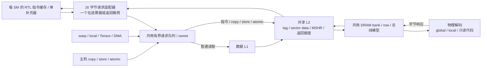

# 指令补充接入共享 L2/DRAM

collector RTL 模式的取指缺失现在会访问与数据、Tensor 操作数、DMA 和主机拷贝相同的 L2/DRAM。之前适配器直接从宿主映像取机器字并等待八拍；这一捷径已删除。返回机器字只从已完成的存储请求中提取，命中、缺失、队列容量、DRAM bank/row 和总线竞争都会影响实际取指。

这是混合仿真中的真实连接：指令缓存及其补充器是 RTL，L2 按配置使用模型或完整容量 RTL；请求打包、票据传递、共享层次调度、物理解码和 DRAM 控制器仍为 C++。没有新增工艺面积结论，也不能将这次连接称为完整 RTL 存储互连。

## 字节经过哪些结构

取指适配器把每个 128 位请求打包成四个连续 32 位读取，使用原有 `MemoryHierarchy::submit(..., bypass_l1=true)`。因此指令补充绕过数据 L1，但占用相同的层次请求额度；已就绪而未消费的数据响应也能阻止新取指。默认请求总额度为 64，而不是给指令另设无限请求队列。

每 SM 最多一个在途机器字。被层次接受后才向 RTL 拉高 ready，返回数据留在有限载荷中直到响应握手。适配器不调用存储层次的 tick；整机或持久设备统一推进一次 DRAM/L2/L1 时钟。查询、观察统计和创建代码映像都不会暗中推进模型时间。

一个 64 字节指令行仍有四次 16 字节补充。L2 的 sector 是 32 字节，所以四次请求通常是两个 sector miss 加两个 hit；当前没有新增“保留半个 sector”的适配器缓存。多个分区或 SM 读取同一物理代码行时可共享 L2 已缓存的 sector。若期间发生替换、维护或其他竞争，时延和请求路径按实际状态决定。

先前的冷取指 40 拍与固定八拍存储延迟已经不是当前接口契约。保持同一 PC 的缓存响应、同一行换 PC 的同步读取规则保持不变；冷补充时间由共享层次决定，不能据此预测某代 NVIDIA 周期。

## 代码存放在哪里

| 物理地址范围 | 含义 |
|---|---|
| `[0, 2^32)` | 原有 global ISA 字节窗口 |
| `[2^32, 2^63)` | local 数据，仍按 warp/lane 交错 |
| `[2^63, UINT64_MAX)` 中已分配区间 | 启动私有的只读原始指令映像 |

这个地址划分是项目设计，不是 NVIDIA GPU VA 布局。代码映射以 64 字节对齐并补齐最后一行，末尾未用位置返回零；取指 RTL 的 PC 范围检查仍禁止执行这些填充。物理解码按字节提供小端读取，DRAM/L2 传输不直接访问 C++ `Instruction` 对象。

`InstructionMemory` 在加载时复制原始机器字，运行期间不可修改。映射结束时释放其字节；之后的启动使用新的物理 sector 地址，即使 PC 相同也不会消费旧 L2 sector。相邻映像可能在同一 L2 line 的不同 sector 内，这不构成同一物理字节的复用。local 翻译和分配上限同步限制在代码窗口以下，并检查范围及耗尽。

当前映像属于每次启动，Graph 重放也会获得新映射；数据 L1/L2 仍跨 kernel 保留，指令 L1 实例不保留，旧代码 L2 sector 可留到正常替换但不会被新启动当成同一地址。因此目前尚未实现模块生命周期内的代码映射复用或跨启动指令缓存命中，不能声称具备这些行为。

向代码区写入会在整个请求接受前被拒绝。`check_write` 先验证全部活动 lane；禁止写入不会先清除缓存、分配票据或部分修改字节。低层 DRAM 也执行写权限检查。代码映射容量属于加载器存储，不混入 NVML 报告的主机分配域用量。

## 失败与释放

指令请求使用所在 kernel 的 owner，与其数据/local/原子请求一起排空。kernel 失败后停止驱动取指器，不再继续请求后续补充字；共享层次仍执行已接受请求。`Machine::drain()` 只消费该 owner 的完成结果，保留其他引擎的响应。代码映射随 Machine 销毁释放，主机 CP 会先完成排空再销毁。

直接使用 C++ Machine 的调用者也必须在失败后调用 drain，不能先销毁带有在途请求的对象再继续驱动共享上下文。这与原有 local 存储生命周期契约一致。适配器及其 ticket 在停止后不再用于 take；故障快照中可以有未完成的取指补充，不能套用成功执行的请求/响应相等断言。

实际整机测试在第八拍令两个 SM 的 kernel 失败，此时取指已经进入共享层次。测试确认映像仍存活、排空读到同一个 DRAM sector、销毁后映射数归零，再依次运行写入 17、91、17 的 kernel，核对实际 global 字节。

## 统计口径

`hardware.instruction_fetch[]` 报告 `memory_backend=shared_l2_dram`，并分别给出 `l2_backend`、`dram_backend=model`、`image_address`、`image_words`、成功握手数和层次准入拒绝次数 `memory_stalls`。没有固定 `memory_latency` 字段；该拒绝计数不包含已经接受后等待 L2/DRAM 完成的所有周期。

`hardware.dram.reads` 现在包含代码和数据。`instruction_reads` 在 DRAM 实际接受代码地址的读请求时增加，`data_reads=reads-instruction_reads`；它不是根据代码长度估算。重复取指、L2 命中和合并不会凭空增加 DRAM 计数。持久设备报告还包含活映射数 `instruction_mappings` 和累计 `dram_instruction_reads`。

## 验证范围

五项存储检查覆盖字节布局、不可变快照、只读保护、尾部填充、映射边界与销毁、local 地址上限、L2 复用、旧 sector 隔离和 owner 排空。五项实际取指适配器检查分别在模型 L2 和完整容量 RTL L2 上运行，共十项；包括共享请求容量被未消费数据响应占满、取指反压及失败排空。两种后端的实际整机失败恢复另有两项检查。

模型存储五项与实际适配器十项分别通过 ASan/UBSan，后者也包含完整容量 L1/L2 的插桩电路。这不是整机联合 sanitizer。原有五项 Python 取指/Graph 检查增加了实际 DRAM 分类、分区间代码 sector 共享和映射回收断言。

四类完整主机负载、NVML 复查、完整回归、修正过的测试假设及源码证据见 [验证记录](VALIDATION.md)。指令缓存 RTL 本身本阶段未改变，原始 RTL/综合网表证据经哈希核对继续适用；不能用其面积数覆盖新增的 C++ 存储连接。剩余硬件目标见 [总计划](HARDWARE_PLAN.md)。
