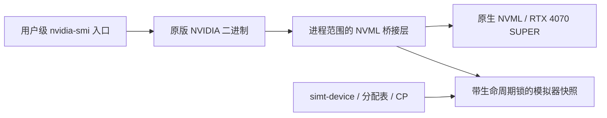

# 原版 nvidia-smi 查询真实显卡与模拟设备

本机已安装用户级 `~/.local/bin/nvidia-smi` 入口。运行中的、启用了状态发布的模拟器可以与 RTX 4070 SUPER 同时出现在普通 `nvidia-smi`、`nvidia-smi -L` 和内存查询中。入口设置子进程的 NVML 后端，实际输出由未修改的 `/usr/bin/nvidia-smi` 575.57.08 生成，不是脚本仿造表格。

这是管理接口接入。模拟器没有成为 NVIDIA CUDA 驱动设备，也没有 PCIe 身份；`cudaGetDeviceCount()`、PyTorch 和直接使用原生驱动的程序不会因此多出一块 GPU。整 GPU RTL 和硬件校准仍未完成。

## 现在怎样使用

在项目目录的终端一启动带监控的会话：

```sh
python3 examples/nvml_device.py --timing --seconds 120
```

它启动实际 `simt-device`，分配 7 MiB，完成一次上传并保持会话存活。终端二运行：

```sh
nvidia-smi -L
nvidia-smi
nvidia-smi --query-gpu=name,memory.total,memory.used,memory.free --format=csv
```

本机实测列表包含：

```text
GPU 0: NVIDIA GeForce RTX 4070 SUPER (UUID: GPU-...)
GPU 1: SIMT Lab 2 SM (simulator) (UUID: GPU-...)
```

模拟设备一行显示 `64 MiB, 7 MiB, 57 MiB`，释放分配后为 `64 MiB, 0 MiB, 64 MiB`，会话退出后只剩真实显卡。UUID 随会话创建，不用固定的假设备占位。模拟设备温度、功耗、频率和 PCI 信息保持 `N/A`。合并表头里的驱动与 CUDA 版本来自真实驱动，不能解释为模拟器支持相应 CUDA 版本。

普通 `Device()` 默认不发布监控状态；自己的程序需传入 `Device(monitor_dir=...)`。默认查询目录是 `/tmp/simt-lab-<uid>`，须属于当前用户且权限为 0700。自选目录时，示例使用 `--registry /path`，查询使用 `SIMT_MONITOR_DIR=/path nvidia-smi -L`，或显式启动器的同名 `--registry` 参数。

已构建联合 RTL 时，终端一可以改用：

```sh
python3 examples/nvml_device.py --build build-cache-rtl --timing --tensor-rtl --cache-rtl --scoreboard-rtl --register-rtl --seconds 120
```

监控协议允许已安装入口使用 `build-release/nvml` 查询这个 RTL 会话，无须给查询命令另选 RTL 构建。示例只负责分配和上传；实际 Tensor/L1/L2 RTL Graph GEMM 的联合验证另见下方证据。

## 安装、独立调用与撤销

本机已执行以下安装命令；新环境需要先构建对应库：

```sh
cmake -S . -B build-release -DCMAKE_BUILD_TYPE=Release
cmake --build build-release --target simt_nvml
python3 tools/install_smi.py --build build-release
```

`~/.local/bin` 必须位于 `/usr/bin` 之前；本机原有 PATH 已满足，没有修改 shell 配置。旧 zsh 会话若仍缓存原路径，执行 `rehash`，再用 `command -v nvidia-smi` 核对。直接执行 `/usr/bin/nvidia-smi -L` 始终使用原生视图，只显示真实显卡。

不安装入口也可以显式合并，或只查看模拟器：

```sh
python3 tools/simt_smi.py --build build-release --merge -L
python3 tools/simt_smi.py --build build-release -L
```

撤销用户入口：

```sh
python3 tools/install_smi.py --uninstall
```

安装器拒绝覆盖无关命令、符号链接或用户改过的入口；卸载也检查归属。安装使用原子替换。如果项目启动器或构建库已被移除，已安装入口退回原版二进制。没有改动系统 NVML、内核驱动或 `/usr/bin/nvidia-smi`；安装前后的原版二进制 SHA-256 一致。

## 查询范围与真实设备共存

| 查询方式 | 行为与限制 |
|---|---|
| 默认表格、`-L`、`--query-gpu` | 原生设备在前，活模拟会话追加在后；名称、UUID、内存与生命周期已有端到端验证 |
| `-i` 数字索引或 UUID | 合并查询；真实设备原索引保留，模拟设备建议用会话 UUID 标识 |
| `-q` / XML / 循环查询 | 启动器允许进入合并后端；未实现的属性返回不支持，不承诺所有版本和报告组合兼容 |
| `-i` PCI bus ID | 启动器转到原生后端，仅查询真实设备；模拟器没有 PCI 身份 |
| compute/accounted-process 专用查询 | 转到原生后端；模拟 kernel 没有原生 CUDA 进程记录 |
| 管理命令与其他模式 | 使用原生后端；不为模拟器实现重置、功耗控制或完整事件订阅 |

默认表格保留真实设备的进程列表。模拟器目前没有 GPU 利用率采样或模拟 kernel 进程列表，不能把宿主 CPU 负载填成 GPU 利用率。原生管理命令沿用 NVIDIA 自身的权限和错误处理。

## 数据来源和 ABI 边界



模拟内存总量来自设备分配域，已用量来自实际分配表；它不是宿主 RSS，也不占用真实显卡上的同等显存。CP 在响应和每 64 个服务 tick 发布快照，查询不推进模拟时钟。正常退出删除记录；SIGKILL 后即使文件残留，生命周期锁也会使该会话退出枚举，旧句柄报告设备丢失。多个活模拟器可同时显示。

合并后端保留原生句柄并登记其身份，模拟句柄走快照分支。公开查询先验证身份，不将外来指针或模拟句柄交给原生设备查询。官方头文件生成精确函数原型；符合条件的单设备只读查询转发原生库，其他未实现接口报告不支持。多设备、MIG 子句柄和完整事件 API 不在通用转发承诺内。

初始化具有引用计数，最后一次关闭才关闭原生 NVML。线程局部调用状态使厂商库内部对公开符号的回调直接返回原生路径，避免重入桥接锁，也避免厂商内部误用合并设备数。公开规范依据为 [NVML 初始化与清理](https://docs.nvidia.com/deploy/nvml-api/latest/api/group__nvmlInitializationAndCleanup.html) 和 [设备查询](https://docs.nvidia.com/deploy/nvml-api/latest/api/group__nvmlDeviceQueries.html)；本项目的合并策略是自定义实现。

本机 nvidia-smi 还依赖私有 `nvmlInternalGetExportTable` 握手。桥接层把它交给与原版程序匹配的已安装 NVML；因此仍依赖 NVIDIA 软件，不能独立分发成完整 NVML 替代品。`SIMT_REAL_NVML` 可指定匹配库路径。兼容性结论限定于本机已验证版本。

## 验证与复现

```sh
cmake --build build --target simt_nvml test-nvml-api test-nvml-merge-api
ctest --test-dir build -R '^(native_nvidia_smi|merged_nvidia_smi)$' --output-on-failure
```

原有 6 项模拟视图检查和新增 7 项合并检查均通过 Debug、Release、ASan+UBSan。新增覆盖真实元数据对照、分配/释放、索引/UUID/PCI 选择、多会话、SIGKILL、公开 ABI、嵌套初始化/关闭/重建、并发查询、安装与撤销及拒绝覆盖。辅助 C++ 断言包含在 Python 用例内，不重复增加检查数。

本次默认 Debug 全量通过 23 套件、268 项检查（225 Python / 43 C++）；Release 与 sanitizer 本次运行的是受影响的 2 套件、13 项。sanitizer 对项目代码及 ABI 辅助程序插桩，启动原版外部程序时预加载 libasan，按原约定仅关闭外部进程泄漏报告，地址和 UB 检测保留。

已安装的普通命令还查询了实际完成两次 Graph GEMM 的联合 RTL 会话：每次验证 96 个输出，最大误差约 2.98e-7，Tensor 与 cache 后端均为 RTL。随后分配 7 MiB、释放、关闭会话，原版表格正确更新，真实设备与其进程列表保留。证据位于 `artifacts/nvml-merged/default-command.txt`、`installation.json` 和 `gemm/`；测试范围及早期失败修复见 [验证记录](VALIDATION.md)。
