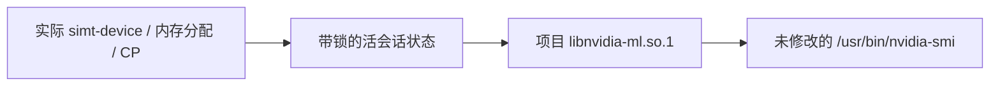

# 原版 nvidia-smi 查询模拟设备

已经在本机 `/usr/bin/nvidia-smi` 575.57.08 上验证：原版程序的 `-L`、默认表格和内存查询能够显示存活的模拟器。调用使用项目 NVML 后端，输出由 NVIDIA 原程序生成。没有替换 `/usr/bin/nvidia-smi`、系统 NVML 或 NVIDIA 内核驱动。

## 两个终端运行

终端一，在项目目录中运行：

```sh
cmake --build build
python3 examples/nvml_device.py --timing --seconds 120
```

它启动实际时序模式 `simt-device`，分配 7 MiB 并完成一次经 L2/DRAM 的真实上传，在 120 秒内保持会话存活。不传 `--timing` 则运行默认功能模式。终端二运行：

```sh
python3 tools/simt_smi.py -L
python3 tools/simt_smi.py
python3 tools/simt_smi.py --query-gpu=name,memory.total,memory.used,memory.free --format=csv
```

验证到的输出包括：

```text
GPU 0: SIMT Lab 2 SM (simulator) (UUID: GPU-...)
SIMT Lab 2 SM (simulator), 64 MiB, 7 MiB, 57 MiB
```

默认表格同样显示 `7MiB / 64MiB`；CUDA、温度、功耗、频率、PCIe 信息为 `N/A`，因为没有实现这些能力或测量。UUID 在会话创建时生成，不能用固定假设备占位。

自选 registry 时，两个命令都传 `--registry /path/to/private-directory`。目录须属于当前用户且权限 0700。Python 接口也可以直接使用 `Device(monitor_dir=...)`，不必通过示例创建。

已构建 [Tensor RTL 后端](RTL_BACKEND.md) 时，终端一可用 `python3 examples/nvml_device.py --build build-rtl --timing --tensor-rtl --seconds 120`，终端二用 `python3 tools/simt_smi.py --build build-rtl -L`。另已对实际完成 RTL Graph GEMM 的会话验证枚举、7 MiB 活分配和退出后消失，原始输出保存在 `artifacts/rtl-integrated/nvidia-smi-status.txt`。

缓存与 Tensor 联合 RTL 构建可改为 `--build build-cache-rtl --timing --tensor-rtl --cache-rtl`，查询命令也选 `--build build-cache-rtl`。对实际经过两级缓存和 Tensor 电路的 Graph GEMM 已重复验证相同行为，证据在 `artifacts/rtl-cache-host/nvidia-smi-status.txt`；没有扩大为系统默认枚举或 CUDA 支持。

## 接入的实际含义



- 启动器只给子进程设置 `LD_LIBRARY_PATH`，然后执行原版二进制；不解析或伪造表格。
- 内存总量来自当前设备分配域，已用量来自实际分配表；释放后下一次查询下降。它不是宿主进程 RSS，也不是 RTX 4070 SUPER 的显存使用量。
- CP 快照在命令响应时和每 64 个服务 tick 发布，查询本身不推进模拟器。当前 NVML 公开已验证的主要属性是名称、UUID、内存；未支持的物理指标报告不支持。
- 多个模拟器会话可以同时枚举。独立 lifetime lock 判断进程存活；正常退出删除记录，SIGKILL 后即使文件残留也不再显示。
- 当前默认表格的进程列表未接入模拟 kernel 归属；不能把它解释为已实现 CUDA 进程监控或 GPU 利用率采样。

直接执行系统 `nvidia-smi`，仍只查询原来的 NVIDIA 后端，当前返回 RTX 4070 SUPER。专用启动方式的视图只列模拟会话，**尚未将真实 GPU 和模拟器合并到系统默认视图**。默认视图合并仍是未完成事项；整个硬件目标仍未完成。

## ABI 与版本约束

构建查找本机官方 `nvml.h` 和真实 `libnvidia-ml.so.1`。已支持函数使用公开原型；其余 `nvmlReturn_t` API 根据官方声明生成正确签名，并返回 `NVML_ERROR_NOT_SUPPORTED`。不会把任意指针传给真实 NVIDIA 驱动。

本机 nvidia-smi 在调用公开 API 前还要求未公开的 `nvmlInternalGetExportTable` 握手。独立的纯公开接口实验被它拒绝；当前后端将该握手转发给**与原版程序匹配的已安装 NVML 库**，公开设备枚举和属性仍由本项目提供。因而这不是可独立于 NVIDIA 软件分发的完整 NVML 复刻，也没有声称跨任意驱动版本兼容。`SIMT_REAL_NVML` 可指定匹配库路径。

本实现未提供 NVIDIA CUDA 驱动/API、PTX 编译、系统 PCIe 设备或真实显卡吞吐。原版管理工具能读取自定义后端，证明的是管理面接入。

## 验证

```sh
ctest --test-dir build -R native_nvidia_smi --output-on-failure
```

六项 Python 端到端测试实际执行原版程序，覆盖枚举/默认表格、7 MiB 分配与释放、多个会话、正常退出、SIGKILL 陈旧文件与旧句柄、损坏快照、公开 ABI 结构版本和精确字节计数、不虚构物理数据。C++ ABI 辅助程序检查小缓冲区、无效句柄、失效设备等返回码。

Debug、Release、ASan+UBSan 都通过。sanitizer 构建对项目 monitor/NVML 代码插桩；启动原版外部程序时预加载 libasan，并关闭对该外部进程的泄漏报告（`detect_leaks=0`），地址和 UB 检测保留。普通模拟器测试保持原有 sanitizer 设置。直接使用 sanitizer 版启动器时需要同样设置 `LD_PRELOAD` 与 `ASAN_OPTIONS`；通常使用默认 Debug/Release 版进行人工查看。

源码：`src/monitor.cpp`、`src/nvml/`、`tools/gen_nvml_stubs.py`、`tools/simt_smi.py`；规范基础为 [NVIDIA NVML](https://developer.nvidia.com/management-library-nvml) 和本机头文件。私有握手可用性以本机实际测试为依据。
