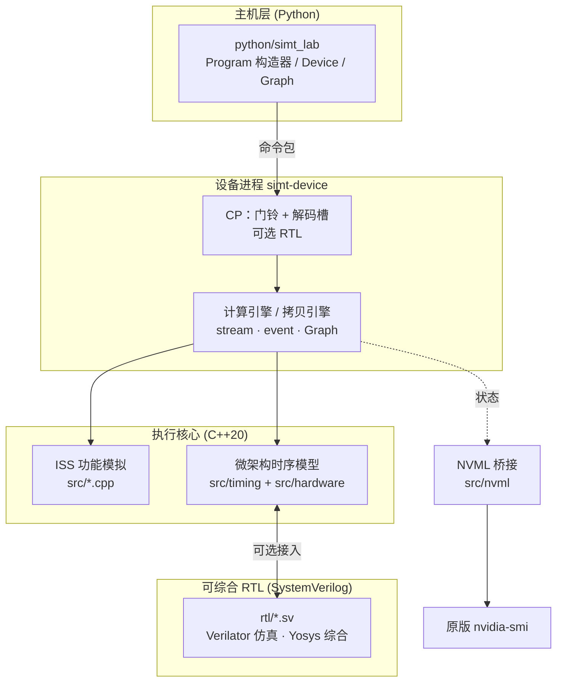
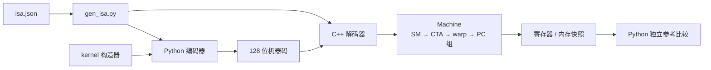
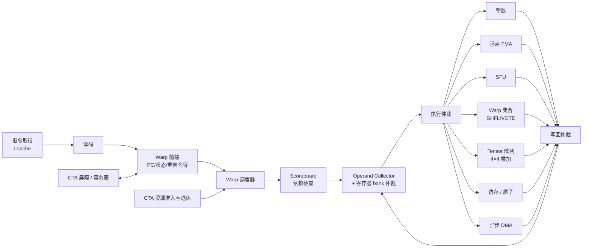
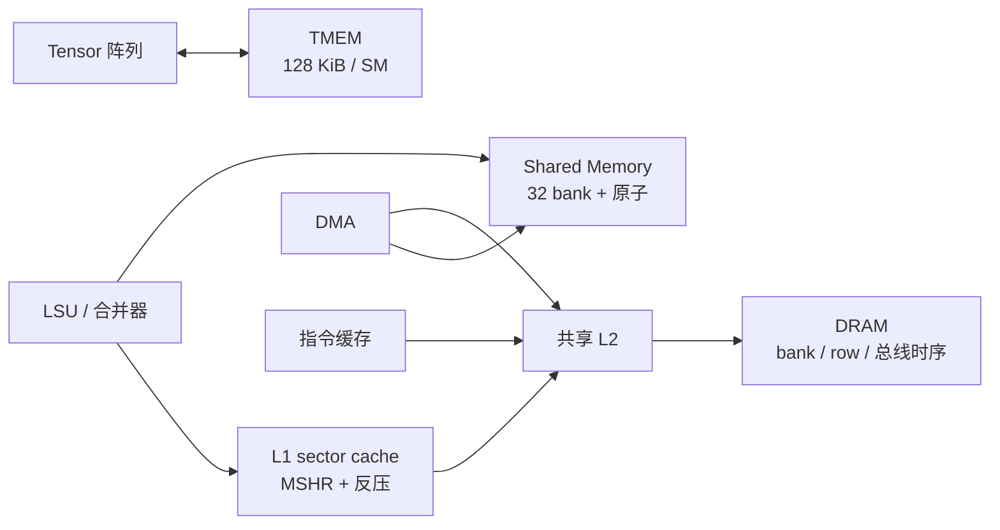
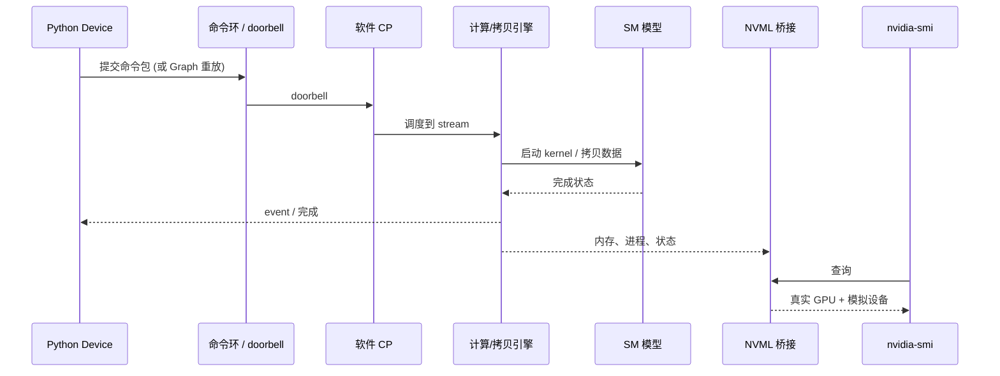

# SIMT Lab 项目结构概览

SIMT Lab 是一个自定义 GPU 的 **C++ / RTL 混合模拟器**，按 curryGPU 公开文章的分层思路从指令集开始逐层实现。它不兼容 NVIDIA SASS、完整 CUDA 或 PCIe，也不等同于 4070 SUPER 或 SM100 的真实电路。默认设备为 2 个 SM，每个 warp 32 个线程。

## 1. 分层总览



| 层 | 目录 | 作用 |
|---|---|---|
| ISA 定义 | `isa/isa.json`, `tools/` | 唯一的指令编码来源，生成 Python 编码器与 C++ 解码器 |
| ISS 功能模拟 | `src/*.cpp`, `include/simt/` | 正确性基准：线程调度、重聚、内存、原子、屏障、MMA、异步事务 |
| 微架构时序 | `src/timing`, `src/hardware` | 逐周期模型：缓存、scoreboard、流水线、DMA、Tensor 阵列 |
| RTL | `rtl/`, `src/rtl/`, `tests/rtl/` | 关键模块的可综合实现，通过 C++ 适配层替换对应时序模块 |
| 主机与设备 | `python/`, `src/device*.cpp` | 持久设备进程、命令环、CP、拷贝、Graph |
| 监控 | `src/nvml`, `src/monitor.cpp` | 让原版 `nvidia-smi` 看到模拟器 |

## 2. 一条指令的路径



功能模式（ISS）和 `--timing` 微架构模式共用同一份机器码与同一套验收负载（向量、规约、分块 GEMM、小型 Transformer）。

## 3. SM 微架构



## 4. 存储层次



## 5. 主机路径与 nvidia-smi



`nvidia-smi` 只通过用户级入口走 NVML 桥接，不修改系统二进制或驱动。CUDA / PyTorch 不会识别出这个设备。

## 6. 实现状态

| 模块 | 状态 |
|---|---|
| ISA、ISS、重聚、屏障、MMA、异步事务 | 完成 |
| 主机、Graph、持久设备 | 功能完成 |
| 缓存、scoreboard、寄存器、collector、整数/浮点/集合执行、warp 调度、CTA 屏障、DMA、事务表、shared、CTA 资源 | 有 RTL，可选接入 |
| Tensor 4×4 乘加阵列 | 自研 RTL，非 NVIDIA 精确复刻 |
| TMEM | RTL：每 SM 128 KiB 共享存储和页映射，可选接入 |
| 命令处理器（门铃、取包、解码槽、依赖、引擎占用） | RTL，可选接入；链路和拷贝数据通路仍为 C++ |
| DRAM、SFU、部分互联 | 仍为 C++ 模型 |
| 完整 GPU 顶层、FPGA 实现、PTX 编译器、CUDA/PCIe 兼容 | 未完成 |

## 7. 常用入口

```sh
cmake -S . -B build -G Ninja && cmake --build build
ctest --test-dir build --output-on-failure
python3 examples/run_workloads.py --timing --out artifacts/timed   # 四类负载，微架构模式
python3 examples/nvml_device.py --timing --seconds 120             # 配合另一终端 nvidia-smi -L
```

各结构的实际容量、bank 数、端口和流水线深度见 [PHYSICAL.md](PHYSICAL.md)。

延伸阅读：`WALKTHROUGH.md`（示例）、`HARDWARE_PLAN.md`（阶段与剩余工作）、`RTL.md`（RTL 工具链）、`VALIDATION.md`（验证记录）。
