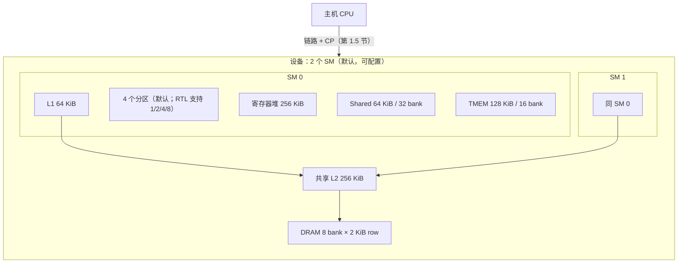
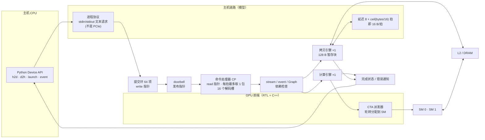
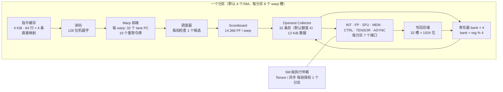
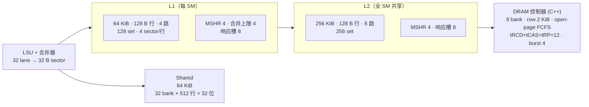
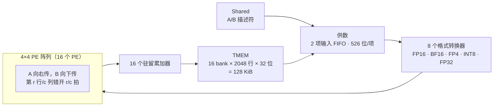

# 物理结构：实际实现的硬件参数

本文只记录代码里**真实存在的容量、端口、bank 和流水线深度**，数值来自 `include/simt/*.hpp` 的默认配置、`rtl/*.sv` 的参数和各 `docs/RTL_*.md` 的综合结果。

先说明边界：

- 所有几何参数都是**本项目的设计选择**，不是对 NVIDIA 某一代电路的逆向还原。公开可见的规则（shared 32 bank、32 位字交错、sector 32 B）按公开文档采用。
- 标 **RTL** 的结构有可综合 SystemVerilog，通过 Verilator 仿真、Yosys 综合；标 **C++** 的仍是逐周期 C++ 模型。
- 没有 FPGA 实现，没有布局布线，所以没有面积、频率和功耗数据。表里的 FF/cell 数是 Yosys 的通用单元统计，不是 NAND2 门数。

## 1. 整机

| 项 | 数值 |
|---|---|
| SM 数 | 2（`Device(sms=2)`） |
| warp 宽度 | 32 lane |
| 每线程寄存器 | R0–R62 可用，R63 恒零；谓词 P0–P7，P7 恒真 |
| 每线程 local | 16 KiB（`thread_bytes = 16384`），每 warp 512 KiB，物理地址从 `1<<32` 起 |
| 单 CTA 线程数 | 1–1024 |
| 每 SM 物理 warp 槽 | 32（RTL）。C++ 配置默认上限写的是 48，启用 RTL 后以 32 为准 |
| 每 SM CTA 记录 | 64 个物理记录，实际驻留数受 warp 槽和资源额度限制 |

## 1.5 CPU 到 GPU 的控制通路

命令处理器的核心状态已有电路，详见 [RTL_COMMAND_PROCESSOR.md](RTL_COMMAND_PROCESSOR.md)，图解见 [cpu-gpu-control.html](cpu-gpu-control.html)。链路、拷贝引擎的数据通路和跨 SM 分发仍是 C++，也没有 PCIe、BAR 或中断。

| 结构 | 实际参数 | 实现 |
|---|---|---|
| 提交环 | 默认 64 项（可配置）；内容在主机内存，取走命令即释放环槽 | 内容 C++，指针 RTL |
| 提交协议 | 写入、doorbell 发布、CP 取走、任务完成是四个独立阶段，各自推进指针；MMIO 是简化寄存器接口 | RTL（写入计数在主机） |
| CP | 每个设备时钟最多取 1 个已发布命令；已取走但未完成的任务占 1 个解码槽，时序模式固定 16 个，槽满则停止取包 | RTL |
| 调度限制 | 每拍最多 1 次 kernel 启动或取消；被依赖阻塞的任务不阻塞其他 stream | RTL（较早任务的完成记录和图节点就绪由 C++ 提供） |
| Graph | 实例化时保存不可变模板；重放只占 1 个队列包，由 CP 内部展开节点；每拍最多 1 个节点从 queued 进入 waiting | 解码选择 RTL，模板与节点依赖 C++ |
| 计算引擎 | 1 个，独占全部 SM 执行一个 kernel；kernel 出错后继续走时钟，排空在途内存请求才释放 | 占用位 RTL，执行调度 C++ |
| 拷贝引擎 | 1 个，可与计算引擎重叠；只保留 1 个 128 B 暂存块和 1 个在途层次请求；阶段为 prepare → link_in → read → write → link_out | 占用位 RTL，数据通路 C++ |
| 主机链路 | 每块延迟 `8 + ceil(bytes/16)` 拍。这是研究假设，**不是测得的 PCIe 延迟或带宽** | C++ |
| CTA 派发 | 跨 SM 轮转分配，每 SM 每拍接受 1 个 CTA；SM 内的资源准入、槽分配和退休是 RTL（见第 5 节） | C++（跨 SM）+ RTL（SM 内） |
| 内存分配 | 256 B 对齐，64 MiB 分配域 | C++ |

**缺少的真实硬件部分**（NVIDIA GPU 上对应这一层的结构，本项目都没有实现电路）：

- PCIe 端点和 BAR 寄存器窗口。门铃寄存器已有电路，但主机仍通过进程协议访问。
- 主机侧 DMA 引擎和地址翻译（IOMMU / GPU MMU 页表）。
- 中断控制器与完成通知。
- GPFIFO / pushbuffer 的真实命令格式；这里的命令是自定义文本协议。
- 硬件的 CTA 全局分发器（类似 GigaThread Engine）；这里是 C++ 轮转。
- 多个拷贝引擎、多个硬件队列。

所以 `nvidia-smi` 看到的是**管理面**（NVML 桥接），CUDA 和 PyTorch 完全看不到这个设备。

## 2. SM 内部：分区与流水线

一个 SM 切成若干**分区**，每个分区自带调度、依赖检查、收集器、执行单元和指令缓存。warp 槽按 `slot % partitions` 分到各分区。

| 结构 | 容量与端口 | 实现 |
|---|---|---|
| 指令缓存 | 每分区 256 × 128 位 = 4 KiB，1 读 1 写口；物理 8 份共 32 KiB，按分区数启用 | RTL |
| 指令补充 | 单通道，整行 4 个 128 位传输，经共享 L2 和 DRAM | RTL + C++ |
| Warp 前端 | 每 warp：32 lane PC（1,024 bit）、32×3 位状态、32 个等待编号、32 个异步阶段；含 16 个重聚令牌，约 1,568 FF 的令牌部分 | RTL |
| 调度器 | 每分区 32 槽，仅 325 FF，7,625 generic cells；每拍只检查一个候选；策略为最小 PC / 最大 PC / PC 轮转 | RTL |
| Scoreboard | 每 warp 槽 63 个寄存器 × 32 lane × (1 位写者 + 6 位读者计数) + 8×32 位谓词，共 14,368 FF；16 组并行事件端口 | RTL |
| 寄存器堆 | 每 SM 65,536 个 32 位字 = 256 KiB；每分区 4 bank；每 bank 一个组合读口、一个边沿写口；行宽 1,024 bit（32 lane × 32 位）；`row = 分区内槽号*16 + reg/4` | RTL |
| Operand Collector | 每分区 32 条目，每条最多 3 个源，数据 12 KiB；按年龄选各 bank 端口最老的请求 | RTL |
| 写回 | 每分区 32 个完成槽，每槽 32 lane × 32 位（32,768 bit）；7 个生产端口，每端口每拍 1 次完成；向 4 个 RF bank 写 | RTL |
| 执行延迟 | INT 4 拍，FP 6 拍，SFU 16 拍；发射间隔 INT 1、FP 1、SFU 4 | C++ 配置 + 部分 RTL |
| 执行仲裁 | 物理 8 分区 × 7 端口 = 56 位请求矩阵；INT/FP/SFU 每分区独立；Tensor、异步每 SM 每拍只给 1 个分区 | RTL |

## 3. 存储层次

| 层 | 几何 | 端口与行为 | 实现 |
|---|---|---|---|
| L1 | 64 KiB，行 128 B，4 路，128 set，sector 32 B，每行 4 个有效位 | 1 请求口、1 响应口；SRAM 同步读 1 + 同步写 1；LRU 排名每 set 4×2 位；整体失效扫描每拍一行 512 拍 | RTL（可选）/ C++ |
| L2 | 256 KiB，行 128 B，8 路，256 set | 同上；LRU 每 set 8×3 位；失效扫描 2048 拍 | RTL（可选）/ C++ |
| Shared | 每 SM 64 KiB = 32 bank × 512 行 × 32 位；`bank = (addr/4) % 32`；每 bank 四个 512×8 字节阵列 | 每 bank 每拍 1 个字操作；同字读广播；8 个请求/返回槽；原子锁定该 bank | RTL |
| DRAM | 8 bank，row 2 KiB，队列 64 | open-page；行命中/未命中分别计时；共享数据总线 | C++ |
| Local | 字交错物理映射，走同一缓存与 DRAM | — | C++ |
| 原子 | 8 bank，延迟 4，队列 8（global）；shared 原子在 shared RTL 内 | bank 预约 → 读 → ALU → 写确认 | C++ / RTL |

C++ 模型默认值（L1 4 bank、16 MSHR；L2 8 bank、32 MSHR）与 RTL 固定几何（MSHR 4）**不同**，两者不是逐拍等价实现，比较吞吐时要分开看。

## 4. Tensor 通路与 TMEM

| 项 | 数值 |
|---|---|
| PE 阵列 | 默认 4 行 × 4 列 = 16 PE（可配 1–4 × 1–4）；PE 状态机 IDLE → DOT → SCALE → ACCUMULATE |
| 流水深度 | 请求在周期 N 接受，N+3 拉高 valid，即 4 级寄存器；无反压时每拍可接受 1 个请求 |
| 吞吐节奏 | 普通 K 波每 4 拍注入一组；带 block-end 的缩放波之后间隔 12 拍 |
| 输入 FIFO | 2 项 × 526 位 = 1,052 数据位 |
| 数据格式 | FP16、BF16、FP4、INT8、FP32 累加；支持 2:4 稀疏和块缩放 |
| 逻辑 tile | 每 CTA 保留 128 × 256 逻辑坐标，列优先地址 `(column*128+row)*4` |
| TMEM 物理存储 | 每 SM 128 KiB，16 bank；每 bank 每拍 1 个 32 位字；返回延迟 2 拍；bank = `(byte_addr/4) % 16` |
| TMEM 容量账本 | 每 SM 256 列，驻留 CTA 的分配之和不得超过；硬件页表把各 CTA 逻辑列映射到物理页 |

启用 collector RTL 时，TMEM 数据和页映射都由 `rtl/tmem_*.sv` 保存，详见 [RTL_TMEM.md](RTL_TMEM.md)。不启用时仍使用 C++ 模型。

## 5. 异步搬运、屏障与 CTA 管理

| 结构 | 容量 | 存储量 |
|---|---|---|
| DMA 命令槽 / 片段槽 | 64 / 64（C++ 配置默认 8 / 4，片段 128 B） | 片段 64 × 1,108 = 70,912 bit |
| 事务屏障表 | 1,024 条记录，默认启用前缀 16 条 | 1,024 × 224 = 229,376 bit = 28 KiB RAM，外加 1,410 FF |
| CTA 屏障 | 16 项到达记录，动态人数和 EXIT 计数 | — |
| CTA 资源控制器 | 64 个归属记录 + 32 个有效 lane 掩码；每 SM 每拍接受 1 个 CTA；寄存器额度固定，shared 以 128 B 为粒度；最低编号空闲槽优先 | 6,912 FF，无 SRAM |
| 异步服务仲裁 | 前台指令、DMA、退休三方优先级 | 状态机 |

## 6. 总存储量（每 SM）

| 存储 | 容量 |
|---|---|
| 寄存器堆 | 256 KiB |
| Shared | 64 KiB |
| TMEM | 128 KiB |
| L1 | 64 KiB |
| 指令缓存（启用分区） | 4 KiB × 分区数 |
| Operand Collector 数据 | 12 KiB × 分区数 |
| 事务表 RAM | 28 KiB |
| 写回载荷 | 4 KiB × 分区数 |

另有全局 L2 256 KiB 和 DRAM。

## 7. 还不是物理电路的部分

- DRAM 控制器、SFU 计算、constant 空间。
- CPU→GPU 通路里的主机链路、拷贝引擎数据通路和跨 SM 的 CTA 派发，见第 1.5 节。
- 各模块之间的连线和路由（RTL 模块由 C++ 适配层逐个接线）。
- 互联网络、PCIe、完整 GPU 顶层。

所以现状是：**SM 内部大部分结构已有可综合模块，但整机仍由 C++ 接线，不是一个能整体综合的 GPU 顶层。**
