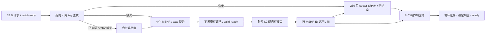

# 缓存、scoreboard 与 bank 仲裁的可综合 RTL

本阶段把三个关键结构写成 SystemVerilog，并完成 RTL 仿真、Yosys 综合和综合后网表的同一套行为验证。源码在 `rtl/`，C++ 对照平台在 `tests/rtl/`。这是真正的触发器、存储阵列、组合选择和握手状态描述，不是在 C++ 模拟器外套一层延迟。

本页记录阶段 16 的首批三个结构。后续 [Tensor RTL](RTL_TENSOR.md) 已补充数值电路和 4×4 乘加阵列，并作为可选 [执行后端](RTL_BACKEND.md) 接入 ISA/TMEM 和主机 Graph。缓存还通过 [L1/L2 后端](RTL_CACHE_BACKEND.md) 接入实际访存与主机链路；后续 [多事件 scoreboard](RTL_SCOREBOARD.md) 和 [寄存器数据阵列](RTL_REGISTERS.md) 已接入实际执行，循环 bank 仲裁器仍为独立验证模块。当前没有完整 RTL SM 或 FPGA bitstream，阶段 16 和整个硬件目标保持进行中。

## 已实现的电路

| 模块 | 实际内部状态 | 验证关系 |
|---|---|---|
| `sector_sram.sv` | 256 位宽数据阵列、同步读输出寄存器、同步 fill 写端口；数据阵列无复位 | 缓存命中必须返回此阵列中的字节 |
| `sector_cache.sv` | line tag/present、逐 sector valid、有限 LRU rank、MSHR、等待者 bitmap、响应槽、下游寄存端口 | 与 C++ `SectorCache` 比较字节、命中/未命中及替换决策 |
| `cache_lru.sv` | 每组独立排名寄存器、组内 rank 比较和写使能、所选组输出 mux | 保持精确 LRU；4/8 路缓存执行相同替换及随机差分检查 |
| `lane_scoreboard.sv` | 64×32 writer 位、8×32 predicate 位、64×32×3 reader 计数位 | 与 C++ `Scoreboard` 比较合法状态转换和逐 lane RAW/WAW/WAR |
| `register_arbiter.sv` | 每 bank 独立读/写循环优先游标，以及组合授权网络 | 授权与 C++ `RegisterPorts` 的端口容量一致；额外验证公平性 |

配置和电路都是本项目的研究设计，不是从 NVIDIA 逆向获得的完整原理图。公开资料和未知项的边界仍见 [HARDWARE_SOURCES.md](HARDWARE_SOURCES.md)。

## L1 的数据究竟放在哪里

默认缓存数据容量为 `128 sets × 4 ways × 4 sectors × 32 B = 64 KiB`。地址保留 64 位，底部 5 位是 sector 内偏移；一个 line 有四个 sector，line 地址为 `address >> 7`。组号为 line 地址 modulo sets，tag 保存完整 line 地址，因此高于 4 GiB 的模拟 local 物理地址不会和低地址混淆。



数据 SRAM 在每个上升沿根据 `write_enable` 更新一个 sector；`read_enable` 使一个 sector 进入读输出寄存器。没有 reset 循环清空 64 KiB 数据，也没有 DPI/C++ 函数代替 SRAM 的读写。复位只清除控制器的 tag 归属和有效位，未初始化的数据不能被合法命中读取。

Yosys 对默认容量实际识别出 **2,048×256 = 524,288 存储位、一个读端口和一个写端口**。这是可进一步映射的存储描述，尚不是某家工艺的 SRAM macro，也没有映射到具体 FPGA 的 BRAM。

控制元数据使用寄存器或后续映射为寄存器的数组。`cache_lru.sv` 为每个组生成独立排名触发器和组内比较器；一次命中/预约只更新对应组，不将 LRU 描述成单端口 SRAM。L1 的排名共 1,024 位，8 路 L2 为 6,144 位，具体更新规则见 [缓存后端说明](RTL_CACHE_BACKEND.md)。复位清除 line present 和队列归属，将每组 rank 初始化为 way 编号；tag 与 sector valid 不复位，由 present 屏蔽旧内容，首次分配新行时设置 tag 并清除 sector valid。这样避免为每个 tag/valid 项增加独立复位写端口。

## 缺失、替换和端口时序

默认有 4 个 MSHR、8 个响应槽，每个 MSHR 最多合并 4 个请求。一个已接受请求立即占有响应槽；即使数据已返回，只要调用方未握手取走，额度就不能归还。

- 同 sector 的读缺失共用一个 MSHR 和一次下游事务，等待者只增加自己的响应槽引用。
- 同 sector 存在未完成写请求时，不接受新的读或写；已有读缺失也不能被写请求覆盖。
- 缺失在准入时预约 line。只要任意 MSHR 仍持有该 line，就不能替换它；同 line 的其他 sector 仍可继续分配缺失。
- 替换先选择未使用且未锁定的 way，否则选择未锁定的最久未用 way。每个 way 只需有限 rank，不使用无限增长的宿主时间戳。
- 下游请求在寄存器中保持 `address/write/data/mask/id`，直到 valid-ready 握手。选择某个 MSHR 不代表它已经发到下游。
- fill 通过 MSHR ID 找回 line 和全部等待者，允许不同 MSHR 乱序完成；一次只设置被填充 sector 的 valid。
- 响应也经寄存选择后保持稳定，直到调用方握手。循环游标避免低编号槽持续抢占高编号槽。

本 RTL 是一个请求入口和一个返回出口的 cache controller。fill 与新请求发生冲突时优先 fill，hit 经过同步 SRAM 的读取/返回状态后再进入响应仲裁。定向测试验证：请求在上升沿 N 接受，在 N+3 上升沿后首次拉高响应 valid，即测试平台的时钟计数增加 4；若 ready 为高，再下一个上升沿完成响应握手。

**这个接口不是 C++ 默认四个 cache bank 请求端口的逐拍等价替换。** 当前对照证明数据、sector/tag、LRU、缺失合并和有界完成语义；RTL 有自己明确的端口时序。默认 RTL MSHR/响应容量也小于 C++ 默认配置，差分测试显式使用一致的容量参数。单端口 L1/L2 已接入混合仿真；更多物理 bank、完整 RTL 层次连线和端到端 RTL SM 时序仍须后续实现。

## 写入、一致性和协议契约

写请求携带 32 字节数据和 32 位 byte mask，采用 write-through/no-write-allocate。命中的目标 sector 在请求准入时失效；下游写完成后才返回确认。只覆盖 mask 指定字节，其他字节保持不变。未命中写不占用新 cache line。

模块的外部协议要求：

- `req_address` 按 32 B 对齐；上层 coalescer 负责生成 sector 请求。
- 调用方在 req_valid 为高但 req_ready 为低时保留请求，或者撤销尚未接受的请求；只有握手才产生副作用。
- 每个在途请求使用独立 req_id；RTL 原样返回，不负责检测重复 ID。
- 下游只返回已握手请求的有效 MSHR ID。写确认必须在字节确实提交后返回；测试中的下层内存在完成时才修改 backing bytes。
- `invalidate_valid/ready` 增加整体/范围模式与首尾 sector 地址。整体要求完全排空，范围要求命中流水线空闲且无目标 MSHR。接受后每拍扫描一行；新请求暂停，旧事务继续，详见 [失效控制器](RTL_CACHE_BACKEND.md)。
- reset 需要与外部内存端协调；当前测试验证已排空复位，不提供“复位后接受旧事务响应”的恢复协议。

不同 sector 或不同 line 之间没有在这个模块内实现全 GPU 的内存排序。当前层次集成由 C++ `MemoryHierarchy` 协调跨 SM 排空/失效，缓存扫描由 RTL 执行；一致性协调器尚未成为 RTL。

## Scoreboard 与寄存器端口

scoreboard 每个 register/lane 有 writer 位和 3 位 reader 数量。writer 令同 lane 的读和再次写入等待；reader 在实际收集之前阻止覆盖旧值，最后一个 reader 释放后才解除 WAR。不同 lane 的不相交掩码可以独立前进。

输入命令包含 reserve-read、collect-read、reserve-write、retire-write、reserve-predicate、retire-predicate。常零寄存器 63 不消耗预约，常真谓词 7 查询永远就绪。读者最多 7 个，达到上限时用 ready=0 施加反压，不取模回绕。非法释放/重复预约报告 error，整条命令不改变已有状态；验证参考在副本上执行 C++ 操作，拒绝转换时丢弃副本，不依赖 C++ 异常中间态。

该 RTL 目前是单 warp、单命令端口的 scoreboard 原语。调度器需要先检查 writable，再预约 RMW 的读写归属。尚未包含多源同拍预约、整个 SM 的 warp 表或发射器，因此不能把本模块的时钟直接当作完整 SM 的 IPC。

bank 仲裁器支持 4 个请求者、4 个 bank，bank 映射为寄存器编号 modulo 4。每个 bank 每拍最多一次物理读、一次物理写，两种方向独立。同 bank 持续竞争时循环授权；常零寄存器请求直接满足，不占 bank。该独立模块没有寄存器数据阵列、operand collector 或跨 warp 地址译码，它证明端口授权和公平前进。后续寄存器数据与槽地址已有 [实际执行后端](RTL_REGISTERS.md)，还可选择 [collector RTL](RTL_COLLECTOR.md) 实现年龄优先读仲裁，未使用这个循环仲裁器；写回请求排序仍为 C++。

## 实际综合结果及其含义

工具为 Verilator 4.038、Yosys 0.40（`a1bb0255d654ffd0d8503577274f24b349a42995`）及 Ubuntu 的 Berkeley ABC。工具位于项目忽略目录 `.tools/rtl`，没有使用 sudo 或修改系统库。

下表保留 2026-10-29 首次综合的历史结果。新增范围扫描和观测端口后为 55,212 / 22,083；再将 LRU 改成组内电路后，当前 2 KiB 缓存为 54,770 个 generic cells / 22,083 个触发器位，综合及 11 项网表检查位于 `artifacts/rtl-cache-banked`。8 路、4 KiB 小配置另为 92,501 / 39,528，也通过相同 11 项网表检查，见 `artifacts/rtl-cache8-banked`。

原 `artifacts/rtl-synth-final/` 的实际 generic-cell 统计：

| 模块/配置 | 通用单元合计 | 其中触发器位 | 组合单元 |
|---|---:|---:|---:|
| 2 KiB sector cache：4 sets、4 ways、4 MSHR、8 responses | 50,627 | 21,958 | 28,669 |
| 单 warp scoreboard：64 registers、32 lanes、3 位 reader | 31,015 | 8,448 | 22,567 |
| 4 请求者、4 bank 的读写仲裁器 | 1,391 | 16 | 1,375 |

缓存的这个结果**把数据 SRAM 也展开成了触发器和多路选择器**，并包含调试统计计数器、MSHR 载荷、返回数据及控制状态。它没有使用 foundry SRAM 宏或 FPGA BRAM，不能拿 50,627 直接估算 ASIC L1 的成本。

“通用单元”包括 mux、AND、OR、XOR、带使能/复位的触发器等不同单元，**不是等价 NAND2 门数**。没有提供工艺 Liberty、布局布线或延迟回标，因此没有面积 μm²、最高频率或功耗结论，更不能乘上两个 SM 就声称是整卡门数。

64 KiB L1 和 256 KiB、8 路 L2 都已执行实际 RTL 仿真和保留存储的综合检查；没有把这两个大配置全部展开到 generic gates。L2 数据阵列识别为 8,192×256 位、单读/单写；tag 仍保存 57 位完整 line 地址，推断为 2,048 项、9 读/1 写端口，valid 为 2,048×4 位、1 读/2 写端口。多端口 metadata `$mem_v2` 是 Yosys 中间表示，不能解释为已经映射的物理 SRAM；后续还需处理具体存储宏的端口约束。2/4 KiB 小配置的完整映射用来检查控制逻辑能落到触发器/门并保持行为。

综合过程启用 `check -assert`，发现组合环、冲突驱动或未驱动的被使用信号会失败。早期 LRU rank 的存储推断在资源共享后触发组合环检查，改为明确触发器阵列后通过。门级导出使用 `splitnets` 拆开内部位网，并清理无用调试别名，避免旧 Verilator 将同一向量中不同 bit 的依赖误报为环；没有关闭组合环或未驱动检查来掩盖问题。

## 验证与复现

```sh
# 仅本机 Ubuntu 22.04 amd64 的固定版本准备脚本需要执行一次。
python3 tools/bootstrap_rtl.py
cmake --build build --target rtl-check

# 实际 64 KiB 配置的 RTL 仿真和存储推断。
python3 tools/rtl.py --module cache --sets 128 --out artifacts/rtl-full
python3 tools/rtl.py --synth --infer-only --module cache --sets 128 --out artifacts/rtl-synth-full

# 实际 256 KiB、8 路 L2 的 RTL 仿真和保留存储综合。
python3 tools/rtl.py --module cache --sets 256 --ways 8 --out artifacts/rtl-l2-banked
python3 tools/rtl.py --module cache --sets 256 --ways 8 --synth --infer-only --out artifacts/rtl-l2-banked-inference

# 当前全部模块的完整综合与门级行为检查，缓存与寄存器使用小配置。
python3 tools/rtl.py --synth --rf-slots 2 --out artifacts/rtl-synth-final
python3 tools/rtl.py --gate-sim --rf-slots 2 --out artifacts/rtl-synth-final

# 同一 RTL 与 C++ 对照平台的 sanitizer 检查。
python3 tools/rtl.py --build build-sanitize --out artifacts/rtl-sanitize-final
```

`bootstrap_rtl.py` 从系统已配置的 APT 源获取固定版本包，解包到项目内，再构建固定 commit 的 Yosys；manifest 保留 deb 的 SHA-256。其他系统可自行安装相应工具，或设置 `SIMT_VERILATOR`、`SIMT_YOSYS`、`SIMT_BERKELEY_ABC`。外部 Yosys 的门级检查还需用 `--simcells` 指向相应发行版的 `simcells.v`。

当前未指定 `--module` 时包含后续 Tensor 和多事件 scoreboard，共 47 项场景（缓存 11、单命令 scoreboard 3、仲裁 2、Tensor 16、多事件 scoreboard 4、寄存器数据 4、collector 5、寄存器/collector 直连 2）；新模块的当前验证见 [RTL_SCOREBOARD.md](RTL_SCOREBOARD.md) 和 [RTL_REGISTERS.md](RTL_REGISTERS.md)。本页以下 14 项及 `rtl-*-final` 数值记录首批三个结构，Tensor 的独立产物和计数见 RTL_TENSOR.md。

三组共 **14 项 RTL 检查**：cache 9 项、scoreboard 3 项、bank 仲裁 2 项。覆盖实际缓存字节、独立 sector、MSHR/merge/response 容量、锁定 way、LRU、byte mask、写确认、反压字段稳定、高地址、精确 hit 流水线、乱序 fill，以及 360 个混合事务与 C++ 差分。scoreboard 包含 5,000 条随机命令，bank 仲裁包含 4,000 拍随机端口对照。64 KiB 配置另外复跑同样的 9 项 cache 检查，不能把重复运行当作新增场景。

综合后网表执行同样 14 项检查。这是有覆盖范围的门级仿真，不是全输入形式等价证明。`netlist.json` 保留 RTL 源码、缓存参数和导出网表哈希；源码、参数或网表不匹配时，门级检查会拒绝使用旧产物。4 路网表配 8 路测试平台的负例已实际验证，不能用源码相同掩盖不同几何配置。

普通运行生成 VCD 波形、完整构建/仿真日志及工具版本。源码 hash、参数化命令、存储 inventory、generic netlist、统计 JSON 和综合脚本都在产物目录。旧 Verilator 4.038 的 VCD runtime 使用会触发 UBSan 的非对齐访问；sanitizer 模式因此执行同一设计和对照平台但关闭波形，保留 ASan/UBSan 检测并启用 `halt_on_error`。最终该模式 14 项检查全部通过，无 sanitizer 报告。普通 RTL/门级运行仍生成波形，不通过关闭 alignment sanitizer 掩盖问题。

本页原阶段软件回归为 20 套件、257 项检查，RTL 检查单独统计。后续 Tensor 数值电路/乘加阵列另增 16 项检查，加上缓存新增两项后，当时 `rtl-check` 共 32 项，见 [RTL_TENSOR.md](RTL_TENSOR.md)。后续多事件 scoreboard 新增 4 项并接入 ISA/主机路径，见 [RTL_SCOREBOARD.md](RTL_SCOREBOARD.md)。L1/L2 与 Tensor 的接入也已另行验证；仍须完成其余 RTL 单元连接、真实显卡参数校准和最终审计，见 [HARDWARE_PLAN.md](HARDWARE_PLAN.md)。

工具机制参考 [Verilator 波形说明](https://veripool.org/guide/latest/faq.html) 与 [Yosys 综合与存储统计示例](https://yosyshq.readthedocs.io/projects/yosys/en/latest/getting_started/example_synth.html)；具体实现、版本差异和上述数值以本地命令及产物为证据。
