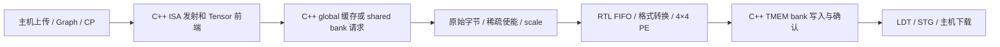

# Tensor RTL 接入 ISA、TMEM 与主机 Graph

`simt-run` 和 `simt-device` 现在可以选择真正执行 SystemVerilog 的 Tensor 后端。每个模拟 SM 持有一份独立的 Verilator 阵列实例；MMA 的格式转换、乘积、累加、缩放和稀疏跳过由该实例产生结果。默认后端仍为 C++ 时序模型，必须显式构建并启用 RTL。

这是一套在 CPU 上运行的混合仿真：Tensor 数值与阵列是 RTL，其余单元仍由 C++ 模拟。它不是完整 RTL GPU，也不是 NVIDIA 内部电路的精确复刻；没有获得 RTX 4070 SUPER 的实际算力。电路细节见 [RTL_TENSOR.md](RTL_TENSOR.md)。

## 如何运行

工具准备见 [RTL.md](RTL.md)。当前已使用项目私有 Verilator 4.038 验证；CMake 也可查找已安装的 Verilator。

```sh
cmake -S . -B build-rtl -DCMAKE_BUILD_TYPE=Release -DSIMT_TENSOR_RTL=ON
cmake --build build-rtl -j6
ctest --test-dir build-rtl --output-on-failure -j6
python3 examples/run_workloads.py --build build-rtl --timing --tensor-rtl --out artifacts/rtl-integrated
python3 examples/hardware_host.py --build build-rtl --tensor-rtl --out artifacts/rtl-host
```

直接执行机器码时使用 `build-rtl/simt-run kernel.bin --timing --tensor-rtl`。Python 主机入口：

```python
from simt_lab.host import Device

with Device("build-rtl/simt-device", timing=True, tensor_rtl=True) as device:
    print(device.properties["tensor_backend"])
```

未编译 RTL 却请求它，会明确报 `tensor_rtl_backend_unavailable`，不会转回 C++ 模型。未启用 timing 也会报错。物理流水线固定四级，输入 FIFO 固定两项；修改 `--tensor-latency` 或 `--tensor-queue` 为其他数值会拒绝启动。`--tensor-rows/columns` 仍允许 1–4，限制每个微 tile 的参与范围，电路本身始终包含 16 个 PE。

## 实际执行边界



| 部分 | 当前实现方式 | 主要源码 |
|---|---|---|
| 描述符、微 tile 拆分、稀疏位置索引 | C++ 有限状态前端，经实际存储模型取数 | `src/timing/tensor_*.cpp` |
| FP16/BF16/FP4/INT8 转换 | RTL；前端传原始字节和半字节选择位 | `rtl/tensor_decode.sv` |
| FP32 融合乘加、INT8 乘加 | RTL 整数位运算、乘法器和流水寄存器 | `rtl/fp32_fma.sv`、`rtl/int8_mac.sv` |
| FIFO、PE 反馈、逐跳传输、缩放和结果保持 | RTL | `rtl/tensor_pe.sv`、`rtl/tensor_array.sv` |
| 时钟与 valid/ready 适配 | C++ 驱动电路引脚，不计算矩阵结果 | `src/rtl/tensor_engine.cpp` |
| TMEM、L1/L2、DRAM、DMA、warp 调度与 CP | C++ 功能/时序模型 | `src/hardware/`、`src/timing/`、`src/device_*.cpp` |
| 缓存、scoreboard、bank 仲裁的其他 RTL | 已独立验证，尚未接入整机执行 | [RTL.md](RTL.md) |

原始数据不会先由宿主转换成 FP32 再冒充 RTL 转换。前端仍负责描述符和 scale 合法性检查；scale 是本项目的 binary32 约定。阵列的结果经原有 TMEM 端口逐次写入，最后写确认到达后 MMA 才退休。

## 时钟、归属与统计

`begin()`、`push()`、`take()` 只设置引脚并求组合逻辑，不产生时钟。每次 `tick()` 仅推进一个上升沿；首次复位也占实际一拍，构造函数不偷偷运行复位周期。主机的查询、Graph 展开和数据搬运不会另外推进阵列。

一次成功的 `push()` 表示保留物理输入端口，数据保持到下一拍握手；它不等于该波已经进入 PE。阵列内部仍只有两项 FIFO，队列满时前端保留当前波并重试。`take()` 只交付一次结果，确认在下一拍发生；紧接着的下一次启动必须等旧结果释放归属，不能覆盖或重复取回它。

每个 kernel 快照中 `hardware.tensor[sm]` 包含：

- `backend`：实际实例返回的 `model` 或 `rtl`，不是仅回显命令行。
- `array_clocks`：该 kernel 私有阵列实际推进的拍数。正常运行及完成时等于 kernel 相对 `cycles`；每次新 kernel 从零计数，设备绝对时钟连续。
- `tiles`：实际启动握手；`waves`：RTL 向网格注入的输入波。
- `products/skipped/scale_products/scale_accumulates`：实际 PE 发射事件位的计数，不能从描述符乘法规模推算代替。
- `queue_stalls`：前端提交被拒绝的次数；`input_stalls`：电路处于可注入状态但没有输入的拍数。两者单位不同。

故障处理停止私有计算状态，包括 Tensor 阵列；已经接受的 global/local/atomic 请求继续经持久存储层次排空。因此失败快照的 `cycles` 可以大于 `array_clocks`。尚留在阵列中的未完成结果不会继续写回 TMEM，新 kernel 获得新的阵列实例；不能把故障排空时钟伪装成阵列时钟。

## 验证与复现实验

默认 Debug 构建通过 21 个 CTest 套件、259 项检查。启用 RTL 的 Release 构建通过 24 个套件、318 项检查（270 Python、48 C++）。其中 5 项为适配器行为，19 项复用 Tensor 数值/存储契约，35 项包括 33 项主机/Graph 契约及 2 项新场景。复用检查是在不同后端执行，不表示新增了同样数量的独立测试设计。

适配器验证显式时钟、真实电路事件、两 SM 状态独立、五种原始格式、结果确认与立即再启动、有限 FIFO、非法命令后恢复。端到端覆盖独立 Fraction 数值参考、次正规数、融合舍入、INT8 回绕、稀疏 NaN、块缩放、TMEM 端口，以及完整 32×32×256 矩阵的 262,144 次有效乘积。

主机用例验证四种完整负载、DMA→MMA→下载的三次图重放、缓存跨 kernel 复用、执行中重复查询不改变任何时钟/状态，以及另一 warp 在 MMA 未完成时触发失败后仍可正确再次启动。Graph 是项目的自定义接口，没有实现 NVIDIA `cudaGraph*` ABI。

```sh
cmake -S . -B build-rtl-sanitize -DCMAKE_BUILD_TYPE=Debug -DSIMT_SANITIZE=ON -DSIMT_TENSOR_RTL=ON
cmake --build build-rtl-sanitize -j6
UBSAN_OPTIONS=halt_on_error=1 ctest --test-dir build-rtl-sanitize --output-on-failure -j4
cmake --build build --target rtl-check
```

软件适配器和 Verilator 生成的电路代码都接受 sanitizer 插桩。最大矩阵首次超过通用的 8 秒进程上限，RTL 测试现设 60 秒；保留原矩阵尺寸、全部数值断言和 sanitizer 检测。此前其余 23 套件已通过，调整后重跑的 19 项 Tensor 套件也全部通过（整套 65.46 秒），合计 24 套件均通过。独立 RTL 仍为 30 项，修改观测端口后的 PE/阵列另通过 sanitizer、重新综合及网表检查，记录在 `artifacts/rtl-{pe,array}-integrated*`。

加入观测端口后的综合结果为：PE 13,090 个 generic cells / 794 个触发器位，4×4 阵列 217,928 / 16,636。新增组合逻辑用于暴露事件，不是整卡门数、等效 NAND2 数或工艺面积。

| 工作负载 | CLI kernel 周期 | 主机 Graph kernel 周期 | RTL 有效乘积 | 输出数 / 最大绝对误差 |
|---|---:|---:|---:|---|
| GEMM | 2253 | 2241 | 1536 | 96 / 约 2.98e-7 |
| 小型 Transformer | 5671 | 5655 | 2304 | 32 / 约 1.07e-7 |

两类实验初始存储状态不同，不能把周期差解释成接口速度。Graph 的每个负载都执行两次重放；Transformer 每次 DMA 实际写入 2176 B。原始输入、机器码、状态、下载字节和验证结果分别保存在 `artifacts/rtl-integrated` 与 `artifacts/rtl-host`。这些周期只描述本研究架构。

## nvidia-smi 与尚未完成的部分

实际完成上述 RTL Graph GEMM 的存活设备已由原版 `/usr/bin/nvidia-smi` 查询，专用 NVML 启动器显示 `SIMT Lab 2 SM (simulator)` 和实际分配的 `64, 7, 57` MiB；进程退出后返回 `No devices found.`。系统默认命令仍显示真实 RTX 4070 SUPER。原始输出在 `artifacts/rtl-integrated/nvidia-smi-status.txt`。

管理面可见性不代表 CUDA 设备枚举、PCIe 设备或驱动兼容。整个 SM/存储层次的 RTL 连接、实卡参数校准、PTX 异步矩阵协议、最终硬件审计与系统默认 nvidia-smi 视图合并仍未完成；完整目标见 [HARDWARE_PLAN.md](HARDWARE_PLAN.md)。
