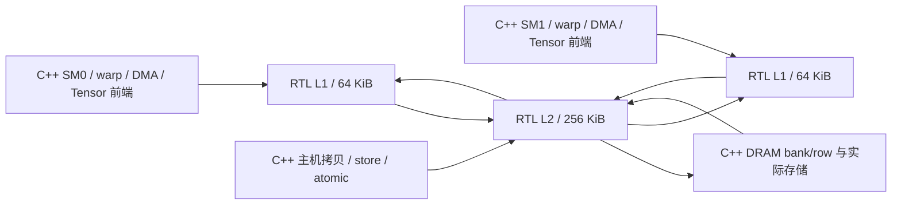

# L1/L2 RTL 接入实际执行路径

`SIMT_CACHE_RTL=ON` 构建新增实际缓存电路后端。运行时 `--timing --cache-rtl` 或 Python `Device(timing=True, cache_rtl=True)` 选择它；默认 C++ 模型仍保留，没有编译 RTL 却请求它会明确报错。它可以与 `--tensor-rtl` 同时使用。

此模式中，load、Tensor 操作数和 DMA 源读取经过每个 SM 的 RTL L1，再经过共享 RTL L2。主机拷贝、普通写入和整数原子经过同一个 RTL L2。缓存命中从 `sector_sram.sv` 的实际数据阵列返回，C++ 不维护另一份影子 tag/data 来替代电路结果。数据 SRAM 的接口、缺失处理和 LRU 电路见 [RTL.md](RTL.md)。

## 硬件配置与连接

| 结构 | 每 SM 的 L1 | 全设备共享的 L2 |
|---|---:|---:|
| 容量 | 64 KiB | 256 KiB |
| 组 × 路 × 行大小 | 128 × 4 × 128 B | 256 × 8 × 128 B |
| 每行 sector 数 | 4，每个 32 B | 4，每个 32 B |
| 数据阵列 | 2048 × 256 位 | 8192 × 256 位 |
| 请求/响应出口 | 各 1 个 | 各 1 个 |
| SRAM 端口 | 同步读 1 个、同步写 1 个 | 同步读 1 个、同步写 1 个 |
| MSHR / 每项合并上限 / RTL 响应槽 | 4 / 4 / 8 | 4 / 4 / 8 |
| 整体或范围失效扫描 | 每拍一行，512 拍 | 每拍一行，2048 拍 |

以上是项目设计选择，不是 NVIDIA 的逆向结论。与 C++ 默认的 4/8 bank、16/32 MSHR、128/256 响应额度不同；时钟和吞吐不应被当作两个逐拍等价实现。RTL 几何配置目前固定，非默认模型配置传给 RTL 工厂会被拒绝，不静默忽略用户调参。



适配器 `src/rtl/cache_engine.cpp` 只管理有限传输状态：一个待握手请求端口、四个 MSHR 对应的下游票据、一个待返回 fill，以及最多八个活请求的响应存储。八个入口 ID 在用户取走完成数据后才能复用；即使 RTL 已经将结果交给适配器，未消费结果仍占额度。返回数据不是直接从底层 Memory 重读。

每个 `tick()` 只推进一次上升沿，包括首次复位。`submit()`、`take()`、失效请求和状态查询都不偷偷推进电路；每个缓存的 `clocks` 与持久设备的绝对时钟相等。独立的命中请求经过 SRAM、返回寄存和响应选择，在接受边沿 N 到 N+3 后拉高 valid，N+4 握手；适配器定向测试从提交到可取结果实际推进五拍。

请求可能已在适配器预留，但下一拍 fill 优先导致 `req_ready` 降低；此时请求引脚保持，之后只握手一次。下游票据也只在 lower 接受时记录，不会因为 `mem_valid` 保持高电平而重复发出。同一个共享 L2 入口自然对多个 L1、copy 和 atomic 施加反压。

## 失效控制器如何工作

原独立缓存只支持排空后的整体失效。接入主机分配和释放需要保留无关缓存及在途填充，因此新增以下实际状态：`invalidate_cursor`、首尾 sector 地址、整体/范围模式位、busy/done 握手。

1. **整体失效**只在 MSHR、响应和命中流水线排空后接受。
2. **范围失效**在命中流水线空闲、目标 sector 没有未完成 MSHR 时接受；无关 MSHR 可以继续存在。
3. 接受后每拍检查一条 line 的 tag 和四个 sector 地址，只清除目标有效位。整体模式还清除 line present。
4. 扫描时暂停新请求；已有下游事务、fill 和响应仍能完成。一个 line 的无关 sector 同拍 fill 与目标 sector 失效可以并行，测试专门验证了这个冲突。
5. 扫描最后一行后释放 busy，并产生一个 done 脉冲。数据 SRAM 不清零，LRU 顺序不因范围失效重建。

主机接口将未对齐字节范围转换为首尾 sector，并先检查整机所有在途请求是否与范围相交。相交时拒绝分配/释放操作，不能先清零 backing 再等待旧读取结束。各缓存的维护队列上限为 64 项；全部队列预检成功后才提交，满时返回 `cache_invalidation_queue_full`，不会部分修改分配。该队列属于 C++ 维护适配层，尚未写成 RTL。

失效请求入队后，适配器立即阻止新的缓存请求；实际有效位仍由后续电路扫描清除。这允许同步主机分配接口在没有隐藏设备时钟的情况下保证后续读取不命中旧字节。无待执行任务时，维护命令可能等到显式 `Device.progress()` 或下一任务才推进。整体失效可合并覆盖已排队的范围，但不会跳过实际扫描。

跨 SM 顺序仍由 C++ `MemoryHierarchy` 协调：普通写入排空较早读取、预约全部 L1 失效，再绕过 L1 写穿 L2，较新请求等待写确认。原子复用 L2 的实际字节读取和带 mask 写入。新读取也必须等待 L1 的失效扫描，所以不会被较快完成的写入超越。这是保守研究协议，尚非 RTL 一致性控制器或 NVIDIA 弱内存语义。

## 运行与观察

```sh
cmake -S . -B build-cache-rtl -G Ninja -DCMAKE_BUILD_TYPE=Release -DSIMT_CACHE_RTL=ON -DSIMT_TENSOR_RTL=ON
cmake --build build-cache-rtl -j6
ctest --test-dir build-cache-rtl --output-on-failure -j6
python3 examples/hardware_host.py --build build-cache-rtl --cache-rtl --tensor-rtl --out artifacts/rtl-cache-host
```

kernel 快照的 `hardware.l1[]` 和 `hardware.l2` 报告实际后端、绝对拍数、容量、way、端口数和队列容量。hits/misses/merges/evictions 来自 RTL 寄存器；line miss 和 fill bytes 来自实际电路事件。提交拒绝和下游等待由适配器计数，不从矩阵规模或 DRAM 调用次数伪造 hit。

普通 C++ 构建通过 22 套件、261 项检查；缓存+Tensor RTL 的 Release 构建通过 28 套件、421 项（368 Python、53 C++）。这包括已有检查在新后端复跑，不表示增加了同样数量的独立测试设计。

- 2 项选择检查：要求 timing、真实能力查询、不支持构建明确失败。
- 5 项 C++ 接入检查：无隐藏时钟、实际 SRAM 命中、八项返回额度与 ID 复用、范围维护队列、两 SM 一致性、在途失效保护，以及 160 次独立字节参考的混合访问。
- 61 项复用的端到端检查：local、原子、DMA、Tensor 数值和时序。包括高位 local 物理地址、跨 CTA 生命周期、稀疏/缩放及 32×32×256 最大矩阵。
- 35 项主机检查：Graph/capture/重放、上传下载、缓存保留、重新分配、故障排空、查询不推进电路，以及四类完整工作负载。

默认构建的软件检查不启用 RTL；测试后端身份和真实事件是上述 RTL 套件的断言。sanitizer 对适配器、L1/L2 和 Tensor 生成代码都插桩。完整最大矩阵首次超过 60 秒进程上限，现设 180 秒，不缩小算例或关闭检测。

第一次完整 sanitizer 验证除该超时外的 27 套件已通过，延长时限后，61 项缓存执行套件在 139.05 秒内通过；并非将超时当作成功。后续删除冗余 tag/valid 复位并重建后，受影响的四个缓存后端套件在 Release 与 ASan/UBSan 下再次全部通过；最终 61 项执行套件耗时 139.22 秒。独立 RTL、sanitizer 和网表也重新验证，具体结果记录于 [VALIDATION.md](VALIDATION.md)。

```sh
cmake -S . -B build-cache-sanitize -G Ninja -DCMAKE_BUILD_TYPE=Debug -DSIMT_SANITIZE=ON -DSIMT_CACHE_RTL=ON -DSIMT_TENSOR_RTL=ON
cmake --build build-cache-sanitize -j4
UBSAN_OPTIONS=halt_on_error=1 ctest --test-dir build-cache-sanitize --output-on-failure -j3
python3 tools/rtl.py --module cache --out artifacts/rtl-cache-integrated
python3 tools/rtl.py --module cache --synth --out artifacts/rtl-cache-integrated
python3 tools/rtl.py --module cache --gate-sim --out artifacts/rtl-cache-integrated
python3 tools/rtl.py --build build-cache-sanitize --module cache --out artifacts/rtl-cache-integrated-sanitize
```

独立缓存 RTL 现有 11 项（原 9 项加范围扫描与并发 fill 两项），小配置 RTL、sanitizer、综合后网表均通过；64 KiB 配置也执行相同检查。新增诊断输出曾触发旧 Verilator 对向量位依赖的组合环误报，改为独立标量输出后通过；没有禁用 UNOPT 或综合 `check -assert`。

新 2 KiB 小配置的实际综合为 55,212 个 generic cells，其中触发器 22,083 位。数据阵列在这个统计中全部展开，不是 SRAM 宏成本、NAND2 等效门数或整卡面积。64 KiB L1 的保留存储综合识别出 524,288 数据位和单读/单写端口。

最初 256 KiB L2 的综合优化超过 600 秒。删除冗余 tag/valid 复位后，64 KiB L1 的 tag 推断写端口降为 1 个、valid 为 2 个；这不是跳过复位检查，而是用已有 present 位保护无效行，并保留新行初始化。工具日志改为实时写入文件，超时也保留部分诊断。

修改后的 256 KiB L2 综合仍在 600 秒时限内未完成，日志最后位于 Yosys `OPT_CLEAN` 优化阶段；因此本阶段没有 L2 综合通过或存储推断完成的结论。下面的 L2 命令用于复现该未完成检查，日志在 `artifacts/rtl-l2-integrated-inference/cache/synthesis.log`。完整 L2 已通过实际 Verilator 执行与 sanitizer 检查，但不能据此替代综合验收。

```sh
python3 tools/rtl.py --module cache --sets 128 --synth --infer-only --out artifacts/rtl-cache-integrated-full
python3 tools/rtl.py --module cache --sets 256 --ways 8 --synth --infer-only --out artifacts/rtl-l2-integrated-inference
```

主机演示的四种负载均完成两次重放：GEMM 96 输出最大误差约 2.98e-7，Transformer 32 输出约 1.07e-7。相邻的只读 kernel 冷/热分别 40/18 模型周期，热读取不增加 DRAM 请求。维护扫描、缓存状态和输入到达时间会影响各次重放周期；这些不是 RTX 4070 SUPER 性能预测。机器码、镜像、下载字节和 kernel/设备快照保存在 `artifacts/rtl-cache-host`。

实际完成上述 RTL GEMM 的存活会话还通过原版 nvidia-smi 查询，显示模拟器及实际 7 MiB 分配，退出后消失；记录为 `artifacts/rtl-cache-host/nvidia-smi-status.txt`。专用 NVML 方式仍不提供系统默认视图合并或 CUDA 设备枚举。

## 尚未完成

当前是 CPU 执行的混合仿真。缓存和 Tensor 电路已经参与计算，但 DRAM、warp 调度、合并器、维护队列、一致性协调、CP 和主机接口仍是 C++；scoreboard/bank 仲裁 RTL 尚未接入完整 SM。没有 FPGA bitstream、布局布线、NVIDIA 门级还原或实卡参数校准。完整目标继续以 [HARDWARE_PLAN.md](HARDWARE_PLAN.md) 为准。
