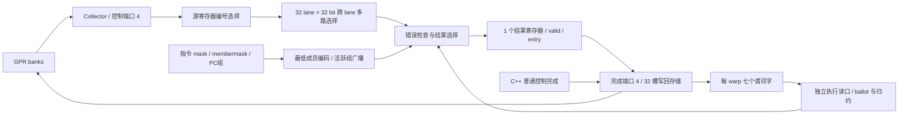

# 跨 lane 集合执行电路

启用 `--timing --register-rtl --collector-rtl` 后，`SHFL`、`VOTE`、`ELECT` 和 `ACTIVEMASK` 由 `collective_execute.sv` 计算。源向量来自 collector 的物理控制端口，VOTE 谓词来自实际谓词存储，结果经物理写回总线进入 GPR 或谓词文件。C++ 不再为这四条指令计算结果。

这是本项目 ISA 的可综合实现，不是 NVIDIA 内部 shuffle 网络或投票单元的逆向电路。跨 warp 仲裁、CTA 屏障、SFU 和部分访存执行仍有 C++；后续已接入 [重聚令牌](RTL_WARP_CONTROL.md) 及 [PC/状态/分组选择前端](RTL_WARP_FRONTEND.md)，整机 RTL 尚未完成。



## 具体硬件结构

SHFL 的每个目标 lane 有一个 32 选 1、32 位宽的选择网络。选择索引来自该 lane 的第二个源操作数；被选值来自第一个源向量中的指定 lane。两个源寄存器编号可相同，collector 的去重规则仍适用；R63 直接提供零。源已在 collector 锁存，所以源等于目的寄存器时仍读到写回之前的值。

VOTE 先做 `predicate & members`，再产生 ballot、any、all 或 equal；结果只写参与成员。ELECT 用 `members & -members` 的位电路产生最低成员的单比特掩码，送到谓词写回载荷。ACTIVEMASK 将谓词过滤之前的 PC 组掩码广播给 guard 为真的 lane。

执行接口包括 opcode/mode、两个源寄存器编号、参与掩码、membermask、PC 组掩码、物理 warp 槽、collector 和 completion 编号；没有宿主生成的 GPR 或 predicate 结果向量。

### 专用谓词读口

`predicate_file.sv` 在原有两个共享 warp 地址的发射读取多路器之外，增加第三个有独立 warp/谓词地址的组合读口。它直连集合单元。发射器继续扫描其他候选 warp 时，不会改变已经放到集合执行接口上的谓词地址；无需从 C++ 谓词镜像提供 VOTE 数据。

新端口使用相同的有效位、P7 常量、清槽和 masked-write 旁路规则，不复制谓词存储。数据位仍为每槽 224 位，加 7 个有效位。当前报告 `predicate_files.read_ports` 为 3；`source_reads` 仍统计发射侧源查询，`collective_units.vote_reads` 另统计执行侧已接受的 VOTE。两者不是同一个硬件读口的重复计数。

### 结果寄存器与反压

每分区只有一个集合结果槽：1,024 位载荷、5 位 completion 编号、1 位 occupied，共 1,030 位。它接受一次完整操作并在时钟边沿保存结果；下一个模型周期可以交给写回。输出不被接受时，数据和编号保持不变，输入停止；同拍 pop/push 可以取走旧结果并接收新结果，每拍至多一条。

这是一层组合执行网络加一级结果寄存器，没有把网络谎称为多级内部流水线，也没有测出真实 NVIDIA 的单周期延迟或达到某个频率。外围写回仍有 32 个有限完成槽，指令发射前预约，因此执行结果不会成为无归属的临时值。

完成端口 4 同时服务尚由 C++ 执行的普通控制指令。RTL 集合结果占用端口时，适配器拒绝软件提交并要求下一拍重试；同一端口的两份结果不能覆盖彼此。独立适配器测试在 1/2/4/8 分区下制造这种碰撞，并核对结果和释放计数。

### 错误与状态原子性

非空执行时要求 membermask 非空且是当前参与掩码的子集。SHFL 索引必须小于 32，且指向成员；非参与 lane 的索引不参与验证。VOTE 检查谓词编号和模式。没有源操作数、错误 opcode 或未被物理控制端口选中的 collector 都明确拒绝。

电路在输入捕获前产生错误码，错误不释放 collector、不占结果槽。宿主将错误码转换为原有 ISA 诊断。零参与指令不执行成员运算；宿主 ISA 解码和字段范围检查仍可在到达电路前拒绝非法编码。

## 实际综合结果

Yosys/ABC 通用逻辑映射，不指定 FPGA 器件或 ASIC 工艺：

| 模块 | 实际参数 | generic cells | 触发器位 |
|---|---|---:|---:|
| `collective_execute` | 全 32 lane，1 个结果槽 | 55,423 | 1,030 |
| `predicate_file` | 32 个物理 warp 槽、3 个读口 | 68,814 | 7,392 |

集合单元中有 44,102 个通用 MUX 单元；这说明当前源选择和跨 lane 网络成本明显。三读口谓词文件比上一版双读口的 53,573 cells 增加 15,241 cells，数据/有效位数量不变。以上是这两个模块的实际综合结果，不包含完整 SM，不是 LUT 个数、SRAM 宏面积或时序收敛结果。

对应综合网表运行相同的行为测试。联合 RF/collector/整数/浮点/集合/写回顶层完成 RTL 和 sanitizer 验证，本阶段没有对完整联合顶层重新做门级映射。

## 复现与证据

```sh
cmake -S . -B build-cache-rtl -DCMAKE_BUILD_TYPE=Release \
  -DSIMT_TENSOR_RTL=ON -DSIMT_CACHE_RTL=ON \
  -DSIMT_SCOREBOARD_RTL=ON -DSIMT_REGISTER_RTL=ON
cmake --build build-cache-rtl -j4
ctest --test-dir build-cache-rtl --output-on-failure
python3 tools/rtl.py --build build-release --out artifacts/rtl-collective --module collective
python3 tools/rtl.py --build build-release --out artifacts/rtl-collective --module collective --synth
python3 tools/rtl.py --build build-release --out artifacts/rtl-collective --module collective --gate-sim
```

`build-release` 是普通 Release 参考库，须先按 README 构建。`--synth` 和 `--gate-sim` 分两次执行；工具会核对网表和对应 RTL 的 SHA-256。工具现在额外保存每模块的 `simulation-manifest.json`、`synthesis-manifest.json` 或 `gate-manifest.json`，防止同一输出目录的后续模块覆盖之前的清单；失败复跑会先删除该模块的旧成功清单。

本阶段已运行：

- 集合单元 4 项：3,000 组功能 ISA 差分、模式/特殊源/无效掩码、非法描述符、持有/替换/复位和 5,000 拍独立反压参考；RTL、ASan/UBSan 和综合网表均通过。
- 三读口谓词 4 项，包含 12,000 拍独立随机状态参考，新增执行读口在每拍前后独立查询另一 warp；RTL、sanitizer、32 槽综合网表通过。
- RF 5 项、直连顶层 8 项，RTL 和 sanitizer 均通过。直连测试刻意让发射读取另一个 warp，验证 VOTE 仍读取执行端指定的物理谓词，随后从 RF 再读回结果。
- 默认 Debug 27 套件/279 项（277 通过、2 跳过）；联合 Release 48 套件/862 项全部通过。新增 ISA 测试核对原功能执行器状态、原地 SHFL、四种 VOTE、部分成员、尾部 warp、槽复用及错误诊断。
- 五个可选后端同时启用，向量、规约、GEMM 和小 Transformer 各两次 Graph 重放通过独立数学结果校验。每次规约实际接受 75 条集合指令，小 Transformer 为 32 条；两次向量/GEMM 没有集合指令，不把它们误算为该单元的运算覆盖。
- 带监控的规约 Graph 两次执行通过；普通 `nvidia-smi` 同时显示实卡与活模拟器，7 MiB → 0 MiB → 退出消失。管理面含义保持 [NVIDIA_SMI.md](NVIDIA_SMI.md) 的边界。

证据目录：`artifacts/rtl-collective*`、`artifacts/rtl-collective-host/`、`artifacts/rtl-collective-final/`；最终审计清单为后者的 `evidence-audit.json`。具体失败与最终成功记录见 [VALIDATION.md](VALIDATION.md)。整个硬件目标仍在进行，不能由这些局部电路验证推出完整 NVIDIA GPU 已还原。
