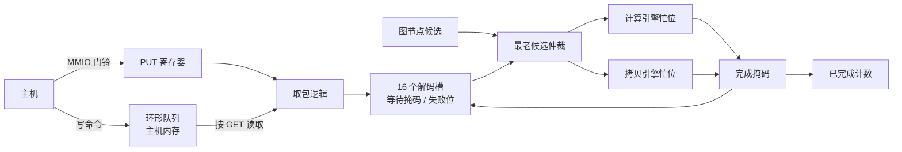

# CPU 到 GPU 的控制模块：命令处理器电路

启用 `Device(timing=True, register_rtl=True, collector_rtl=True)` 后，命令处理器（CP）的核心状态由 `rtl/command_processor.sv` 保存。队列指针、门铃、十六个解码槽、依赖等待、引擎占用和完成计数都在电路里，`stats()` 的 `cp_backend` 报告 `rtl`。

这是本项目的研究设计，不是 NVIDIA 前端或 GPFIFO 的逆向还原。图解见 [cpu-gpu-control.html](cpu-gpu-control.html)。

## 电路负责什么

| 结构 | 实现 |
|---|---|
| MMIO 寄存器 | PUT（门铃）、GET、已完成数、状态、容量，共五个；门铃写保持到下个时钟边沿，并旁路给同拍取包 |
| 取包 | 每拍最多一个包，`GET != PUT` 且有空槽时才取；队列容量 1–4,096 |
| 解码槽 | 16 个；每槽保存 32 位句柄、引擎类型、16 位等待掩码、失败标记和运行标记，完成后才释放 |
| 依赖 | 句柄 CAM 把依赖转换成等待位，完成广播同拍清除；前驱失败会让后继进入取消 |
| 派发 | 单调句柄即年龄，选最小句柄的合格候选，每拍一次；被阻塞的包不挡其他 stream |
| 引擎占用 | 计算、拷贝各一个忙位；启动失败时同拍归还 |
| 图解码 | 每拍只服务一个有未展开节点的最早运行图 |
| 协议检查 | 七类非法输入整体拒绝，状态不变 |



Yosys 综合结果是 21,357 个 generic cell、946 个 FF 位，没有 SRAM。这不是 NAND2 门数，也没有面积或频率数据。

## 仍在电路之外的部分

- **环形队列内容**：放在主机内存，这与真实 GPU 的做法一致；电路按 GET 读取。
- **更早任务的完成记录**：已离开解码槽的依赖，由适配层查询后驱动 `external_pending/failed` 引脚，相当于读取内存里的信号量。
- **图节点就绪判断**：节点依赖仍由 C++ 计算，最终胜者由电路和队列包一起仲裁。
- **命令负载**：拷贝和 kernel 的参数仍在 `Job` 对象里；电路只保存句柄和类型。

## 还没有做的硬件

- PCIe 端点和 BAR。这里的 MMIO 是简化寄存器接口，主机和设备之间仍是进程协议。
- 真实 GPFIFO 命令格式、IOMMU 和 GPU 页表、中断。
- 拷贝引擎的数据通路和跨 SM 的 CTA 分发器，它们仍是 C++。

所以 CUDA 和 PyTorch 仍然看不到这个设备，`nvidia-smi` 也仍然走 NVML 桥接。

## 对时序的影响

同拍取包和派发的旁路保留了原 C++ 模型的语义。向量和规约负载的 kernel 周期与上一阶段完全相同，主机跟踪在 GEMM 第一次使用 TMEM 之前也逐条一致。此后的差异只出现在使用 TMEM 的负载上，这说明 CP 没有带来可见偏差，但两份电路是同期接入的，没有单独测过 TMEM 不接入时的结果。

## 验证

```sh
python3 tools/rtl.py --module command_processor
python3 tools/rtl.py --module command_processor --synth --no-share --out artifacts/rtl-cp-final
python3 tools/rtl.py --module command_processor --gate-sim --out artifacts/rtl-cp-final
ctest --test-dir build-cache-rtl -R command_processor --output-on-failure
```

- RTL、门级网表和 ASan/UBSan 下各通过五项：门铃与十六槽限制、依赖与失败传播、引擎占用与图解码、非法批次、40,000 拍随机流量对照独立模型。
- 适配器四项：读取不产生隐藏边沿、派发与完成、节点仲裁与启动失败、协议错误。
- 主机层复用了完整的主机、Graph 和持久硬件合约，全部经过这份电路。
