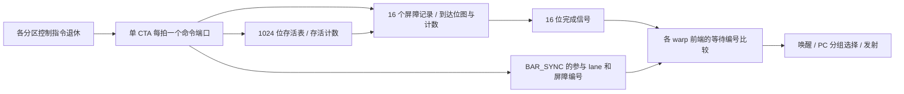

# CTA 屏障的到达存储、计数与线程唤醒

`--timing --register-rtl --collector-rtl` 已将 BAR_SYNC、BAR_ARRIVE 和 EXIT 对 CTA 屏障的更新接入实际 RTL。每个驻留 CTA 使用独立物理表，保存最多 1,024 个线程的存活状态和 16 个屏障的到达记录。完成位直接送到各 warp 前端，由前端电路判断并唤醒等待线程；C++ 不再计算这条路径的到达数或唤醒掩码。

这是本项目自定义 ISA 的实现，不能称为 NVIDIA 屏障单元的精确逆向。CTA 准入、跨分区提交次序、实例之间的引脚路由仍由 C++ 驱动；异步 mbarrier/CP_ASYNC 的事务表与字节计数现已另接入 [事务 RTL](RTL_TRANSACTION_TABLE.md)，DMA 片段和 shared 服务仍为 C++。没有新增完整 SM/GPU 的可综合顶层。



## 存储由什么实现

`cta_barrier_record.sv` 实例化 16 次；`cta_barrier.sv` 保存 CTA 存活状态并提供共同端口。当前综合全部映射为触发器及组合选择/更新网络，没有 SRAM 或 FPGA BRAM 映射。

| 每个屏障记录的字段 | 位数 |
|---|---:|
| 活跃位 | 1 |
| 固定人数、已到达人数、当前目标人数 | 3 × 11 |
| 代数 | 64 |
| 每线程到达位图 | 1,024 |
| 单记录合计 | **1,122** |
| 16 个记录合计 | **17,952** |

CTA 公共状态为 initialized 1 位、启动人数与存活人数各 11 位、存活位图 1,024 位，共 1,047 位。因此完整表保存 **18,999 位**。每个 warp 前端沿用原有等待状态和编号存储，没有为屏障增加另一份线程状态。

位图用于判断重复到达，以及区分“已经到达后退出”和“尚未到达就退出”。只保存一个总计数不能区分这两种情况。当前接口需要按 warp 选择 32 位到达字，并在 EXIT 时并行更新 16 个记录；清槽同时清除所有记录。这是选择触发器实现的接口背景，不代表这些状态不能重新设计为多拍 SRAM 通路。

`lane_popcount.sv` 使用五层加法树计算一个 32 位掩码的人数。每个记录独立计算本次退出但尚未到达的线程数。11 位计数能够表示 0–1,024，新增到达使用 12 位临时和检测溢出后才写回。

## 一代屏障怎样推进

- 首次非空到达启动一代；固定人数非零时以它为目标，否则以当前存活人数为目标。
- 每次到达先检查人数约定一致、没有重复成员、没有超过目标，以及成员仍然存活。所有检查通过才更新位图和计数。无参与 lane 的谓词屏蔽指令不验证无效的编号/人数，但仍占一个命令端口。
- 动态人数屏障遇到 EXIT，只减去“仍存活且尚未到达”的退出人数。已经到达的线程即使退出，也保留这一代的到达贡献。固定人数屏障不因 EXIT 改变目标。
- 到达数等于目标时产生完成位，清除活跃状态、到达数和位图，代数加一。一个 EXIT 可以同时完成 16 个动态屏障。固定人数与目标字段在不活跃时保留最后值，不能把它们当作下一代已经启动。

动态目标的含义是“已到达人数 + 仍存活但尚未到达的人数”。正常到达只把后一组成员移到前一组，目标不变；未到达成员退出才令目标递减。因此缓存目标计数不需要每拍重新扫描全部 1,024 个线程。独立参考仍按功能模型的成员集合计算，用于检验这条不变量。

BAR_ARRIVE 只更新表，BAR_SYNC 还把参与线程置为 CTA 等待。最后一次 BAR_SYNC 到达可能同拍完成；前端先应用阻塞，再比较完成位，所以这些线程可以同拍恢复，并参与后续 PC 组选择。异步等待状态即使有相同低四位编号也不会被唤醒；前端会验证完整等待编号小于 16。

## 端口、时钟与实际执行路径

每物理 CTA 表每拍接受一个到达或退出命令。同拍有多个分区的 warp 准备提交时，其他请求等待，`cta_barrier_stalls` 记录被拒绝的尝试次数，不等于独立停顿周期数。准入检查发生在消费写回确认之前，不能先取走确认再发现屏障端口忙。

适配器只驱动原始描述符、读取 RTL 输出和累计实际事件；没有用于替代电路的到达位图。命令保持到拍末 `tick()`，只提交一次边沿；读取快照不推进时钟。错误命令撤销引脚并保留存储，后续合法命令仍可使用该端口。

CTA 退休后，物理表保留实例；同一 kernel 内新 CTA 复用前通过初始化端清槽。默认 SM 准入额度决定表槽上限，实际只为用过的槽创建 Verilator 实例；软件惰性实例化不能被解释为芯片动态制造电路。下一次 kernel 会建立新的表实例。

`hardware.cta_barriers` 按 SM/物理槽报告时钟、初始化、命令、到达、退出、完成次数和 16 条记录。事件计数跨槽复用累积；记录快照只描述最近占用该槽的 CTA，不是所有逻辑 block 的历史。`hardware.warp_frontends` 新增 `cta_blocked` 和 `cta_woken`，外部字段写接口仍保留，后续事务 RTL 接入后，实际 CTA/异步路径均通过专用信号更新等待状态。

源文件职责：`src/timing/cta_barrier.cpp` 管理槽位与事件路由，`src/rtl/cta_barrier.cpp` 负责引脚生命周期，`rtl/cta_barrier*.sv` 保存并更新屏障状态，`rtl/warp_frontend.sv` 执行本地阻塞/唤醒。跨实例路由仍经 C++，尚未综合为完整互连。

## 实际综合和验证

| 完整对象 | generic cells | 触发器位 |
|---|---:|---:|
| 一个完整 CTA 表：16 屏障、1,024 线程 | 234,669 | 18,999 |
| 增加 CTA 阻塞/释放端口后的单 warp 前端，含重聚令牌 | 106,383 | 4,801 |

两者均通过 Yosys `check -assert`，没有残留 memory/process，并通过实际综合网表行为检查。它们不是等价 NAND2 门数，也不能相加后当作两个完整 SM 的成本。没有工艺映射、布局布线、时序收敛或 FPGA 资源报告。

本轮验证范围：

- CTA 独立电路四项：全部编号、1/37/257/1,024 线程、重复代数；到达后退出和 16 路同时完成；错误拒绝与清槽；3,200 次随机到达/退出事件。
- Warp 前端五项：原四项加 CTA 阻塞/释放、同拍唤醒到发射、异步状态隔离。上述九项均通过 RTL、ASan/UBSan 和综合网表。
- C++ 适配器 CTA 四项、前端五项，均在联合 Release 和独立 ASan/UBSan 中通过，包括两电路实例实际传递完成位。
- 新增实际 ISA/主机八项：端口反压、16 屏障、尾 warp、四种分区、9 CTA 槽复用、提前退出、错误诊断、失败 kernel 后两次 Graph 重放并验证 333 个下载值。
- 默认 Debug 27 套件/279 项运行，277 通过、2 跳过；联合 Release 53 套件/897 项全部通过。未运行本次版本完整联合 sanitizer 或整 GPU 综合。
- 同时启用五种可选后端的四类完整负载各两次 Graph 重放通过，输出字节与上一阶段相同。规约每次产生 9 次 CTA 端口等待，本组负载总模型周期仍与上一阶段一致；不因此声称所有调度或 trace 不变。
- 原版 nvidia-smi 经用户入口再次验证真实显卡共存、7 MiB→0 MiB→退出移除；直接 `/usr/bin/nvidia-smi` 只见实卡，仍属于 [NVML 管理面](NVIDIA_SMI.md)。

最初复用的功能负例假定 warp 0 连续两次到达必然发生在 warp 1 首次到达之前。多分区时序执行可以完成两代，该程序因此合法。保留首次失败记录，改用已有时序测试中显式延迟另一 warp 的程序，继续要求 `duplicate_barrier_arrival`，没有修改电路来迎合该调度假设。

```sh
cmake --build build-cache-rtl -j4
ctest --test-dir build-cache-rtl --output-on-failure
python3 tools/rtl.py --build build-release --out artifacts/rtl-cta-barrier --module cta_barrier
python3 tools/rtl.py --build build-release --out artifacts/rtl-cta-barrier --module cta_barrier --synth
python3 tools/rtl.py --build build-release --out artifacts/rtl-cta-barrier --module cta_barrier --gate-sim
UBSAN_OPTIONS=halt_on_error=1 python3 tools/rtl.py --build build-sanitize --out artifacts/rtl-cta-sanitize --module cta_barrier
```

前端对应使用 `--module warp_frontend --out artifacts/rtl-cta-frontend`，sanitizer 使用 `--build build-sanitize --out artifacts/rtl-cta-sanitize`。每条命令只接受一个 `--module`；重复选项只保留最后一个，本轮已分别执行并检查两份模块清单。参考构建的准备方式沿用 [RTL.md](RTL.md)。

独立适配器 sanitizer 的实际编译命令保存在 `artifacts/rtl-cta-adapter-sanitize/manifest.json`；全量日志、源码/网表审计和监控结果在 `artifacts/rtl-cta-final/`，完整主机产物在 `artifacts/rtl-cta-host/`。完整硬件目标仍按 [HARDWARE_PLAN.md](HARDWARE_PLAN.md) 继续，不能以局部屏障完成替代整机验收。
