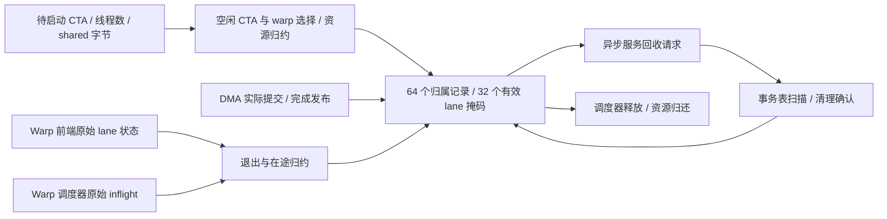

# CTA 资源准入、排空资格与退休电路

启用 `--timing --register-rtl --collector-rtl` 后，每 SM 的 CTA/warp 分配、寄存器与 shared 额度、DMA 未完成数、事务表清理状态和退休阶段由 `cta_resources` 电路保存。实际路径不再调用 C++ `SmResources::acquire/release`，也不再用软件 lane/DMA 扫描生成回收掩码或用 `scheduler_releasing_` 数组保存退休阶段。默认 C++ 后端保留原行为。

这是本项目的资源控制器设计，没有声称逆向出 NVIDIA 的 block 分配电路。固定寄存器额度、128 B shared 粒度、首个空闲槽选择与退休协议都是明确的设计选择。跨 SM 分配顺序和模块连接仍有 C++，并非完整 RTL SM。



图中的跨模块箭头目前由 C++ 适配器传送实际电路信号；没有把这些连线宣称为已经综合的 SM 顶层。

## 存储与组合结构

| 每个 CTA 记录 | 位数 | 用途 |
|---|---:|---|
| live / releasing / table_used / table_clean | 4 | 归属、退休与事务清理状态 |
| owner | 32 | 完整逻辑 CTA 编号 |
| warp_mask | 32 | 所属物理 warp 槽 |
| shared_size | 17 | 按 128 B 向上取整后的字节额度，可表示 65,536 |
| dma_count | 7 | 未完成 DMA 命令数，可表示 64 |
| 每记录合计 | **92** | 同步复位、带写使能的触发器 |

64 份记录共 5,888 位。每个物理 warp 另有 32 位有效 lane 掩码，共 1,024 位，保存分配时从线程数生成的有效范围。总存储 **6,912 FF 位**，没有 SRAM。64 个物理 CTA 记录不表示可同时驻留 64 个非空 block：32 个物理 warp 和其他额度还会限制实际并发。

`cta_resource_totals.sv` 使用 64 叶、六层树归约 CTA 数、shared 字节和 warp 归属掩码。实例化两棵树：一棵观察已提交归属，一棵排除本拍已获准释放的记录。后者允许释放与下一次分配同边沿交接。寄存器额度由已占 warp 数乘 2,048 字得到；这个项目每线程固定保留 64 个 32 位寄存器，没有实现 NVIDIA 按 kernel 寄存器使用量变化的分配粒度。

配置允许 CTA 上限 1–64、物理 warp 上限 1–32、寄存器不超过 65,536 字、shared 不超过 65,536 B。实际 warp 上限同时受配置的寄存器容量限制。请求线程数为 1–1,024；所需 warp 为向上取整的线程数除以 32。shared 先按 128 B 取整，再同时检查全部额度。线程数非法和重复 CTA 编号是错误；额度暂时不足是反压。

单输入端口每 SM 每拍最多接受一个 CTA。空闲选择采用最低编号的可用 CTA 槽和 warp 槽。接受后，适配器保持电路选出的槽与 warp 掩码到显式边沿，避免同拍稍后释放较低槽时重定向已接受分配。查询使用 64 路 owner 比较和选择，输出最高槽 63、最高 warp 31、完整 CTA 编号与额度均有独立测试。

## 排空与两阶段退休

`lane_states` 输入包含 32×32 个三位原始状态，`inflight` 输入包含 32 个完整 32 位在途数。RTL 以分配时保存的有效掩码筛选 lane，再判断它们是否全部为 EXIT 状态且在途数为零。最后一个不满 32 线程的 warp 不会因未分配 lane 而无法退出。

DMA 提交成功时产生 start 事件；数据完成写入 shared、事务完成状态发布后，产生 finish 事件。每个 CTA 的七位计数在电路内部增减；start 与 finish 可同拍抵消，溢出、下溢和非法事件拒绝整个批次。CTA 必须同时满足 lane/指令排空和 DMA 数为零才是 drained。

使用过事务表的 CTA 先输出 cleanup 请求。异步服务单元选择它，事务表验证和扫描实际记录，完成后反馈 clean 事件。仍有未完成事务的扫描会报告错误，不能归还资源。未使用事务表的 CTA 可以跳过这一步。

接着执行两个独立边沿：

1. `begin_release` 验证排空和清理条件，锁存 releasing，并与 warp 调度器的释放事件在下一拍提交。
2. `release` 归还资源，可以与新 CTA 的分配共用边沿；kernel 成功返回必须等到最后的归还边沿实际完成。

releasing 已锁存排空资格，禁止新的 DMA 或表初始化事件。最终 release 不重新读取旧 warp 的 lane 状态，因为同拍新 CTA 的前端初始化可能已经通过旁路改变这些物理连线。否则合法的槽复用会被误判为旧 CTA 再度活跃。该交接在 RTL、实际适配器和整机复用测试中都已覆盖。

事件接口只驱动当前拍的引脚，查询和观察不会推进隐藏时钟。每 SM 每模型拍显式调用一次 `tick()`；纯查询时不更新状态。错误批次不产生部分提交。没有新增循环计数式“软件资源模拟”来替代这些寄存器和比较电路。

## 整机连接与剩余边界

`src/timing/cta_resources.cpp` 按物理 warp/partition 连线读取前端和调度器输出，不在 C++ 中判断全体线程是否退出。`async_service` 的回收掩码与 CTA 编号直接取资源电路输出。DMA/事务事件来自实际端点的接受和完成。

C++ 仍负责跨 SM 轮转请求、逻辑 CTA 与架构快照、shared 基址绑定及清除连线、跨模块调用、故障取消和外部请求/返回路由。同一个 kernel 的 shared 额度相同，基址仍按物理 CTA 槽乘取整后的额度计算；这不是任意大小区域的硬件分配器。TMEM/constant/DRAM、SFU、整数内部流水级和完整设备顶层也仍有工作。

`hardware.cta_resources[]` 报告硬件后端、物理容量、接受/释放/退休/表清理/DMA 事件、有效/输入时钟、峰值额度和最终状态。成功 kernel 中接受等于释放，DMA 开始等于完成，最终 live、pending 和全部额度为零。统计是硬件事件观测，不参与准入决策。

## 验证和综合

完整 64 CTA 记录、32 warp 控制器通过严格 Verilator lint、五项独立 RTL 检查、相同五项 ASan/UBSan 检查和相同五项综合网表检查。测试包括全部物理 warp、最高 CTA 槽、1,024 线程、64 KiB 额度、部分 warp、64 个 DMA 计数、同拍交接、非法批次不提交、复位，以及 1,500 个随机请求与独立空闲集合参考的差分。

真实 C++ 适配器另有四项 ASan/UBSan 检查，覆盖显式时钟、错误撤回、输入保持、完整容量与 SM 实例隔离。四项新增整机检查覆盖不同资源限制、双 SM 每拍准入数、40 个 CTA、退出后等待 DMA/表清理、全 1,024 线程 CTA 复用和最后归还边沿。

Yosys 0.40 / ABC 对完整控制器综合，关闭资源共享优化但保留结构检查与完整容量：**85,734 generic cells、6,912 FF 位、78,822 组合单元**，`check -assert` 通过。这个独立模块没有 SRAM，计数不是 NAND2 等效门数、FPGA LUT 数或完整 GPU 面积；未做布局布线、时序回标和形式等价证明。

```sh
cmake -S . -B build-cache-rtl
cmake --build build-cache-rtl -j8
ctest --test-dir build-cache-rtl --output-on-failure -j6
python3 tools/rtl.py --module cta_resources --out artifacts/rtl-cta-resources-final
python3 tools/rtl.py --build build-sanitize --module cta_resources --out artifacts/rtl-cta-resources-sanitize
python3 tools/rtl.py --module cta_resources --synth --no-share --out artifacts/rtl-cta-resources-final
python3 tools/rtl.py --module cta_resources --gate-sim --out artifacts/rtl-cta-resources-final
python3 artifacts/rtl-cta-resources-final/build_adapter.py
python3 artifacts/rtl-cta-resources-final/audit.py
```

联合 Release 的 73 套件、1014 项全部通过；默认 Debug 的 28 套件、284 项中 282 通过、2 条件跳过。四类主机 Graph 负载各两次和监控会话两次 Transformer 共十份报告与上阶段下载字节一致。普通 nvidia-smi 的活设备、分配/释放和退出再次验证通过；仍是用户级 NVML 管理接入，不是 CUDA/PCIe 设备。

完整证据与故障记录见 [VALIDATION.md](VALIDATION.md)，目标边界见 [HARDWARE_PLAN.md](HARDWARE_PLAN.md)。
