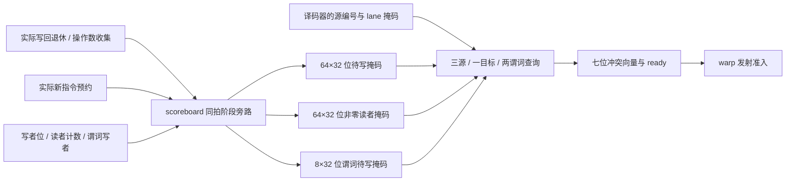

# 并行指令依赖查询电路

启用 `--timing --scoreboard-rtl` 后，一条指令的依赖不再通过 C++ 循环逐个查询并合并。每个物理 warp 的 scoreboard 直接连接 `dependency_query.sv`，一次组合求值同时判断三个普通源、一个普通目标和两个谓词端口。真实发射使用电路的 `ready` 输出。

这套端口数量、逐 lane 预约和旁路拓扑是项目设计，不是 NVIDIA scoreboard 的精确逆向。译码、调度、寄存器数据可分别选择各自 RTL；最完整的当前路径使用 `--register-rtl --collector-rtl --scoreboard-rtl`。实例间引脚路由、指令映像、CTA 资源分配和部分后台执行仍有 C++，没有形成完整 RTL GPU。

## 状态怎样接到查询端口



`scoreboard_cell.sv` 在原有退休→收集→新读者→新写者阶段计算之后，输出该寄存器的 `pending_writers` 和 `pending_readers`。后者是每 lane 的六位计数是否非零的组合结果，不增加另一份读者存储。父模块将 63 个寄存器的结果按固定连线打包，并将 R63 的两种掩码接零；谓词来自同拍事件之后的 `next_predicates`。

查询模块通过固定宽度多路器选择状态，然后按各自 lane mask 归约。共有三个独立普通源选择器、一个目标的写者/读者选择器和两个谓词选择器。每个源都有自己的 32 位 mask，不能把它们全部替换成当前执行线程的一个掩码。两个谓词端口分别用于写目标与 VOTE 源，guard 的就绪检查继续使用原独立查询接口，并先于操作数检查。

| blocked 位 | 端口与含义 |
|---|---|
| 0–2 | 对应源的请求 lane 尚有写者，即 RAW |
| 3 | 普通目标的写入 lane 尚有写者，即 WAW |
| 4 | 普通目标的写入 lane 尚有未收集读者，即 WAR |
| 5 | 谓词写目标的请求 lane 尚有写者 |
| 6 | 谓词源的请求 lane 尚有写者 |

`ready = !(|blocked)` 由 RTL 产生。多个冲突可以同时存在，不因先发现 RAW 就停止检查 WAW/WAR/谓词。R63 和 P7 的恒定语义在电路内实现；空 mask 不读取任何 lane，未使用的源以 R63/零 mask 接入。

原单寄存器查询接口保留，用于 guard、独立检查和兼容路径。它现在同样读取旁路后的掩码；改变该接口的地址/掩码不会改变并行指令端口。端口是组合电路，查询不会更新状态或产生隐藏时钟。

## 同拍释放与重新预约

一条旧指令写回时，实际 `retire_write` 事件先释放写者；尚未提交时钟也可在旁路中观察到释放。同拍的 `collect_read` 同样能清除最后一个读者，因此下一条指令可以在这一拍准入。若其自身读改写相同寄存器，新读者和新写者都在后续预约阶段进入旁路，不能错误地再报告可写。

阶段顺序和 16 个有限更新端口保持原契约。错误释放先在原状态电路中拒绝并撤回，不会通过查询端口“提前”释放某些 lane。适配器只把固定字段写入输入引脚、读取结果；没有宿主写者表、读者非零表或短路式依赖归约。

主机仍负责从译码的 `Footprint` 路由最多三个源和各目标字段，检查参数能否表示为有限端口，并选择当前 warp 实例。这里没有将跨 warp 选择多路器或整条发射通路伪称为一个已经综合的顶层。只启用 scoreboard RTL 时，指令字段仍可由原 C++ 译码提供；同时启用 collector RTL 时，字段来自原始机器码译码电路。

SHFL 的源掩码仍遵守译码器的保守依赖定义，但实际执行必须满足项目 ISA 的成员掩码规则：非空执行时，所有成员都须参与这一动态指令。并行依赖端口不放宽这个规则。合法的跨 lane 测试等待上半 warp 的加载，然后全 warp 从 lane 16 取数；guard 排除部分指定成员的版本仍以 `membermask_not_subset` 拒绝。

## 报告与物理规模

`hardware.scoreboards[]` 新增 `issue_source_ports=3`、`issue_predicate_ports=2`、`dependency_queries`、`dependency_blocked` 及 RAW/WAW/WAR/predicate 四类冲突查询数。它们是宿主对实际查询端口的观测，不是新增硬件计数寄存器。类别可重叠，不能相加得到被阻塞次数；guard 尚未就绪的候选不进入这组查询。

collector RTL 后端每分区每拍最多检查一个候选，所有 scoreboard 的 dependency_queries 总和等于译码器 operands 总和。查询中发现冲突的次数不必等于调度器 dependency_stalls：同一候选可能先被边界或访存串行化条件拒绝。只读主机查询不会增加任何上述计数。

Yosys 0.40 / ABC 的实际完整综合结果：

| 对象 | 通用单元 | 触发器位 | SRAM |
|---|---:|---:|---:|
| 独立并行查询模块，全部状态为输入 | 11,061 | 0 | 0 |
| 完整 32 lane / 63 普通寄存器 / 8 谓词 scoreboard | 764,130 | 14,368 | 0 |

第二行已包含第一行的查询电路及所有状态、16 端口更新和旧查询接口，不能再次相加。状态容量保持 `63×32×7 + 8×32`。此前同拍门控版为 763,658 个单元；本次既增加并行查询，也将旧接口改为先选择掩码再归约，所以不能用两个模块的独立数字推导真实面积增量。这些是通用逻辑单元，不是 NAND2 门数、工艺面积、频率或整 GPU 规模。

## 验证与复现

独立查询模块三项检查覆盖所有 128 种同时冲突组合、R63/P7、空/不相交 lane，以及 16,000 组随机完整状态图。完整 scoreboard 五项检查保留原有 6,400 个阶段事件差分，并新增并行端口、旧接口隔离、同拍释放、撤回事件及读改写分类。两模块的 RTL、ASan/UBSan 和实际综合网表均通过。

实际适配器七项检查另通过独立 sanitizer，覆盖固定引脚打包、第三源与最高 lane、全部目标范围、实例隔离、被拒绝事件、旁路和观测计数。五项实际 ISA/主机检查验证 1/2/4/8 分区、尾 warp、多 CTA 复用、WAW、未收集源的 WAR、谓词目标/guard、跨 lane 读取和失败后的独立 stream Graph 重放。

```sh
cmake -S . -B build-cache-rtl
cmake --build build-cache-rtl -j4
ctest --test-dir build-cache-rtl --output-on-failure
python3 tools/rtl.py --build build-release --module dependency_query --out artifacts/rtl-dependencies-final
python3 tools/rtl.py --build build-release --module dependency_query --synth --out artifacts/rtl-dependencies-final
python3 tools/rtl.py --build build-release --module dependency_query --gate-sim --out artifacts/rtl-dependencies-final
python3 tools/rtl.py --build build-release --module warp_scoreboard --out artifacts/rtl-dependencies-final
python3 tools/rtl.py --build build-release --module warp_scoreboard --synth --out artifacts/rtl-dependencies-final
python3 tools/rtl.py --build build-release --module warp_scoreboard --gate-sim --out artifacts/rtl-dependencies-final
python3 artifacts/rtl-dependencies-final/build_adapter.py
```

独立 sanitizer 分别使用 `--build build-sanitize --module dependency_query` 和 `--module warp_scoreboard`，输出到 `artifacts/rtl-dependencies-sanitize`。所用参考库须先构建；不将局部 sanitizer 冒充完整联合 sanitizer。完整回归、主机负载、NVML、失败记录及源码/网表映射见 [验证记录](VALIDATION.md)，剩余目标见 [硬件计划](HARDWARE_PLAN.md)。
