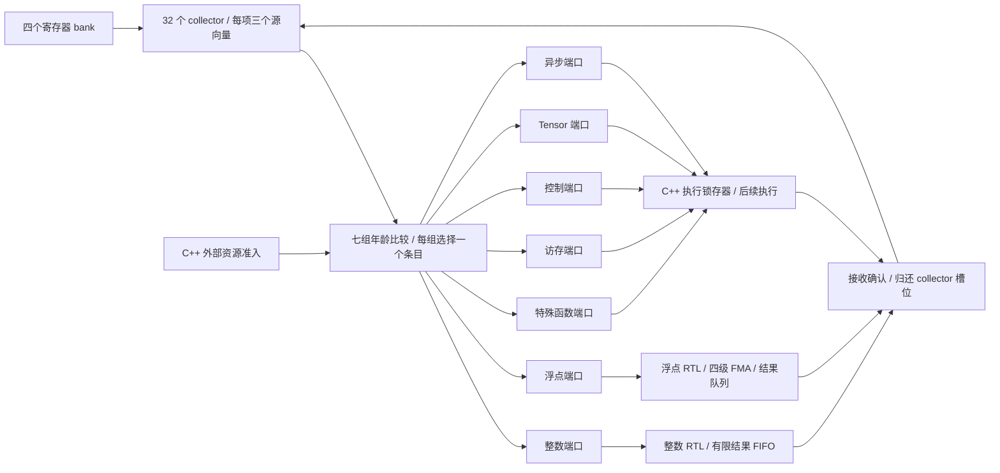

# Collector 到执行单元的七端口 RTL 数据通路

`--timing --register-rtl --collector-rtl` 现在同时启用源读取、数据收集和执行端口分派。没有新增必须手动打开的后端开关。实际执行不再依次设置诊断 `query_entry` 来取源值，而是读取七组独立的 RTL 执行输出总线。

## 数据和选择如何连接

每个条目新增一个 3 位流水线编号：0 整数、1 浮点、2 特殊函数、3 访存、4 控制、5 Tensor、6 异步。编号 7 是非法描述符，会连同整个分配请求被拒绝。完整 32 条目配置增加 96 位元数据，原来的相对年龄、源等待位和向量存储继续由同一个 collector 电路持有。

`collector_dispatch.sv` 为每个端口选择 `ready && eligible` 且 rank 最小的条目。它不按物理槽编号选最老条目，也不依赖宿主先排列候选。不同流水线可同拍各选择一条；同一流水线最多一条。零普通源的指令也必须占用对应执行端口。

七条数据总线各包含三个 1,024 位 warp 向量，合计 21,504 位；另有七个 2 位源数量、七个 18 位源寄存器编号组和七个条目编号。数据来自 collector 存储和最后一个源的 bank 旁路，保留逐 lane 掩码。旧诊断查询口仍存在，但实际 ISA 执行的适配器不读取它。

整数和浮点端现在分别直连 [整数执行 RTL](RTL_INTEGER.md) 与 [浮点执行 RTL](RTL_FLOATING.md)，接收确认也由相应电路产生，宿主不复制这两个端口的源向量。其余五端口继续使用 C++ 执行锁存器；本页原阶段综合和测试数据保留其当时范围。

每个条目实例化相同的 `collector_payload.sv` 子模块；每个源保存为 32 个独立的 32 位 lane 寄存器，读授权控制其捕获使能。条目内部只做一次 bank 旁路选择、源数量判断和 lane 掩码处理，再将三组准备好的向量路由到所选端口。四个 bank 使用明确的四选一连接，不将固定 bank 选择表示成任意位偏移的宽总线截取。

分配仍每拍最多一条，默认 collector 额度为 4。七端口允许不同流水线的积压指令同拍离开，并不意味着持续每拍执行七条；寄存器四个读端口和实际执行单元的准入也继续限制吞吐。

## 候选与确认协议

所有控制输入在时钟低电平阶段设置。每个端口输出当拍候选及其数据，执行层可确认该端口；七个端口可同时确认。确认只产生对应条目的释放位，下一上升沿提交释放，并允许同拍将归还额度用于一条新分配。确认不改变边沿前的候选身份，不能在同一拍连续确认同一端口来消费第二条指令。

端口未被确认时不释放 collector，不丢失操作数、不占用无界宿主队列。候选是每拍重新仲裁的结果，外部准入变化或更老条目收齐源时，下一拍的候选可以改变；这里没有承诺 AXI 那样在反压期间固定同一笔输出事务。保留的是条目及其数据，确认只作用于当前拍选中的条目。

适配器强制“写回 → 收集 → 设置分派准入 → 确认 → 分配 → 时钟”的顺序，拒绝重复分派、未选择条目的取值、重复确认及分配后再确认。每拍末只推进一次现有寄存器/collector 公共时钟；组合选择和数据查询不增加隐藏时钟。仅设置候选不打开状态时钟门，实际接收确认才需要更新状态。

## 哪些控制仍在 C++

C++ 提供外部资源准入，而不是提供获胜条目：例如 CP_ASYNC 的拷贝队列已满时，它不能挡住另一条可用的异步控制请求。后续 [执行仲裁 RTL](RTL_EXECUTION_ARBITER.md) 已用 32 位计数器管理 INT/FP/SFU 发射间隔，并通过两个轮转器选择 Tensor/异步共享候选。Tensor 持有状态保存在该电路，异步控制忙信号和 DMA 完成优先服务次序仍由 C++ 提供。未获得授权的候选不确认。

执行接收后，C++ 锁存器读取该物理端口的源向量，随后启动计算或访存。本页原阶段没有覆盖全部执行锁存器或完整执行单元；后续跨分区候选仲裁与写回排序已有独立 RTL，但整个 SM 的执行和控制链仍未全部电路化。新的电路补齐了 collector 到七类执行端口的数据选择和带宽约束；完整 SM 还需继续连接后续状态和流水线。

从寄存器最后源旁路，经就绪判断、年龄选择和向量多路选择，到执行端口，是实际组合路径。没有额外插入流水级，也没有布局布线和时序回标，不能从模型周期相同推出该路径能够达到某个频率。

## 验证与成本

新增三项独立选择器检查：七端口/禁用、年龄与逐条目准入、5,000 组随机排列。完整 collector 原有五项检查保留，新增七端口数据/确认和 1,500 拍独立分派生命周期对照。参考按软件绝对年龄找最老请求，不复用 RTL 相对 rank 算法。寄存器直连测试另增加最高端口的同拍写回旁路和跨流水线槽复用。

C++ 适配器新增同时确认七个端口、每端口三个源向量的检查，覆盖所有 lane 掩码及跨 32 位边界的寄存器编号字段。原 96 项指令和 34 项主机/Graph 契约继续复用，包括异步队列反压、最大矩阵、错误与重新启动。

当前选择器完整 32 条目综合为 8,835 个 generic cells，全部为组合逻辑；不包含源数据多路选择器或 collector 存储。综合后的选择器网表通过相同三项检查。含数据总线的 collector 成本和综合结果另见 [VALIDATION.md](VALIDATION.md)，不能把单独选择器的成本当成完整数据通路成本。

4 条目完整 collector（包含七个执行端口、诊断端口和数据存储）当前综合为 279,821 个 generic cells、12,816 个触发器位。最初各端口重复读取/准备源向量的版本为 851,890 个 cells；共享条目内准备逻辑的中间版本为 354,937。最终子模块结构与直接选择降低约 67.2%，容量、端口和掩码语义不变。这是实际通用单元统计，不是等效 NAND2 门数、完整 SM 面积或工艺频率。

完整 32 条目 collector 和 8 个 warp 槽寄存器直连顶层均完成保留存储综合；当前完整 collector 的门级行为验证使用 4 条目配置，完整 32 条目执行选择器另有门级验证，不将这些结果写成完整 32 条目数据通路的门级验证。

主机四类负载各两次 Graph 重放通过。去除新增的 `dispatch_ports/dispatches/dispatch_waits` 观测字段后，八份完整 kernel 状态、逐拍 trace、模型周期和其他统计与前一阶段全量相等。所有指令的分配、执行端口确认和最终释放数量一致，没有靠丢弃指令维持周期相等。

后续 [写回 RTL](RTL_WRITEBACK.md) 已将执行结果的有限存储、写回仲裁与 RF 连接接入同一后端。本页记录执行端口阶段的历史测试与成本；当前组合顶层还包含写回电路，综合与时序变化见后续验证。

复现命令与测试范围见 [验证记录](VALIDATION.md)。这是本项目设计，不是 NVIDIA 执行端口数量或仲裁策略的逆向结论；完整目标继续按 [硬件计划](HARDWARE_PLAN.md) 推进。
