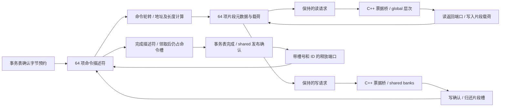

# DMA 命令、片段存储与完成确认电路

`--timing --register-rtl --collector-rtl` 现在为每个 SM 实例化完整 64 命令槽、64 片段槽的 DMA RTL。命令游标、分片、地址与掩码生成、读写请求选择、返回载荷存储和完成资格均由电路提供。它与 [事务表 RTL](RTL_TRANSACTION_TABLE.md) 配合执行自定义 CP_ASYNC；默认 C++ 后端保留。

这些端口、容量和仲裁方式是项目设计，没有据此宣称复刻 NVIDIA copy engine、TMA 或 PCIe DMA。电路通过 Verilator 在 CPU 上仿真；没有生成整 GPU 的 FPGA bitstream，模型周期不代表实卡性能。

## 哪些状态真正存在于电路里

| 存储 | 每项字段 | 位数 |
|---|---|---:|
| 命令描述符，64 项 | valid/claimed 各 1；ID 64；CTA/source/destination/barrier/phase 各 32；总长/游标各 13；未完成片段数 7 | 64×259 = 16,576 |
| 片段，64 项 | 状态 3；命令槽编号 6；source/destination 各 33；字节数 8；字访问标志 1；返回数据 1,024 | 64×1,108 = 70,912 |
| 全局控制 | 四个 6 位轮转游标、三个有效位、三个 6 位保持槽号、两个 7 位占用计数 | 59 |
| 合计 | 载荷部分为 65,536 位，即 8 KiB | **87,547 位** |

这些存储实现为带写使能的触发器，包含 64 选 1 的载荷读取网络；没有把它们称为 SRAM。片段的 1,024 位载荷仅在读返回握手时写入，复位只清元数据及有效状态，不要求清空无效载荷。描述符没有保存整条命令的源数据副本。

完整 64/64 配置实际综合为 **400,338 个 generic cells，其中 87,547 个触发器位**。其中 65,536 个无复位数据触发器与 22,011 个带同步复位的元数据/控制触发器，和上述位数一致。这个数包含组合选择、比较和地址逻辑；不是等效 NAND2 数、工艺面积或整 GPU 门数，也没有布局布线、频率或功耗结论。



## 准入、分片和有限端口

物理容量固定为 64/64；`--async-depth` 和 `--async-fragments` 分别限制可使用的前缀槽位，范围均为 1～64，默认 8 和 4。`--async-chunk` 为 1～128 B，默认 128 B。这些配置在实例创建时确定，不能带在途命令动态重配。

每拍最多接受一条 1～4096 B 命令。所有 live 描述符参与 ID 重复检查，领取完成后仍算 live。空槽采用最低编号，分片、读请求、写请求和完成选择分别使用独立轮转游标。一个长拷贝不能无限占住分片准入。

每拍最多分配一个片段。地址由 32 位基址加 13 位游标得到，保留 33 位进位；不会在 `0xffffffff` 处静默绕回。真实执行的全局/shared 地址范围由既有存储检查验证，电路独立测试另验证跨 32 位边界的地址生成。

源、目标同时 4 B 对齐，剩余长度和 chunk 都至少 4 B 时使用 4 B lane；字节数向下取整到 4 B。否则使用 1 B lane，每片段最多 32 B。每个请求最多 32 个 lane，提供真实地址、掩码和宽度。尾部不会越过描述符长度；写数据来自片段寄存器。

读、写、完成各只有一个保持寄存器。选中后即使其他候选变为就绪，也保持原槽位和全部有效输出，直到消费者握手。当前控制器在握手后留一个重新选择周期，所以每个请求端口的持续接受上限是 **每两拍一次**，不是每拍一个，也不是保证的每拍 128 B。

每拍最多接收一个读返回和一个写确认；二者可以同时发生。分片分配与旧片段写确认也可同拍发生，未完成数和占用数执行增减合并。被释放槽在下一拍才参与空槽选择，没有同拍回收旁路。

## 载荷与命令的不同生命周期

片段状态依次为 `FREE → READ_OFFER → READ_INFLIGHT → WRITE_OFFER → WRITE_INFLIGHT → FREE`：

1. 分配时写入命令槽编号、两个完整地址、长度和宽度。
2. 读握手后等返回。多个片段可以乱序返回，每个响应以槽编号定位，数据进入对应的载荷寄存器。
3. 写握手只表示 shared 服务接受请求；片段仍保留载荷和归属。
4. shared 写确认后归还片段槽，并扣减所属命令的未完成片段数。

只有游标达到命令总长度且未完成片段数归零，命令才能进入完成选择。完成描述符携带原始 ID、CTA、barrier、phase 和总字节数，事务表使用这个输出更新计数。

领取完成只设置 `claimed`，不归还命令额度。事务表经过 shared 记录发布确认，再返回最终结果后，宿主适配层将原始槽号/ID送入释放端口。只有匹配的 live 且 claimed 命令才会释放。队列满时仍优先处理完成事务，使完成路径能够归还额度。

非法长度、重复 ID、错误阶段的返回、未领取或 ID 不匹配的释放均拒绝。返回接口采用槽编号，没有跨复位 generation 字段；复位必须取消对应外部请求，不能把上一实例的迟到响应交给新实例。kernel 失败会停止私有 DMA，既有设备恢复流程排空已接受的持久内存请求，下一 kernel 创建全新实例。

## C++ 适配层还负责什么

`src/rtl/dma_engine.cpp` 只驱动引脚、解包 33 位地址、采样事件和推进时钟，不执行分片选择或搬运结果计算。构造时有初始化复位边沿，kernel 的计数从零开始；`submit/request/accept/returned_*/claim/release` 本身不推进时钟。每次 `tick()` 最多产生一个有效边沿，空闲实例可以门控；观察统计不会推进状态。

`src/timing/async_dma_rtl.cpp` 仍保存每个物理片段的外部读/写 ticket，并在每条返回总线上按轮转顺序选择最多一个已完成响应。shared 的实际存储与 bank 服务现由 [shared RTL](RTL_SHARED.md) 提供；**外部返回选择、global 访存合并及实例间连线仍是 C++**，不能把本阶段写成完整内存互联 RTL。

`sm.copies` 在 RTL 模式仅保留指令来源和范围元数据，用于 trace、错误归属、CTA 生存期以及 mbarrier 区域保护；不会填充 C++ 片段、推进软件游标或用其判断 DMA 完成资格。发射准入读取 DMA 的硬件 ready，后台存活判断读取硬件命令占用。每个片段的数据和进度只在 RTL 中持有。

报告 `hardware.async[].dma_backend` 为实际 `rtl/cpp`；`dma_engine` 给出物理容量、当前占用、输入/有效时钟、分配/请求/返回/领取/释放次数、确认字节数和反压周期。上层 `read_bytes/write_bytes/fragments/peak_commands` 在 RTL 模式取这些硬件事件。失败报告可以保留尚未完成的占用，不能用成功 kernel 的“最后必须归零”规则检查失败快照。

## 验证与复现

```sh
cmake --build build-cache-rtl -j4
ctest --test-dir build-cache-rtl --output-on-failure
python3 tools/rtl.py --build build-release --module dma_engine --out artifacts/rtl-dma-final
python3 tools/rtl.py --module dma_engine --synth --out artifacts/rtl-dma-final
python3 tools/rtl.py --build build-release --module dma_engine --gate-sim --out artifacts/rtl-dma-final
python3 tools/rtl.py --build build-sanitize --module dma_engine --out artifacts/rtl-dma-sanitize
python3 artifacts/rtl-dma-final/build_adapter.py
```

独立电路六项检查使用逐字节参考，不复写 RTL 的分片调度算法：全 64 槽及最高槽、请求/完成反压、逆序返回、尾部及最大长度、chunk 1/3/7/32/127/128、33 位进位、拒绝输入、在途复位、360 条随机并发描述符和长命令公平性。适配器四项检查验证原始数据、显式时钟、快照隔离、完整容量、事件统计及错误后恢复。

原事务执行套件扩展为 30 项，在既有 25 项异步/DMA 契约及三个事务用例之外，加入实际访存占满 64 片段、活查询不推进 DMA、在途 DMA 失败后恢复。正常结果检查硬件读/写/返回数相等、命令释放数和确认字节数一致，并要求全部占用归零。没有用单元检查替代主机图和内存链路验证。

四类完整主机负载各运行两次 Graph，另两次监控 Transformer；Tensor、cache、scoreboard、register、collector 同时启用。Transformer 每次由 DMA RTL 实际分配 17 个片段，读写确认各 2176 B；两次 kernel 为 5735/5741 模型周期，上一事务表阶段为 5730/5738。输出字节逐份比较，周期和 trace 不要求与软件 DMA 相同。监控仍是 [NVML 管理面](NVIDIA_SMI.md)，没有增加 CUDA/PCIe 兼容。

最终检查、网表仿真及失败记录见 [VALIDATION.md](VALIDATION.md)，源码/网表/二进制审计位于 `artifacts/rtl-dma-final/evidence-audit.json`。取指/译码和 [异步服务仲裁](RTL_ASYNC_SERVICE.md) 后续已有 RTL；外部返回路由、SFU、剩余访存电路、整机 RTL、实卡参数辨识和 PTX 异步矩阵协议仍按 [完整计划](HARDWARE_PLAN.md) 推进。

网表仿真使用原始 `gates.v`，工具从其端口元数据生成只含直接连线的 `dma_gate_wrapper.sv`。这样地址总线成为子模块内部信号，可用 Verilator 的 `split_var` 分析不同输出位之间的依赖；没有改变逻辑、增加时钟或关闭 UNOPT/UNOPTFLAT 告警。网表与包装文件的哈希均保存在验收审计中。
