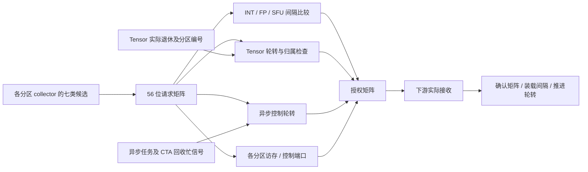

# 跨分区执行仲裁与发射间隔电路

`--timing --register-rtl --collector-rtl` 现在为每个 SM 实例化一个 `execution_arbiter`。各分区 collector 的七类候选送入同一仲裁器，Tensor 与异步控制候选由 RTL 轮转选择；整数、浮点与 SFU 的发射间隔也由 RTL 计数。Tensor 命令从执行接收到实际退休期间的单元归属保存在电路中，后端不再用 C++ `tensor_owner` 或 `partition.available` 判断这些准入条件。

这是本项目设计的研究结构，不是 NVIDIA 逆向证明的共享单元数量、轮转策略或间隔电路。异步任务处理、DMA 完成优先服务、CTA 表回收次序以及部分执行/访存通路仍有 C++；本阶段没有形成完整 RTL SM。

## 物理状态与端口

| 状态 | 物理容量 | 位数 |
|---|---|---:|
| 整数、浮点、SFU 冷却计数 | 8 分区 × 3 流水线 × 32 位 | 768 |
| Tensor busy 与拥有者分区 | 1 位 + 3 位 | 4 |
| Tensor 与异步控制的轮转起点 | 2 × 3 位 | 6 |
| 合计 | 同步复位及写使能触发器 | **778** |

物理几何固定为八个分区、每分区七个候选端口；实际 SM 使用 1/2/4/8 分区，额度外请求会被拒绝。候选矩阵按 `pipe×8+partition` 编码，流水线顺序为整数、浮点、SFU、访存、控制、Tensor、异步。56 位请求、授权与确认是独立的总线；单个端口代表该 collector 已选择的一条指令，不是无界请求队列。

完整实例实际综合为 **6,360 generic cells / 778 FF 位**，没有 SRAM。这里不包含 collector、源向量数据、Tensor 算术阵列、SFU 或异步控制器，不能将它称为整个 SM 的门数或面积。未做工艺映射、布局布线和时序回标。



## 候选、授权与实际接收

先由每个 collector 的年龄电路选择各端口最老的合格条目，再将这些原始候选组成请求矩阵。C++ 仍读取条目对应的 ISA 类型并路由实例间信号，但不比较分区优先级。遍历 `inflight_` 的先后顺序无法改变已经产生的共享端口获胜分区。

整数、浮点、SFU 每分区独立；访存和控制同样保持每分区一个执行端口。Tensor 每 SM 每拍至多授权一个分区，并要求前一拥有者已释放。非空异步指令每 SM 每拍至多授权一个分区，并要求外部异步控制路径空闲。Tensor 与异步控制使用独立轮转游标，两者可以在同拍接受来自不同分区的请求。

只有下游实际接收后才确认：整数/浮点/集合单元使用其 RTL 握手，其余执行路径在成功接收源数据和启动后确认。没有确认的授权不推进游标、不装载间隔、不释放 collector；本拍也不会重新选择另一分区。候选数据仍由原 collector 保留，下一拍可以按新的请求集合重新仲裁。

轮转只在接受时前移，在八个分区都持续请求且下游持续可接收的条件下，每八次实际共享接收都给每个物理分区一次机会。外部就绪不足不提供有限等待时间保证。本项目没有实现或声称 NVIDIA 的 GTO、两级调度或其他实卡调度策略。

## Tensor 的持有与同拍交接

电路保存 `busy` 和拥有者分区，从包括 TMEM 操作在内的 Tensor 命令接收后一直保持到该指令退休。结果完成但被写回带宽阻塞时，不提前释放共享单元。释放输入携带原分区号；无拥有者或分区不匹配使整批事件失败。

退休阶段先设置释放引脚，组合旁路随即使单元可用，因此本拍执行阶段能够授权下一条 Tensor 指令。末尾边沿同时提交旧拥有者释放与新拥有者接收。RTL 后端不维护软件 Tensor 归属副本；指令身份和数据搬运上下文仍由既有 `Inflight` 对象保存。

## 发射间隔与时钟

接受一条间隔为 N 的整数/浮点/SFU 指令时，末尾边沿装载 `N−1`。之后每个模型拍减一，到零才允许该分区的同类端口再次接收。因而在周期 C 接收后，最早下一次接收是 C+N；这与指令完成延迟不同。间隔 1 允许连续拍接收。

三个配置值均为非零 32 位无符号数。CLI 的 `--int-interval`、`--fp-interval` 与既有 `--sfu-interval` 可分别调整；默认值仍是 1/1/4。独立电路检查覆盖最大 32 位间隔及最高分区，实际 kernel 另验证 3/5/7 间隔和 1/2/4/8 分区。配置和模型周期不代表真实 GPU 的吞吐或延迟。

构造复位后，输入时钟从 kernel 零点计数。观察不产生边沿；每个 SM 每模型拍调用一次 tick。存在非零间隔、实际接收或释放事件时才开启状态时钟，纯观察、空闲与仅被拒绝的请求可以保持门控。硬件仍执行真实倒计数，没有把时间戳差值当作电路状态。

## 异步空操作与仍有软件的部分

参与掩码为零的异步指令不访问事务表、不申请 DMA 命令，也不占异步共享控制资源。它仍经过所属 collector 的一个物理执行端口并正常退休，但可以与其他分区的非空异步请求同拍接收。`async_noop` 只允许标记确实存在的请求，不会推进异步共享游标。

非空 CP_ASYNC 的 DMA 容量约束在 collector 的逐条目 eligible 输入体现：已满的拷贝请求不挡住同分区其他可完成的异步控制指令。`command_stalls` 现在统计实际 collector 已就绪但被 DMA 容量阻塞的条目；不依赖是否调用旧 C++ 发射函数。`barrier_stalls` 在此后端汇总仲裁器实际共享忙事件。

异步 `busy` 输入来自正在执行的控制任务或 CTA 事务回收，仍由 C++ 编排；DMA 返回后的完成发布仍先于新指令获取控制服务，避免满队列无法归还额度。这些后台服务之间的选择、同址等待分组、shared 访问和返回路由尚未全部落实为电路。只把分区间新指令的候选选择和轮转称为本阶段新增 RTL。

## 原子拒绝、报告与验证

非法额度、零间隔、额度外请求、孤立空操作位、错误 Tensor 释放以及未授权确认都由 RTL 拒绝；错误批次不提交已有计数、归属或游标变化。适配器允许先提交实际退休事件，再进行一次仲裁，随后只能确认已有授权；禁止再次仲裁、仲裁后释放或重复确认，防止先前授权被输入变化撤销。

`hardware.execution_arbiters[]` 输出每 SM 的物理几何、运行额度、778 位存储说明、24 个计数、Tensor 归属、两个游标、时钟，以及按七种流水线排列的请求/授权/接收/间隔停顿/共享忙/竞争失败/下游拒绝计数。请求等于授权加三类准入拒绝，授权等于接收加下游拒绝。接收总数必须等于实际 `execute` trace，成功 kernel 的 Tensor 接收数必须等于释放数。

`unit_stalls` 在 RTL 后端汇总实际候选事件，未被 collector 选中的条目继续由 collector 等待统计反映。调度顺序和停顿口径可以变化，验证要求数值与资源协议正确，不要求旧 trace 或所有模型周期保持不变。

```sh
cmake --build build-cache-rtl -j4
ctest --test-dir build-cache-rtl --output-on-failure
python3 tools/rtl.py --build build-release --module execution_arbiter --out artifacts/rtl-execution-final
python3 tools/rtl.py --module execution_arbiter --synth --out artifacts/rtl-execution-final
python3 tools/rtl.py --build build-release --module execution_arbiter --gate-sim --out artifacts/rtl-execution-final
python3 tools/rtl.py --build build-sanitize --module execution_arbiter --out artifacts/rtl-execution-sanitize
python3 artifacts/rtl-execution-final/build_adapter.py
```

五项独立电路检查通过 RTL、ASan/UBSan 与实际综合网表；随机参考使用绝对截止时间和独立优先队列，不复用硬件倒计数和游标扫描。实际适配器四项另通过 sanitizer。五项执行/主机检查覆盖每分区间隔、八分区 Tensor 互斥、单命令 DMA 池争用、异步空操作以及持有 Tensor 时的观察与错误恢复。

完整回归、Graph/NVML、失败修复和源码/网表/二进制证据见 [验证记录](VALIDATION.md)。没有将局部 sanitizer、独立综合网表或管理接口可见性作为完整 RTL GPU 已完成的证明；剩余目标仍见 [硬件计划](HARDWARE_PLAN.md)。
