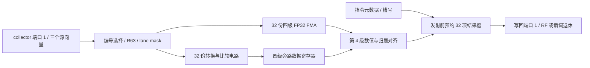

# 普通浮点执行：四级算术、转换比较与有限完成队列

启用 `--timing --register-rtl --collector-rtl` 后，普通浮点流水线的全部六种自定义指令由 RTL 执行：FADD、FMUL、FFMA、FSETP、I2F、F2I。整数与浮点分别使用 collector 的物理端口 0、1，各自直接连接写回端口 0、1；宿主只提供指令元数据，不提供浮点源向量或预计算结果。

这是本项目的研究电路，不是 NVIDIA FP32 单元的精确逆向。SFU 的 FEXP2、FRCP、FRSQRT 仍用原来的 C++ 实现；Tensor 有自己的阵列，普通浮点和 Tensor 不共享同一个 FMA 实例。



## 算术实际经过哪些电路

每个 lane 实例化 `fp32_scalar_lane.sv` 和已有的 `fp32_fma.sv`。FMA 的四级分别保存乘法/解码结果、对齐后的乘积与加数、带符号加减结果、规格化及舍入后的 binary32，详情见 [Tensor 数值电路](RTL_TENSOR.md)。普通浮点模式保持相同的最近偶数舍入、次正规数、规范化 NaN 和带符号零约定。

| 指令 | 电路输入与结果 |
|---|---|
| FADD | FMA 计算 `a × 1.0 + b`，只有最后一次舍入 |
| FMUL | FMA 计算 `a × b + 同乘积符号的零`，保留负零与负下溢的符号 |
| FFMA | FMA 直接计算 `a × b + c`，不先舍入乘积 |
| FSETP | 位分类与比较：NaN 无序，正负零相等；支持 eq/ne/lt/le |
| I2F | 有符号幅值、前导位、移位、guard/sticky 和最近偶数进位；包含 `INT_MIN` |
| F2I | 指数字段检查、有效数移位和符号恢复，向零截断；NaN/Inf/越界拒绝整条指令 |

转换与比较在组合电路中产生结果，再经过四级旁路数据寄存器与算术结果对齐。**这不表示转换算法被拆成四个计算阶段。** 它们的旁路有效位、运算类型和参与位与真正的四级 FMA 同步推进；返回时检查所有 lane 的 valid 与中央归属流水线一致。

F2I 对指数域 158 只接受精确的负 `2^31`；正 `2^31`、更小的负数和非有限值报 `float_to_integer_out_of_range`。掩码外 lane 不进行此检查。非法浮点比较 mode 同样只在活动 lane 上报错，遵守现有 ISA。

FMA 数据寄存器现在只在所属级的 valid 为真时写入，空泡仍推进有效位。此前数据级即使在空泡时也计算并写入；这次补上实际写使能。Tensor 引用相同模块，因此同时复跑 FMA、PE、完整阵列及主机 Graph 的数值、反压和门级检查。没有据此报告真实芯片功耗收益。

## 归属、存储与反压

`floating_execute.sv` 在接受指令前预约一项结果槽；物理四级流水线始终有保存结果的目的地。每项保存 occupied/finished、5 位写回槽号、32 位延迟计数和 1024 位结果。四级中央归属寄存器携带结果槽索引与谓词类型，slot 在完整退休前不能复用。

完整配置有 32 个槽，包括还在四级算术流水线中的运算；不能“32 个结果加额外无限在途”。队列满会拉低 input-ready，只有同时出队时可接受替换。按发射顺序读取队首，完成端反压不会丢失或覆盖结果；内部 FMA 可继续推进，因为所有已接受操作已有专属槽。

第四级结果可直接旁路到队首输出。如果仍需等待延迟或下游端口，下一拍写入对应结果存储；随后由 stored/finished 状态驱动输出。C++ 的完成查询来自写回模块真实完成位与到达旁路，不使用 `entry.due`。写回退休总线直接写 RF，宿主架构副本只作观测。

## 时钟与配置

接收发生在周期 C 的末尾边沿时，最早在 C+4 的退休阶段可见结果。默认 `--fp-latency 6` 保留已有模型行为，额外两拍由结果槽中的硬件倒计数实现；100 拍等较大配置同理。四级算术本身没有变成六级或一百级。

启用 collector RTL 时，`--fp-latency 1..3` 明确报 `floating_rtl_requires_latency_at_least_4`，即使该 kernel 没有浮点指令也先验证配置。纯 C++ 后端保留原来的可调延迟，不用软件结果绕过物理流水级。

发射间隔、warp 调度、指令解码和谓词输入快照仍由 C++ 控制。`hardware.floating_units` 按 SM/分区报告后端、四级结构、32 项容量、占用、时钟、有效更新周期以及真实 accepted/completed 事件。寄存器复合模块整体仍在 CPU 的 Verilator 模型上运行，这些周期不是 RTX 4070 SUPER 的性能预测。

## 验证与综合

独立电路五项检查包括：特殊浮点组合与 fused cancellation、随机有符号整数及舍入边界、F2I 边界与非法输入无部分提交、容量/同拍复用/保持/在途复位、6,000 拍混合格式随机流与独立到期时钟参考。同一套驱动用于普通 RTL、sanitizer 和实际综合网表；两项小队列另验证首尾回绕与在途容量。

连接检查要求最后源读取同拍进入 FMA，并在四级算术及额外延迟后由物理 RF 保存结果。C++ 适配器覆盖 1/2/4/8 分区几何、masked fused cancellation、禁止宿主覆盖浮点完成端口以及后续读取。实际 ISA 新套件验证 4/6/100 拍、转换、谓词、无效模式、有限完成槽和小于四拍的配置拒绝；既有 collector 全套指令和主机 Graph 继续复跑。

```sh
cmake -S . -B build-cache-rtl -DSIMT_REGISTER_RTL=ON
cmake --build build-cache-rtl -j4
ctest --test-dir build-cache-rtl --output-on-failure -j3
python3 tools/rtl.py --module floating --out artifacts/rtl-floating
python3 tools/rtl.py --synth --module floating --out artifacts/rtl-floating-synth
python3 tools/rtl.py --gate-sim --module floating --out artifacts/rtl-floating-synth
python3 tools/rtl.py --module operand_unit --out artifacts/rtl-floating-connected
```

完整 32 槽浮点模块的 Yosys 0.40 / ABC 实际结果为 **588,501 generic cells、53,809 个触发器位**，包括 32 份 FMA、转换比较、流水归属、计时和结果存储。RF/collector/整数/浮点/写回组合顶层另完成保留存储综合：8 warp 槽配置按实例展开为 147 个数组、598,048 个数组位和 167,612 个 FF 位；这不是整个组合顶层的门级验证。

构建范围、失败记录和主机证据见 [验证记录](VALIDATION.md)。Yosys 的 generic cells 不能换称为 NAND2 门数或整 GPU 面积。整机 RTL、SFU/控制/访存执行、真实显卡参数校准和异步矩阵协议仍未完成，整体要求见 [硬件计划](HARDWARE_PLAN.md)。
