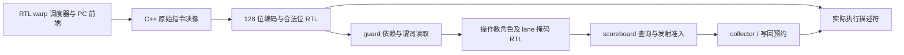

# 原始机器码与操作数译码 RTL

启用 `--timing --register-rtl --collector-rtl` 后，每个 SM 分区使用一个组合译码电路。被调度器选中的 warp 提供 PC，宿主从模块原始映像读取四个 32 位机器字；字段、合法位、流水线类别、寄存器请求和 lane 掩码均由 RTL 产生。实际发射不再读取宿主预解码对象中的执行字段，也不调用 C++ `instruction_footprint()`。

这是自定义 ISA 的 59 个 opcode，不是 NVIDIA SASS/PTX 译码。指令映像存储、PC 越界检查、部分静态跳转目标验证、scoreboard 查询组合与跨实例路由仍有 C++；没有指令缓存、取指延迟模型或完整 SM 顶层。本阶段只完成译码路径。

## 机器字怎样进入电路



`Module::from_bytes()` 同时保存原始机器字 `image` 与功能后端使用的 `code`。RTL 路径直接读取前者；没有将预解码对象重新编码的后备路径。只有 `code` 而缺少匹配长度的 `image` 会明确报错。加载器仍提前拒绝非法编码，因此 CLI 通常在运行之前报告这类错误；直接 C++ 测试修改已加载映像，另行验证电路自身也拒绝未知 opcode 和保留位。

`tools/gen_isa.py` 从规范 `isa/isa.json` 生成 `instruction_encoding.sv`。每个字段按固定位置取线，59 项 case 给出允许的 128 位掩码；未知 opcode 优先报错，其次检查未使用字段与保留位。生成阶段同时产出原有 C++/Python 接口，构建阶段核对依赖；独立 RTL 工具拒绝使用与当前 schema 或模板不一致的旧生成文件。

手写的 `instruction_operands.sv` 定义各 opcode 的源、目标、谓词、执行类别、边界和写内存标志。适配器静态检查所有 59 个 opcode 的编号，避免规范重新编号后仍默默使用旧操作数电路。

## 有界源端口与错误顺序

每条指令至多三个普通源。电路按 ra、rb、rc 顺序压紧请求，相同寄存器合并 lane mask，R63 常量零不占读取端口。SHFL 的值源读取 `participating | imm`，索引源读取 `participating`，写掩码为 `participating & imm`；因此不能只按执行线程裁掉跨 lane 的数据依赖。VOTE 单独输出谓词源，不能误当普通寄存器。

源字段在范围检查之前保持完整八位，不先截断为六位。普通源没有参与 lane 时不产生读取或此阶段的源范围错误；目标寄存器、目标谓词及 VOTE 谓词源按原有结构规则检查。guard 的依赖必须先就绪，再读取谓词和检查操作数，避免在真正参与掩码尚未确定时报告错误。

下游执行仍独立检查模式、地址、令牌、屏障及描述符。例如空执行掩码的 `MOV ra=255` 不产生译码源错误，但整数端仍以 `integer_descriptor` 拒绝其八位非法源。这个边界保持原后端行为，不以译码测试替代执行验证。BSSY/BAR 的编号字段也不会被错误解释为普通寄存器目标。

## 组合时序、报告和综合

译码器没有 clock、reset、FIFO 或持久状态。一次模型拍允许当前分区检查一个候选，输入变化后组合求值得到输出；没有为译码虚构一个流水级。适配器的 `tick()` 只结束本拍接口阶段并累计观测计数，不对电路产生隐藏边沿。真实时序收敛仍需工艺综合和布局验证，组合电路的存在不能证明某个 MHz。

`hardware.instruction_decoders[]` 报告每 SM/分区的后端、128 位输入、三个源端口、零持久存储位，以及 inspected、operands、accepted、sources 和两类错误计数。这些是宿主观测事件，不是额外 RTL 计数器。成功 kernel 要求：

- inspected 等于同分区调度器 probes，且每拍不超过一次。
- operands 等于 inspected 减 guard stalls。
- accepted 等于同分区 issued，所有实例的 accepted 总和等于 kernel issued。
- 零编码/操作数错误，sources 不超过 operands 的三倍。

Yosys 0.40/ABC 实际完整通用门映射为 **1,941 个组合单元、0 个触发器位、0 个运行时存储位**。编码模块 334 个单元，操作数模块 1,607 个单元。中间推断阶段将常量 case 表表示为 64×114 位、零写口 ROM；完整映射已将它化为组合逻辑，不能把这 7,296 个常量位称为可写 SRAM 或状态寄存器。这也不是等价 NAND2 门数或整个 SM 的面积。

## 验证及复现

五项独立电路检查覆盖固定字面量布局、全部 opcode/保留位、197 个未知 opcode、重复源/R63/跨 lane 掩码、范围错误与 70,800 组随机字段/操作数差分。普通 RTL、ASan/UBSan 和实际综合网表均通过。四项适配器检查另通过联合 Release 与独立 sanitizer。

实际执行路径的三项 C++ 检查故意污染 `Module::code`，确认原始映像仍决定结果；修改原始立即数会改变真实存储结果；非法或缺失映像会被拒绝。五项 Python 检查覆盖 1/2/4/8 分区、三个源、最高有效寄存器、尾 warp、多 CTA、控制字段、分歧、只读查询及失败 stream 后在独立 stream 重放 Graph。

```sh
cmake --build build-cache-rtl -j4
ctest --test-dir build-cache-rtl --output-on-failure
python3 tools/rtl.py --build build-release --module instruction_decoder --out artifacts/rtl-decoder-final
python3 tools/rtl.py --build build-release --module instruction_decoder --synth --out artifacts/rtl-decoder-final
python3 tools/rtl.py --build build-release --module instruction_decoder --gate-sim --out artifacts/rtl-decoder-final
python3 tools/rtl.py --build build-sanitize --module instruction_decoder --out artifacts/rtl-decoder-sanitize
python3 artifacts/rtl-decoder-final/build_adapter.py
```

首次独立运行前先构建相应 build 的库与生成目标；综合和网表验证须选同一个 build 的实际生成文件。清单记录 RTL、生成源码、测试驱动与网表哈希。完整回归、Graph/NVML 与失败记录见 [验证记录](VALIDATION.md)，原始证据在 `artifacts/rtl-decoder-final/`。

指令存储/取指、依赖查询直连、异步后台和 CTA 服务次序、SFU/剩余访存、外部返回选择、整机 RTL、实卡参数校准和 PTX 异步矩阵协议仍未完成。不能用本阶段的局部电路与综合网表证明整 GPU 已还原，剩余目标见 [硬件计划](HARDWARE_PLAN.md)。
