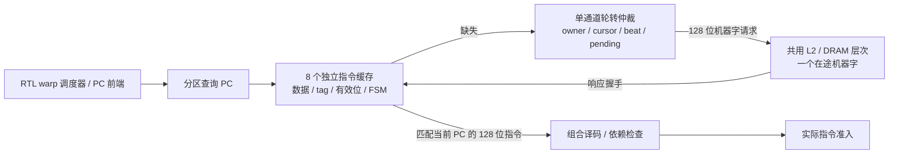

# 指令缓存与取指 RTL

启用 `--timing --register-rtl --collector-rtl` 后，实际发射必须从有限指令缓存取得原始 128 位机器字，再送入组合译码器。命中时不读取宿主映像，缺失时等待电路完成整行补充。每个 SM 实例有八个物理分区缓存，运行时允许启用 1/2/4/8 个分区。

这是项目自定义的研究架构。容量、直接映射方式、端口和轮转策略均是设计选择，没有声称逆向还原 NVIDIA 指令缓存。取指与译码实例之间仍由 C++ 路由引脚；补充请求现已接入 [共享 L2/DRAM](INSTRUCTION_MEMORY_HIERARCHY.md)，其传输连接和 DRAM 仍有 C++，没有形成完整 RTL GPU 顶层。

## 实际存储结构

| 每分区结构 | 容量与端口 | 实现 |
|---|---|---|
| 指令数据 | 256 × 128 位，4 KiB | 同步读取数组，一个读口、一个写口 |
| tag | 64 × 24 位 | 同步读取数组，一个读口、一个写口 |
| 有效位 | 64 位 | 可复位寄存器 |
| 当前查询 | PC、读出的机器字/tag/有效位、响应消费标志 | 寄存器 |
| 控制 | 五状态 FSM、两位补充位置 | 寄存器 |

项目 PC 以 **16 字节指令**为单位。`PC[1:0]` 选择行内四条指令，`PC[7:2]` 选择 64 个直接映射行，`PC[31:8]` 是 tag。不同分区不共享这些数据/tag 数组。全部八个缓存的数据容量是 32 KiB；运行时禁用分区不会缩减本次综合的物理实例。

数据和 tag 不进行整阵列复位，只复位有效位和控制状态。复位后必须完整补充才可命中；最后一个补充字到达时才写 tag 并提交有效位。部分补充、复位前旧数据和末行越界填充不能成为可执行指令。



## 同步查询、补充和反压

五个状态分别是 `IDLE → LOOKUP → REQUEST → FILL → HOLD`；命中时从 LOOKUP 直接到 HOLD。查询提交到时钟边沿后，读出的机器字和 tag 才可用于响应。同一 PC 的已保持结果可以连续使用；换 PC 必须重新同步读取。换 PC 即使发生在缺失补充中，也不能获得旧 PC 的机器字：电路完成原补充后再查询新的候选。

共享补充器每次选择一个分区，完成整行四个 128 位传输后才释放归属并推进轮转游标。外部通道最多一个在途机器字，请求遭反压时保持地址；响应仅路由到当前归属缓存。分区缺失、行内 beat、轮转、请求在途状态都由 RTL 保存，没有软件请求队列替代仲裁。

适配器只从共享存储层次的完成响应取得机器字，不直接读取宿主映像，也不再设置八拍固定延迟。每个补充字绕过数据 L1，经过同一个 L2、DRAM bank/row 与总线；详细传输和只读映射见 [指令存储连接](INSTRUCTION_MEMORY_HIERARCHY.md)。保持同 PC 再取一次多一拍，换到同一缓存行另一条指令多两拍；冷补充时间由实际共享层次状态决定。

补充结束而指令尚未被查询方取走时，缓存仍报告 busy。`response_seen` 防止整机把“已经有结果、但尚未被译码”错误地当成无后台工作的死锁。已消费的保持结果不持续报告忙；候选被放弃后补充继续排空，之后回到 IDLE，不凭空留下等待。

合法范围由 RTL 比较 32 位 PC 与 33 位指令数量，包含最高 PC `0xffffffff`。末行不足四条时，后备模型给越界位置填零，但范围检查仍禁止执行这些位置。分区数量和映像长度在创建适配器时检查；配置在实例生命周期内固定，不支持运行中修改配置或自修改代码。

## 接入、生命周期和统计

调度器选出的候选先查询当前分区缓存。没有指令响应时，本拍不调用译码器，也不提交调度器的接受/拒绝决定。缓存不推进调度游标；后续退休、唤醒等事件仍可能改变下拍候选，因此响应必须与当前查询 PC 相同。

每个 SM 的缓存每模型拍只显式时钟一次。只读 `query()`、报告和计数读取不推进电路。启动持有原始机器字的只读物理映射，所有已接受请求排空后才释放；每次 kernel 创建新的取指实例和物理映射，所以 Graph 更换 kernel 或重放不会错误沿用旧映像。这里与跨 kernel 保留的数据 L1/L2 不同，指令缓存目前不跨 kernel 保留。

`hardware.instruction_fetch[]` 明确报告 `backend=rtl`、`memory_backend=shared_l2_dram`、实际 L2 后端和 `dram_backend=model`、实际物理容量、启用分区数、单补充通道、映射地址和事件计数。计数是宿主对引脚的观测，不是附加的 RTL 性能计数寄存器。成功排空的运行检查：

- 每分区 `queries = delivered + stalls`，`reads = hits + misses`。
- 每分区 `fill_words = 4 × misses`；全部补充字数等于外部请求/响应数。
- `delivered` 等于对应译码器的 `inspected`，未启用分区为零。
- 每个 SM 的 clocks 等于 kernel 模型周期，结束时 busy 为 false。

保持同一 PC 的重复响应不重新读阵列，不能把 delivered 与 hits 等同。中途失败或被终止的运行可能未完成补充，不应用成功排空的守恒式冒充其状态。

## 综合和验证

Yosys 0.40 / ABC 对完整八分区实例的结果为 **564,062 个通用单元、276,530 个触发器位**。中间推断阶段，每个缓存有数据与 tag 两个存储定义，乘以八个实例为 **274,432 个存储位**。最终通用映射将存储展开成触发器和选择逻辑；这不是 SRAM 宏面积、FPGA BRAM 占用、等价 NAND2 门数或整 GPU 门数。也没有布局布线和频率结论。

五项独立检查在 RTL、ASan/UBSan 和实际综合网表上通过，覆盖同步命中、缓存内真实字节、tag 冲突替换、八分区轮转、请求/响应反压、候选变化、部分补充复位、最高 PC、末行、废弃查询排空、400 次随机替换及全部 2,048 个物理字位置。独立存储源与生产适配器不同，能主动暂停握手。

当前五项实际适配器检查分别在模型与 RTL L2 上运行，共十项，并单独经过 ASan/UBSan；另有五项只读映射检查和两项整机失败排空检查。五项 Python 整机/主机检查覆盖循环复用、超容量程序、相冲突的远跳转、1/2/4/8 分区，以及 Graph 将相同 PC 的 kernel 从写 17 改为写 91 再改回 17，核对真实下载数据和实际 DRAM 请求。

```sh
cmake --build build-cache-rtl -j4
ctest --test-dir build-cache-rtl --output-on-failure
python3 tools/rtl.py --build build-release --module instruction_fetch --out artifacts/rtl-fetch-final
python3 tools/rtl.py --build build-release --module instruction_fetch --synth --out artifacts/rtl-fetch-final
python3 tools/rtl.py --build build-release --module instruction_fetch --gate-sim --out artifacts/rtl-fetch-final
python3 tools/rtl.py --build build-sanitize --module instruction_fetch --out artifacts/rtl-fetch-sanitize
cmake --build build-cache-sanitize --target simt_hardware test-instruction-memory -j4
python3 artifacts/rtl-fetch-hierarchy-final/build_adapter.py
```

独立工具使用的参考库应先按 [RTL 工具说明](RTL.md) 构建。适配器 sanitizer 是局部插桩，不是整机联合 sanitizer。完整回归、失败及修复、四类负载和 NVML 复查见 [验证记录](VALIDATION.md)。存储传输连接的 RTL、前端顶层连线、后台服务仲裁、其余执行/访存和整机验收仍须继续，见 [硬件计划](HARDWARE_PLAN.md)。
