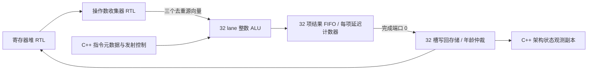

# 整数执行电路与直接写回

启用 `--timing --register-rtl --collector-rtl` 后，当前自定义 ISA 的整数指令全部在 SystemVerilog 中计算。没有新增开关，也没有把未支持的整数操作静默交回 C++。普通功能模式和未启用 collector RTL 的时序模式继续使用原执行器。

这完成了整数数值和有界结果通路，**还不是完整 SM，也不是 NVIDIA ALU 的精确逆向**。本阶段采用组合算术电路、结果 FIFO 和硬件倒计数；不能把可配置的“四拍延迟”描述成乘法器内部已经切分为四级流水线。



## 算术与操作数

`rtl/integer_lane.sv` 实现 NOP、MOVI、MOV、S2R、IADD、ISUB、IMUL、IMAD、AND、OR、XOR、SHL、SHR、SAR、ISETP、CVTA，共 16 种操作。算术按 32 位回绕，移位取低五位，ISETP 支持六种有符号/无符号比较；S2R 提供项目规定的 lane、逻辑 warp、CTA、SM 和启动尺寸。CVTA 检查项目自己的 shared/local 地址窗口，不能据此声称实现 NVIDIA 地址转换硬件或 TLB。

`rtl/integer_vector.sv` 按寄存器编号，从 collector 的三个物理源总线选择 a/b/c。重复源复用已有数据，R63 由电路提供零，非活动 lane 不参与计算。谓词结果放在 1024 位载荷的第零个 32 位字，其余字为零；普通寄存器结果保持逐 lane 布局。非法比较、特殊寄存器、地址转换和缺失源会拒绝整条命令，不能先提交部分 lane。

C++ 的 `IntegerCommand` 只有 opcode、寄存器编号、mask、立即数、执行上下文和槽编号，没有源向量或结果字段。整数 launch 不调用 `take_collector()`，也不调用 `evaluate_scalar()`。收集器的最后源旁路可在同拍直接驱动 ALU；只有 RTL 接收成功才释放 collector 所有权。

## 延迟、容量与完成

`rtl/integer_execute.sv` 每分区有 32 项 FIFO。每项存放 1024 位结果、5 位完成槽编号和 32 位倒计数；另有占用位、首尾指针及容量计数。接收时保存计算结果和 `latency−1`，之后实际时钟逐拍递减。宿主不使用 `entry.due` 判断整数结果完成。

所有在途计数器可同时推进，只有 FIFO 队首能完成。输出受阻时，完成槽编号和数据保持不变；队列满则停止接收，支持同拍出队/入队。普通延迟为全局配置，测试另覆盖不同延迟混排导致的队首阻塞。复位排空有效状态，不要求清空每个结果位。

若在模拟周期 C 的末尾边沿接收，延迟 L 的结果可在 C+L 的退休阶段使用。L=1、4、100 均由实际时钟验证。整数发射间隔、warp 调度和指令解码仍由 C++ 控制；本阶段没有把整个发射器称为 RTL。

整数输出直接连接写回模块的完成端口 0，优先于该端口的测试用外部注入。写回模块的 `completed_entries` 包含已保存结果和当拍到达结果，供宿主跟踪指令身份；不返回重新计算的数值。真正退休数据来自写回物理输出总线，并直接写入 RF，C++ 只更新观测副本。

RF、collector、整数执行和写回在组合顶层共享时钟。collector 的独立模块仍支持原有门控配置；组合顶层不再把内部生成的接收信号直接用于门控时钟，避免有效边沿期间门控改变。`clocks` 是宿主提供的时钟数；`active_clocks` 表示该单元请求状态更新的周期，不是 FPGA 工艺时钟门控或功耗测量。

## 验证与复现

独立整数 RTL 的四项检查覆盖全部操作、边界值、随机数、掩码、重复源/R63、CVTA 异常、容量、输出保持、同拍复用、在途复位，以及 6,000 拍随机输入/反压。数值参考调用原有功能 ISA；随机队列参考独立计算到期时刻和容量。相同检查也用于实际综合网表。

组合顶层另有实际 RF→collector→整数→写回→RF 检查；C++ 适配器测试覆盖 1/2/4/8 分区几何、拒绝命令后的重试、掩码、完成端口所有权和持久 RF 数据。实际指令回归检查全部整数单元收发相等、占用归零，以及依赖链在 1/4/100 拍设置下的退休时刻。

```sh
cmake -S . -B build-cache-rtl -DSIMT_REGISTER_RTL=ON
cmake --build build-cache-rtl -j4
ctest --test-dir build-cache-rtl --output-on-failure -j3
python3 tools/rtl.py --module integer --out artifacts/rtl-integer
python3 tools/rtl.py --synth --module integer --out artifacts/rtl-integer-synth
python3 tools/rtl.py --gate-sim --module integer --out artifacts/rtl-integer-synth
python3 tools/rtl.py --module operand_unit --out artifacts/rtl-integer-connected
```

各次构建、综合统计、主机 Graph 结果及失败修复记录见 [验证记录](VALIDATION.md)。综合使用 generic cells，没有指定工艺库或 FPGA DSP；单元数不能称为等价 NAND2 门数、两个完整 SM 面积或实际频率。

浮点/SFU/控制执行、跨分区共享资源仲裁、完整 GPU RTL、实卡参数校准和 PTX 异步矩阵协议仍未完成。NVML 可见性不提供 CUDA 计算接口；整体目标见 [硬件计划](HARDWARE_PLAN.md)。
