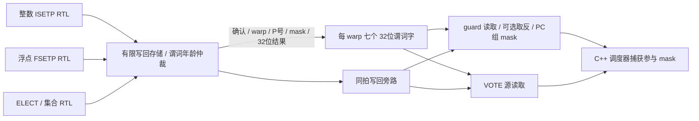

# 谓词存储、发射读取与直连写回

启用 `--timing --register-rtl` 后，指令 guard 与 VOTE 的谓词输入来自 `predicate_file.sv` 的实际存储输出。再启用 `--collector-rtl` 时，ISETP/FSETP 的电路结果及 ELECT 的完成结果经写回单元直接进入谓词存储，不经过宿主谓词写调用。架构转储中的谓词数组保留为结果镜像，不再为该后端提供执行输入。

这是自定义 ISA 的研究设计，不是 NVIDIA 谓词寄存器电路的精确逆向。后续阶段已接入 [跨 warp 调度](RTL_WARP_SCHEDULER.md) 和 [PC/状态前端](RTL_WARP_FRONTEND.md)；指令后备存储及前端实例间信号路由仍有 C++。ELECT/VOTE/SHFL/ACTIVEMASK 已接入独立集合电路，并增加执行侧第三个读口，见 [RTL_COLLECTIVES.md](RTL_COLLECTIVES.md)。下方综合表记录原双读口阶段的历史结果，三读口完整配置的当前综合结果见该文档。



## 存储究竟由什么实现

每个物理 warp 槽存储 P0–P6 的七个 32 位字，每位对应一个 lane。每个字另有一个有效位；P7 不存储，读取为全 1。模块按字生成触发器和写选择逻辑，不是 SRAM，也没有用 C++ 数组代替这些状态。

| 范围 | 数据位 | 有效位 | 合计 |
|---|---:|---:|---:|
| 一个 warp 槽 | 224 | 7 | 231 位 |
| 默认一个分区，8 槽 | 1,792 | 56 | 1,848 位 |
| 每个 SM，合计 32 槽 | 7,168 | 224 | 7,392 位 |

1/2/4/8 个分区分别划分为每分区 32/16/8/4 槽，总容量不随分区数量倍增。以上不包含普通寄存器堆、scoreboard 或写回存储，不能当作整个 SM 面积。

复位和槽复用只清有效位，不要求清除所有数据触发器。未有效的字按零读取。第一次部分写入时，未选中的位从零建立；已有有效字的部分写入则保留其他位。这样一个有效位足以表示整个字已经具有确定的可观察内容，不需要为 32 个 lane 各加有效位。

## 发射双读口、执行独立读口与单写口

发射侧两个组合读多路器共享 warp 槽地址，分别选择 guard 和 VOTE 源谓词。guard 端执行可选按位取反，再与当前 PC 组的 mask 相与。P7 的全 1 常量因此只激活组内 lane；取反 P7 得到零。部分 warp 的有效线程范围仍由上层 PC 组提供。

当前还有一个独立 warp/谓词地址的执行读口，直接向集合 RTL 提供 VOTE 输入。它共享同一存储和写旁路，不受发射侧查询地址变化影响。

每分区每拍只接受一条指令的谓词读取捕获。调度器可在发射前改变候选地址、探测就绪 warp；探测不推进时钟，不占用额外存储副本，也不算已发射读取。当前候选扫描仍由 C++ 实现，没有证明整个扫描网络能在特定硬件频率下一拍完成。

适配器只在查询引脚改变时额外调用 Verilator 求值；写入、退休和时钟路径已经在各自修改后完成求值，因此查询始终读取最新电路输出。这省去等待存储操作期间的大量重复组合求值，没有在宿主缓存谓词结果，也不改变模型时钟。

写端一次携带 warp 槽、P0–P6 编号、32 位 lane mask 和 32 位谓词值。P7 写入报告错误，零 mask 不产生写使能。各字的地址译码控制自己的触发器组，同拍不能向两个不同谓词字提交写入。

## 写回、旁路与复用顺序

`writeback_unit.sv` 的第五个退休端口负责谓词，按指令相对年龄从已完成结果中选一个。未确认的结果可以保留，但不能写存储。确认后，独立的谓词总线直接连接 `register_file.sv` 内的谓词模块。

写回到同一 warp、同一谓词的值可在捕获边沿之前旁路到三个读端口。旁路同样应用 lane mask，因此下一条指令可以在比较退休的同拍读取结果，而未参与 lane 保留原值。

清零和写入同拍时先清零再写入；组合旁路与边沿后的存储遵守同一顺序。读取不会泄漏旧槽未被本次 mask 覆盖的位。不同槽的清零互不影响。组合顶层与写回共享源时钟，不通过随内部反馈变化的组合门控时钟制造额外边沿。

只启用 `--register-rtl` 时，比较/集合运算仍由软件执行，但退休结果必须通过谓词模块的写端口；启用 collector 后，写回总线直接驱动该端口。适配器拒绝同拍重复写、已捕获读取之后的写，以及外部生产端与写回端覆盖彼此的操作。

## 实际统计与验证

`hardware.predicate_files` 按 SM/分区报告数据/有效位容量、两个读端口、一个写端口、输入时钟、有效更新边沿和读写次数。`guard_reads` 包含 P7 常量查询，成功执行时合计等于 issued；它不是触发器数组的动态功耗估算。`source_reads` 只统计实际发射的 VOTE 输入捕获。写计数采样真实 write-accept 信号，清槽另由原有寄存器统计报告。

独立 RTL 四项检查覆盖：初始化/P7、两端口读取、guard 取反与组掩码、捕获边沿、部分写入、清零/写入同拍、warp 隔离、P7 写拒绝、空 mask 以及 12,000 拍独立数组随机对照。4/8/32 槽均通过普通仿真，8/32 槽均通过同一套实际综合网表检查。C++ 适配器另覆盖 1/2/4/8 分区，以及写回年龄、保持、旁路和外部端口冲突。

实际指令检查验证 ISETP 部分覆盖、VOTE、ELECT、FSETP 到后续发射的同拍旁路、37 线程的部分 warp 和多 CTA 槽复用；同时复用既有 register/collector 全套指令测试。主机四类负载各重放两次，数值、全部旧统计与原始 trace 均和上一浮点阶段相等。每次 vector/reduction/GEMM/Transformer 的谓词写入分别为 20/45/6/56。

Yosys 0.40 / ABC 的实际 generic-cell 结果如下：

| 独立谓词模块 | 通用单元 | 触发器位 |
|---|---:|---:|
| 8 槽 | 13,733 | 1,848 |
| 32 槽 | 53,573 | 7,392 |

计数包括读多路器、地址译码、旁路和控制；不是 NAND2 等价门数，没有工艺时序、布局布线、FPGA 映射或功耗结论。构建结果、sanitizer、组合顶层范围及监控证据见 [验证记录](VALIDATION.md)。

```sh
python3 tools/rtl.py --module predicate --out artifacts/rtl-predicate
python3 tools/rtl.py --module predicate --synth --out artifacts/rtl-predicate-synth
python3 tools/rtl.py --module predicate --gate-sim --out artifacts/rtl-predicate-synth
ctest --test-dir build-cache-rtl -R 'rtl_(predicate_execution|register_file|writeback_adapter)' --output-on-failure
```

SFU、控制/访存执行电路、异步后台与 CTA 提交/回收服务次序、整数内部算术流水级和整机 RTL 连接仍未完成；实卡校准、PTX 异步矩阵协议及完整硬件验收仍需继续。
