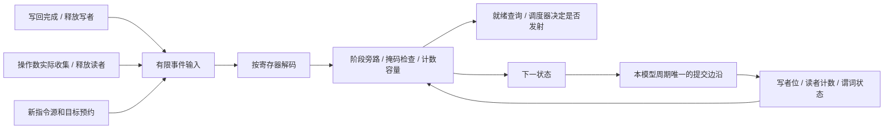

# 接入实际执行的 warp scoreboard 电路

`SIMT_SCOREBOARD_RTL=ON` 构建和 `--timing --scoreboard-rtl` 已将寄存器 RAW/WAW/WAR 与谓词写依赖交给实际 RTL 状态。C++ 不再为这个后端保存另一份写者表或读者计数。普通算术、访存、Tensor、异步搬运及主机 Graph 都通过同一依赖接口执行。

这一步接入的是依赖控制电路。寄存器**数据**另可选择 [寄存器 RTL](RTL_REGISTERS.md)，collector 与请求排序仍为 C++；独立 `register_arbiter.sv` 尚未接入整机。它不是完整 RTL SM，也不是 NVIDIA scoreboard 的逆向复刻。

## 每个物理 warp 槽保存什么

| 结构 | 实际内容 |
|---|---|
| 普通寄存器写者 | R0–R62 各 32 个 lane 位；R63 常零，不分配状态 |
| 尚未收集的读者 | R0–R62 每 lane 一个 6 位无符号计数，最大 63 |
| 谓词写者 | 8×32 个状态位，P7 查询始终就绪且禁止预约写者 |
| 同拍事件接口 | 16 组 valid、操作类型、寄存器号与 32 位 lane mask；组合检查及明确的 ready/error |
| 查询接口 | 寄存器可读/可写、谓词就绪；读取本拍事件旁路后的结果 |

综合结果包含 14,368 个触发器位：`63 × 32 × (1 + 6) + 8 × 32`。它们是实际状态寄存器，不是用软件计数代替的统计字段。6 位读者覆盖当前每 partition 最多 32 个 collectors 的配置上限，并保留硬件饱和检测；不会溢出回绕。

`TimedSm` 按物理 warp 槽持有实例，首次使用该槽时建立模拟对象，后续 CTA 复用同一实例。CTA 只能在已发射工作和搬运排空后回收，所以正常复用无需额外复位脉冲。未使用过的槽不创建宿主对象，这是仿真对象的延迟构造，不代表动态改变芯片资源数量。新 kernel 创建新的私有 SM 状态；故障排空仍由既有持久存储上下文负责。

## 一拍如何完成多种依赖更新



同一个寄存器本拍按“释放旧写者 → 收集旧读者 → 预约新读者 → 预约新写者”处理。同种事件对该寄存器每拍最多出现一次；重复或阶段倒序会返回错误。不同寄存器的事件可以交错进入。读改写指令允许同时拥有自己的源读取和目标写者，调度器仍须在预约之前检查 writable。

这个约束来自当前执行路径：每 bank 每拍一读一写，源寄存器去重，每 partition 每拍至多发射一条指令。一个 warp 所在 partition 最多贡献 4 个普通写回、1 个谓词写回、4 个操作数收集，以及新指令最多 3 个源和 1 个目标预约，合计至多 13 个非空事件。16 个端口因此覆盖完整路径，不通过加隐藏时钟“消化”调用。RTL 模式明确拒绝超过 4 个寄存器 banks 的配置；更宽的真实接口需要相应重新设计。

掩码只部分有效时，整个事件被拒绝。例如仅 lane 0 持有读者，释放 lanes 0、1 不会偷偷释放 lane 0。已饱和的读者返回反压；同拍先收集一个旧读者后可以预约新读者。适配器撤回被拒绝的候选输入，保留此前已经接受的事件。零掩码和 R63 的无状态更新不占事件端口。

引脚设置和查询仅执行组合求值；`TimingMachine::advance()` 在写回、收集、发射之后，对每个已建立的物理实例执行一次 `tick()`。RTL 用 `reset || |command_valid` 门控预约状态时钟；输入只在时钟低电平期间改变。适配器只在该电路输出允许时产生有效更新边沿，关闭时省略无状态变化的求值；固定 R63/P7 查询和未改变的组合输入也无需重复求值，不缓存第二份依赖状态。初始化复位属于设备建立，不计入 kernel 工作周期。报告的 `hardware.scoreboards` 按 SM/槽位分别给出输入模型拍数 `clocks` 和实际有效更新边沿 `active_clocks`；晚出现的槽位拍数可以小于整个 kernel 生命周期。普通状态/NVML 查询不推进这些电路。

## 为什么没有直接包装旧的单命令模块

旧 `lane_scoreboard.sv` 每拍只接受一个更新，仍保留为独立基元与历史验证。简单地对每次 C++ 方法调用打一次时钟，会把一次指令发射扩成多个未声明的硬件周期，无法与其他执行单元共用时钟。

首版新模块允许 16 个任意顺序事件串联更新所有 lane 计数。实际综合得到 2,741,408 个 generic cells。根据上述真实流水线约束，最终 `scoreboard_cell.sv` 先解码阶段事件，读者只经过一次减法和一次加法，写者经过释放/预约掩码；阶段版完整模块降为 763,640 个 generic cells；最后加入显式时钟门控为 763,658，较首版减少约 72%，触发器位数仍为 14,368。

该统计包含所有 63 个寄存器子实例和谓词/查询控制。通用事件解码与逐 lane 状态仍有明显面积代价；没有声称这是紧凑 FPGA 设计，更不能将 generic cells 当成 NAND2 等效门数、工艺面积、频率或整 GPU 成本。组合路径未进行工艺时序收敛；时钟门当前依赖低电平控制约束，尚未映射到工艺 ICG 或 FPGA 专用时钟网络。

## 构建与运行

独立构建这个后端：

```sh
cmake -S . -B build-scoreboard -DCMAKE_BUILD_TYPE=Release -DSIMT_SCOREBOARD_RTL=ON
cmake --build build-scoreboard -j4
build-scoreboard/simt-run PROGRAM.bin --timing --scoreboard-rtl --hardware-trace
ctest --test-dir build-scoreboard -R 'scoreboard' --output-on-failure
```

与缓存、Tensor 电路联合构建和运行完整主机负载：

```sh
cmake -S . -B build-cache-rtl -DCMAKE_BUILD_TYPE=Release -DSIMT_TENSOR_RTL=ON -DSIMT_CACHE_RTL=ON -DSIMT_SCOREBOARD_RTL=ON
cmake --build build-cache-rtl -j4
python3 examples/hardware_host.py --build build-cache-rtl --tensor-rtl --cache-rtl --scoreboard-rtl --out artifacts/rtl-scoreboard-gated-host
```

Python 使用 `Device(..., timing=True, scoreboard_rtl=True)`，可以同时启用 `tensor_rtl=True, cache_rtl=True`。未构建后端却请求 RTL、未启用 timing 或端口配置超界均明确失败，不回退为软件依赖表。默认模式继续使用原 C++ 参考实现。

Debug sanitizer 的大型电路仿真可能超过默认的单次主机响应等待上限。可传 `Device(..., request_timeout=180)`；它的单位是宿主秒，与设备 tick 预算不同。默认仍为 30 秒，参数必须有限且大于零，地址/UB 检测和算例不因此改变。

## 验证证据

- 4 项独立 RTL 检查：组合旁路与边沿归属、lane/谓词/原子拒绝及复位、有界读者与同拍释放、6,400 个事件的独立 C++ 差分。相同检查在 RTL、ASan/UBSan 和实际综合后网表执行，清单校验当前源文件和网表哈希。
- 4 项 C++ 适配器检查：查询不打时钟、RMW、16 个事件端口与跨字打包、容量/非法输入、物理槽隔离和读者饱和。另有 2 项 CLI/Python 后端选择检查。
- 96 项既有指令/数值/存储/同步检查在 scoreboard RTL 下复跑，包括真实 RAW/WAW/WAR、guard、同 bank 延迟、多 CTA、local/原子、DMA 和 Tensor。34 项主机/Graph 检查包含无时钟查询、故障后独立 stream 再次启动。
- 向量、规约、GEMM 和小型 Transformer 各两次 Graph 重放，同时启用 scoreboard、L1/L2 和 Tensor RTL。与前阶段 `rtl-banked-host` 比较，除新增 scoreboard 观测字段外，8 份 kernel 的完整状态和逐拍 trace 相同，汇总输出、设备/kernel 周期和缓存/DRAM 计数也相同；最终设备时钟仍为 64,500 拍。
- 最终带门控的联合 RTL GEMM 会话由普通 `nvidia-smi` 实际查询：真实 4070 SUPER 与模拟器共存，7 MiB 分配、释放到 0 和退出后移除均正确。`nvidia-smi-status.txt` 保存原程序输出，`backend-audit.json` 核对 10 份真实 kernel 报告及有效/输入时钟关系。

最终独立电路证据位于 `artifacts/rtl-scoreboard-gated/` 和 `rtl-scoreboard-gated-sanitize/`；首版面积与阶段优化记录分别保留在 `rtl-scoreboard-integrated/`、`rtl-scoreboard-phases/`。最终完整主机产物位于 `rtl-scoreboard-gated-host/`。各构建的实际通过范围、失败与重跑记录见 [VALIDATION.md](VALIDATION.md)。

寄存器数据已另有可选 RTL 后端；operand collector、bank 仲裁整机接入、其余 RTL 连接、实卡校准、PTX 异步矩阵协议和最终审计仍按 [HARDWARE_PLAN.md](HARDWARE_PLAN.md) 继续，不能用本模块的通过证明整颗 GPU 已经完成。
