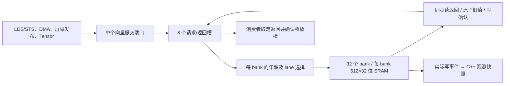

# 共享内存 SRAM、bank 仲裁与原子读改写

启用 `--timing --register-rtl --collector-rtl` 后，每 SM 使用同一份 **64 KiB、32 bank 的 shared RTL**。普通 LDS/STS、通用 shared 地址、shared 原子、DMA 目的写入、事务屏障记录发布和 Tensor 描述符/操作数读取均经过它。读取结果来自电路的数据阵列，C++ 中 CTA 的 `Memory` 仅保存实际写端口产生的观测快照，不能为后续 load 提供数据。

NVIDIA 公开文档说明 shared 的 32 个 bank、连续 32 位字依次映射及同字读取广播，见 [CUDA Programming Guide](https://docs.nvidia.com/cuda/cuda-programming-guide/02-basics/writing-cuda-kernels.html)。本项目采用这些可见规则；64 KiB 容量、八请求槽、年龄仲裁、清零方式、返回延迟和原子等待电路是设计选择，没有宣称精确还原某一代 NVIDIA 的 SRAM 或互联。已有 4070 SUPER 实测及其与模型的差异见 [MEMORY_CALIBRATION.md](MEMORY_CALIBRATION.md)。

## 实际存储与端口

| 结构 | 实现 |
|---|---|
| 物理容量 | 每 SM 32 banks × 512 rows × 32 bits = 64 KiB |
| bank 映射 | `bank = (physical_address / 4) % 32` |
| row 映射 | `row = physical_address / 128` |
| 每 bank 数据阵列 | 四个 512×8 位字节阵列，共用行地址，独立字节写使能 |
| 读取 | 一个同步读端口；读出的字和返回元数据进入寄存器 |
| 写入 | 一个按字节使能的写端口；每 bank 每拍至多服务一个普通字操作 |
| 有效位 | 每字一位，32×512 = 16,384 位；复位与区域重新分配清除有效位 |
| 请求与响应 | 八个物理向量槽，每槽最多 32 lanes；未消费响应继续占槽 |

数据 SRAM 本身没有复位，也没有从宿主快照加载初始字节。无效字读取为零。对无效字进行第一次子字写入时，写入指定字节，同时把其余字节置零并设置有效位；以后只更新掩码指定的字节。这避免重新分配后部分写入暴露上个 CTA 的残留字节。

SRAM 接口具有独立读、写连线，bank 控制器限制普通服务为每拍一个字操作。原子操作进一步锁定该 bank，不能据此声称读写端口可无限并行，或借 SRAM 推断结果推导出某个 MHz。



## 请求归属、冲突与广播

每个槽保存地址、值、CAS 替换值、宽度、写/原子类型、尚未发往 bank 的 lane、等待返回的 lane、实际结果向量及返回延迟计数。相对年龄矩阵记录请求接受先后，不使用可能在长时间占槽后回绕的有限时间戳。释放后重新使用低编号槽不会抢到更老请求之前。

电路先在每个请求内部形成该 bank 的首个 lane 和同字广播掩码，再在八个候选之间比较相对年龄，得到最早向量及其中编号最小的未服务 lane。不同 bank 可以同拍服务同一或不同向量。同一向量的同字读取一起广播，包括读取同字内不同字节/半字；不同字落在同 bank 时逐拍服务。不同请求之间不合并广播。

普通写同字与原子操作均逐 lane 服务。相互冲突的普通写采用本模型确定的 lane 顺序，不能将这一顺序当作 CUDA 数据竞争的保证。返回通过 lane 原地址中的 bank 编号选字，再做一次子字移位/掩码；完成位仍由 bank 携带的槽编号与 lane 掩码确认。结果保留在原请求槽，外部消费者可以按 ticket 独立取走，不要求按请求顺序消费。

每拍只接受一个新向量；八个槽都被在途或未消费结果占用时拒绝提交。适配器固定已接受输入的物理槽编号，之后同拍消费另一响应也不会把该请求重新指向新出现的低编号空槽。请求提交、查询和响应取走均不产生隐藏时钟；确认和 SRAM 状态变化在显式 tick 生效。

## 原子操作内部

每个 bank 有独立的读改写状态：地址、请求槽、lane、运算类型、操作数、CAS 替换值、旧字和 32 位等待计数。接受原子后先同步读取 SRAM，锁住该 bank，整数 ALU 产生候选新值；等待计数归零后通过同一写端口提交，并返回原始旧值。

实现十种已有 ISA 操作：32 位回绕加法、交换、CAS、AND/OR/XOR、无符号 min/max、有符号 min/max。该 ALU 是组合整数逻辑加显式等待状态，不是已完成时序收敛的深流水线。其他 bank 仍能推进；被锁定 bank 上的普通访存、DMA 和屏障发布都必须等待写确认。

读出的旧值来自 bank 的实际 SRAM 返回，不调用 C++ `atomic_result()` 生成 RTL 结果。原子的等待延迟保持可配置，完整 32 位计数已覆盖边界检查；其数值不是测得的 NVIDIA 原子延迟。

## CTA 分配、清零与生命周期

同一 kernel 的每 CTA shared 额度统一按 128 B 向上取整，物理基址为 CTA 槽编号乘该额度。资源准入同时限制总容量和 CTA/warp 数，因此多个 CTA 共享 64 KiB，而不是各自获得一份 64 KiB 电路。基址按完整 bank 行对齐，保留原有逻辑地址的 bank 映射。

一个 512 位区域清除总线可以清除本拍新分配区域的字有效位。它不写 SRAM 数据，也不推进隐含的初始化时钟。清除与尚未完成的同区域请求冲突时电路报错，错误批次不修改已有状态。重新分配只清除对应区域，其他 CTA 数据保持。

CTA 退休须先消费所有相关请求，随后解除物理区域映射；历史 C++ 快照保留用于检查。失败 kernel 的私有 shared 状态随实例销毁，不继续提交失败任务；已经进入共享 global/local 层次的请求仍按既有规则排空。

## 时钟与剩余软件边界

无冲突普通请求在边沿 N 被接受，N+1 服务 bank，N+2 收集返回，默认返回延迟配置为 2，因此 N+3 后结果可取。32 个不同字集中在同 bank，比一次并行服务增加 31 拍。新硬件入口和同步返回可能改变旧 C++ 模型的整体周期，不要求 trace 逐拍相同。

接口提供实际接受/消费、bank 服务、广播、未获服务 lane、原子开始/完成和时钟计数。`hardware.shared[]` 同时报告 `backend=rtl`、物理容量与剩余请求数。统计来自硬件握手和写返回事件，不通过宿主读取字节估算。

C++ 仍负责物理区域分配与绑定、入站客户之间的调用顺序、向量检查、外部 ticket 路由和观测快照。TMEM、constant 及 DRAM 后端仍有独立 C++ 模型。当前 shared SRAM 与 L1 数据 SRAM 是两个独立模块，没有实现 NVIDIA 式可重新划分的统一 L1/shared 容量。完整 GPU 顶层和校准继续见 [硬件计划](HARDWARE_PLAN.md)。

## 完整容量综合

Yosys 0.40 / ABC 对完整 64 KiB、32 bank、八槽结构完成通用门映射，`check -assert` 通过。保留存储的中间产物在 `shared_bank` 定义中推断出四个 512×8、单读/单写存储，顶层实例数为 32，实际数据容量为 524,288 位；不是只统计一个 bank 的模块定义。

| 完整 shared 模块的映射结果 | 数量 |
|---|---:|
| 通用单元总数 | 3,653,250 |
| 触发器位 | 577,120 |
| 组合单元 | 3,076,130 |

这一统计将数据 SRAM 展开为触发器和选择逻辑；没有映射 SRAM 宏、FPGA BRAM 或特定工艺单元，不能解释为等效 NAND2 门数、芯片面积、工作频率或两个完整 SM 的成本。综合使用 `--no-share` 保留独立资源，跳过耗时且未找到可合并资源的 SAT 共享优化；其余结构检查仍执行。默认 600 秒首次超时后，同一 RTL 以 1800 秒期限完成，过程见验证记录。

同一套五项驱动已在完整综合网表上通过，覆盖全容量数据、广播/冲突、全部原子类型、随机字节参考和异常/复位。网表 SHA-256 为 `7c49f4a57008e4dadc3f24465b348d8c2393a934910c418e46211dcbb571c4fd`；对应 RTL、测试驱动、实际网表可执行文件和主机负载的审计记录见 `artifacts/rtl-shared-final/evidence-audit.json`。这是实际网表行为验证，没有执行形式等价证明。

## 验证入口

```sh
cmake --build build-cache-rtl -j4
ctest --test-dir build-cache-rtl --output-on-failure -j4
python3 tools/rtl.py --module shared --out artifacts/rtl-shared-final
python3 tools/rtl.py --build build-sanitize --module shared --out artifacts/rtl-shared-sanitize
python3 tools/rtl.py --module shared --synth --no-share --timeout 1800 --out artifacts/rtl-shared-final
python3 tools/rtl.py --module shared --gate-sim --jobs 16 --timeout 3600 --out artifacts/rtl-shared-final
python3 artifacts/rtl-shared-final/build_adapter.py
```

独立驱动覆盖全部 16,384 个字、最高地址、局部清除、子字写、广播与冲突、十种原子操作、完整八槽容量、年龄与复用、非法批次、在途复位和 700 个随机请求及完整 SRAM 字节差分。实际适配器故意修改观测快照，再检查读取仍返回原 RTL 数据；整机检查包括 CTA 复用、DMA→shared→load 及原有 Tensor 消费路径。实际执行结果、综合范围和故障记录见 [VALIDATION.md](VALIDATION.md)。
