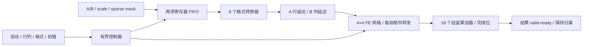

# Tensor 数值电路与 4×4 乘加阵列

本阶段把之前 C++ 模型中的数值运算落实为可综合 SystemVerilog：FP32 融合乘加、INT8 乘加、FP16/BF16/FP4 解码、PE 的点积/缩放/累加状态机，以及 16 个 PE 的逐跳阵列。RTL 中没有 `real`、`shortreal`、DPI 或宿主 `std::fma` 调用；Verilator 只负责执行电路描述，C++ 浮点运算用于独立验证。

这仍是本项目的研究架构，不能称为 NVIDIA Tensor Core 的精确逆向。`simt-run`/`simt-device` 已支持可选的 [RTL 执行后端](RTL_BACKEND.md)，将本阵列接入 ISA/TMEM；默认仍为 C++ 模型。整 GPU RTL、FPGA bitstream 和工艺布局布线尚未完成。

## 电路连接与存储



| 文件 | 电路内容 |
|---|---|
| `rtl/fp32_fma.sv` | 24×24 位乘法器、指数对齐、77 位加减通路、前导位检测、最近偶数舍入、四级寄存器 |
| `rtl/int8_mac.sv` | 有符号 8×8 位乘法器、32 位模加法器、四级寄存器 |
| `rtl/tensor_decode.sv` | 浮点字段译码、FP16 次正规数规格化、FP4 查表及 INT8 符号扩展 |
| `rtl/tensor_pe.sv` | 驻留累加器/块内部分和、有限状态机、两个数值流水线、反馈旁路 |
| `rtl/tensor_array.sv` | 两项 FIFO、边缘错拍寄存器、相邻 A/B 传输寄存器、16 个 PE、完成与反压控制 |

一个输入波包含四个 A、四个 B、两组各四个 scale、FP4 高/低半字节选择、四个稀疏使能位、block-end 和 last。FIFO 每项 526 位，两项共 1,052 个数据位，另有读写指针和容量计数；明确使用触发器组及读多路选择器。有效位/计数决定哪些数据可用，复位不要求清空每个数据寄存器。

阵列实际包含 16 份 PE。A 数据和行 scale 向右传，B 数据和列 scale 向下传，last/block-end/稀疏使能随 A 同步前进。第 r 行和第 c 列分别错开 r/c 拍，使同一 K 的 A/B 在对应 PE 相遇；输入气泡也沿相同路径传播。传输对齐错误或令牌到达尚不能接收的 PE 会设置 `transport_error`。

## FP32 融合乘加四级流水线

共同数值约定见 [TENSOR.md](TENSOR.md)：binary32、最近偶数舍入、保留次正规数、NaN 统一为 `0x7fc00000`。这里只实现该约定的结果位；没有 IEEE 异常状态寄存器、可选舍入模式或 NVIDIA 特有 FTZ/累加精度模式。

1. **解码与乘法。** 输入有效尾数各 24 位，正常数补隐含 1，次正规数不补。整数乘法器产生完整 48 位乘积；并行保存 C 的 24 位尾数、符号、10 位有符号指数及特殊值分类。此处不把乘积舍入回 FP32。
2. **指数对齐。** 令 P 的参考指数为 `eA+eB`，C 的为 `eC`，取较大者 E。乘积低端补 27 位，C 低端补 50 位，再按指数差移位到公共 77 位通路；最低位保留被移走部分的 sticky 信息。公共定点单位为 `2^(E-73)`。零操作数不参与最大指数选择，避免 `0×巨大数 + 极小数` 因错误对齐损失极小数。
3. **有符号加减。** 同号相加，异号先比较幅度再相减，保留结果符号。精确抵消按最近偶数规则得到正零；两个同号负零保留负零。接近抵消时，乘积的低位仍在通路中，没有提前截断。
4. **规格化和一次舍入。** 前导位检测确定有效指数，移位器取得 24 位有效数及 guard/sticky。精确中点取偶数；次正规数在 `2^-149` 网格舍入，可能进位到最小正常数，溢出产生带符号无穷。非零极小负数舍入为零时仍保留负号。

特殊值分类覆盖 NaN、`0×Inf`、乘积无穷与异号 C 无穷等情况；分类结果跟随同一流水线到输出，不提前返回。`A×B+C` 不经过“两次 FP32 运算”的中间舍入。测试中的 `(0x3f800001 × 0x3f7ffffe) + 0xbf800000` 实际得到 `0xa8800000`，用于区分融合与分离乘加。

若请求在上升沿 N 被接受，结果在 N+3 上升沿后拉高 valid，即经过四级寄存器；下游在 N+4 可握手取走。无反压且操作相互独立时可每拍接受一个请求。输出受阻会冻结整个流水线并拉低 input-ready，结果和所有在途操作保持不变；这是保守的整体暂停控制，没有宣称各级独立弹性缓冲。

RTL 的 `*` 由 Yosys 映射成实际乘法逻辑。当前使用 generic cells，没有指定 FPGA DSP 或标准单元库；四级划分本身不能证明能够达到某个 MHz。

## 低精度与整数电路

FP16 的所有 65,536 个编码都已遍历验证，包括两种零、次正规数、正常数、Inf 和 NaN。正常数调整偏置并扩展尾数；次正规数用前导位与移位电路构造精确 FP32。BF16 也遍历所有编码，通过字段扩展并规范化 NaN。

FP4 E2M1 的八种幅值为 0、0.5、1、1.5、2、3、4、6；符号独立。调用方提供字节及半字节选择，电路选择对应四位值。INT8 从低八位进行符号解释，乘积为有符号 16 位，扩展后与 32 位 D 相加并保留低 32 位。全体 65,536 种 INT8 输入对已在实际 PE 上验证，包括累加回绕。

输入格式在 tile 启动时固定。INT8 与块缩放组合被控制器拒绝，格式编号 5–7 也被拒绝。该解码电路没有增加 MXFP4/NVFP4 的 E8M0/E4M3 scale 编码，scale 仍是项目约定的 binary32。

## PE 内部与块缩放反馈

每个 PE 有 32 位输出累加器、32 位块内部分和、两份保存的 scale、跳过时保留的原值及 enabled/block-end/last 元数据。状态为 IDLE、DOT、SCALE、ACCUMULATE；每个 PE 同时只有一项依赖其驻留累加器的运算。

- 普通 DOT 使用整数或浮点流水线更新 D。新 K 可以在上一结果退休的同拍接收，通过结果反馈旁路取得最新 D，不能读取旧寄存器值。
- 缩放 DOT 更新块内部分和；block-end 到达后复用浮点流水线计算 scale 乘积，再执行 `fma(partial, scale_product, D)`。三个阶段分别经过实际四级流水线，完成后清零块内部分和。
- scale 乘法用 FMA 加同号零实现，保留乘积负零的语义；不能一律加正零而改变已有数值约定。
- 稀疏缺失项不把传入 A/B 送进有效算术计算，返回保存的原位模式。因此 NaN/Inf 的隐式缺失项不会产生 `0×NaN`；负零也不会因多余运算变号。传输和完成时钟仍被占用，没有实现压缩 K 传输或稀疏吞吐翻倍。
- last 被接受后，最后结果退休的同拍也不能再通过反馈旁路接受后继；完成位一直保留到下一次合法初始化。

阵列每四拍注入一组普通 K 波；带 block-end 的缩放波之后间隔十二拍。两项 FIFO 满时上游等待，最后波接受后不再接收输入。所有参与 PE 都完成后才拉高 result-valid；未取走结果时阵列仍 busy，新 tile 不能覆盖结果。

## 真实时钟与 C++ 参考的关系

对照逐位比较原 `simt::hw::TensorArray` 的结果、未参与单元的初值及异常数值规则。RTL 多了输入 FIFO 读出和边缘寄存器的实际时钟，不要求它与 C++ 的注入接口逐拍完全相同。

启动后下一拍开始持续提供波、无输入气泡时，从启动后的时钟计数到 result-valid：

`T = 7 + 4×(K−1) + (rows−1) + (columns−1) + 8×缩放块数`

普通模式最后一项为零。定向测试实际验证：2×3、两个 INT8 K 波为 14 拍；1×1、两个独立缩放块为 27 拍；4×4、256 个普通 K 波为 1,033 拍。输入气泡、输出握手和下一次启动另计，不能将这些模型时钟解释为 RTX 4070 SUPER 的性能。

## 验证与综合

新增 16 项行为检查：FMA 4、格式解码 3、PE 3、阵列 6。该阶段加原 14 项共 30 项；后续 [缓存范围扫描](RTL_CACHE_BACKEND.md) 增加 2 项，当前 `rtl-check` 合计 32 项。不同构建和网表复跑不重复计算为新场景。

- FMA：13,824 组边界/特殊值组合，250,000 组随机与抵消输入，12,000 组独立 Python Fraction 参考；另验证四级延迟、反压稳定和复位排空。
- 解码：全部 FP16/BF16 编码、全部 INT8 字节、FP4 的两个半字节位置和 FP32/非法格式。
- PE：全部 INT8 输入对、融合舍入、稀疏 NaN 跳过、三阶段缩放、last 退休时的准入边界。
- 阵列：矩形精确时钟、结果反压、跨模式复用、100 个带输入气泡的混合格式 tile、满 4×4/256 K、有限 FIFO 反压、非法命令无部分提交及在途复位。

2026-10-29，Yosys 0.40 / ABC 的实际 generic-cell 结果如下。阵列统计包含层次展开后的 16 个 PE、8 个转换器和控制/传输逻辑；不是只计一次共享模块定义。

| 完整综合对象 | 通用单元合计 | 触发器位 | 组合单元 |
|---|---:|---:|---:|
| FP32 FMA | 11,498 | 478 | 11,020 |
| 一个格式转换器 | 546 | 0 | 546 |
| 一个 PE，含浮点/整数流水线、控制与事件输出 | 13,090 | 794 | 12,296 |
| 完整 4×4 Tensor 阵列，含事件输出 | 217,928 | 16,636 | 201,292 |

上表 PE/阵列已更新为执行后端所需观测端口的重新综合结果，产物为 `artifacts/rtl-pe-integrated` 和 `artifacts/rtl-array-integrated`。端口暴露实际发射事件，没有加入宿主算术或额外的 RTL 计数寄存器；当前源码对应的网表检查均已通过。

这些值不是等价 NAND2 门数，也没有计入尚未实现的 TMEM、SM、缓存层次连接或外部接口。没有工艺 Liberty、DSP 映射、布局布线与时序回标，不能据此给出芯片面积、频率、功耗或两个完整 SM 的门数。

综合执行 `check -assert`。首次阵列综合在 FIFO 的存储输出寄存器合并后发现 260 个未驱动位；明确两项 FIFO 为触发器组后通过。失败日志保存在 `artifacts/rtl-tensor-array-synth/tensor/synthesis-before-fifo-fix.log`，没有跳过未驱动检查。

```sh
cmake --build build --target rtl-check

python3 tools/rtl.py --synth --module fma --out artifacts/rtl-tensor-synth
python3 tools/rtl.py --gate-sim --module fma --out artifacts/rtl-tensor-synth
python3 tools/rtl.py --synth --module decode --out artifacts/rtl-tensor-decode-synth
python3 tools/rtl.py --gate-sim --module decode --out artifacts/rtl-tensor-decode-synth
python3 tools/rtl.py --synth --module pe --out artifacts/rtl-tensor-pe-synth
python3 tools/rtl.py --gate-sim --module pe --out artifacts/rtl-tensor-pe-synth
python3 tools/rtl.py --synth --module tensor --out artifacts/rtl-tensor-array-synth
python3 tools/rtl.py --gate-sim --module tensor --out artifacts/rtl-tensor-array-synth

python3 tools/rtl.py --build build-sanitize --module fma --out artifacts/rtl-tensor-fma-sanitize
python3 tools/rtl.py --build build-sanitize --module decode --out artifacts/rtl-tensor-decode-sanitize
python3 tools/rtl.py --build build-sanitize --module pe --out artifacts/rtl-tensor-pe-sanitize
python3 tools/rtl.py --build build-sanitize --module tensor --out artifacts/rtl-tensor-array-sanitize
```

网表验证使用同一套 C++ 驱动，并在运行前检查 RTL/网表 SHA-256。它是实际综合产物的行为检查，不是形式等价证明。普通运行保留短场景 VCD；大规模随机场景不输出波形，sanitizer 模式也不使用旧 Verilator 的波形运行库。

浮点硬件与验证的背景资料参考 [Berkeley HardFloat](https://www.jhauser.us/arithmetic/HardFloat-1/doc/HardFloat-Verilog.html) 和 [Berkeley TestFloat](https://www.jhauser.us/arithmetic/TestFloat-3/doc/TestFloat-general.html)。本项目没有导入它们的实现；当前用例覆盖不代表通过了 TestFloat 的完整测试套件。

RTL 阵列与 ISA/TMEM 的接入已完成本阶段验证，具体边界与时钟规则见 [RTL_BACKEND.md](RTL_BACKEND.md)。仍须完成整个 SM 和存储层次的 RTL 连接，并进行真实显卡参数校准。专用 NVML 启动器的 nvidia-smi 可见性独立于此电路，不证明 CUDA/PCIe 兼容；完整目标仍以 [HARDWARE_PLAN.md](HARDWARE_PLAN.md) 为准。
