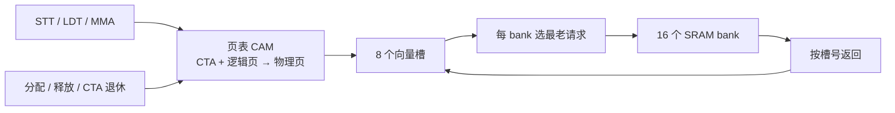

# TMEM 共享存储、页映射与 bank 仲裁

启用 `--timing --register-rtl --collector-rtl` 后，每 SM 使用同一份 **128 KiB、16 bank 的 TMEM 电路**。此前 TMEM 数据按 CTA 保存在 C++ 对象里，列归属由软件记录；现在 STT/LDT、MMA 的初值读取和结果写回都经过这份电路。每个 CTA 的 `Memory` 对象只观察实际写端口，不再向电路提供读数据。

这是本项目的研究设计，容量和映射方式不是 NVIDIA TMEM 的逆向结论。128×256 的逻辑窗口保留自定义 ISA 的既有约定。

## 实际结构

| 结构 | 实现 |
|---|---|
| 物理容量 | 16 bank × 2,048 行 × 32 位 = 128 KiB，支持 1–128 bank 的参数化实例 |
| bank 映射 | `bank = 物理字地址 % BANKS`，每 bank 每拍一个字操作，读响应带槽号标记 |
| 物理页 | 32 个页，每页 8 列（1,024 字），分配粒度因此是 8 列 |
| 页表 | 每页保存有效位、6 位 CTA、5 位逻辑页、分配头和长度，共 32 项 |
| 地址转换 | 每个 lane 并行比较 32 个页表项，不使用软件映射表 |
| 请求端口 | 8 个向量槽，每槽 32 lane；未取走的响应继续占槽 |
| 仲裁 | 每 bank 选最老的请求及其首个 lane；相同字的读取广播给同向量的多个 lane |
| 返回延迟 | 由 `response_latency` 配置，默认 2 拍 |



## 分配、释放和隔离

- 不同 CTA 可以使用相同的逻辑列，页表把它们映射到不同物理页，数据互不可见。
- 分配选择首个足够大的逻辑空洞，物理页不要求连续。
- 释放必须和分配的基址、长度完全一致，否则报错且不改变任何状态。
- 请求在途时，不能释放或退休其所有者。
- 分配后的清零经过真实写端口。SRAM 数据没有复位，也没有宿主导入通路。
- 一批非法输入整体拒绝，不会留下部分提交。

## 综合结果

Yosys 对完整 16 bank 实例的结果是 3,173,874 个 generic cell 和 1,075,363 个 FF 位，其中 SRAM 被展开为 1,048,576 位。这是通用单元统计，不是 NAND2 门数，也不是面积或频率。

## 对时序的影响

| 负载 | 上一阶段 kernel 周期 | 本阶段 |
|---|---|---|
| 向量 | 4847 / 5284 | 不变 |
| 规约 | 4024 / 4309 | 不变 |
| GEMM | 4362 / 4374 | 4400 / 4412 |
| Transformer | 20688 / 20972 | 20839 / 21123 |

向量和规约不使用 TMEM，因此完全一致。周期变化只出现在使用 TMEM 的 GEMM 和 Transformer 上，下载结果与参考值仍然相符。电路与原模型的端口和返回时序不同，但这些周期差还没有逐项分解到具体原因。

## 验证

```sh
python3 tools/rtl.py --module tmem
python3 tools/rtl.py --module tmem --synth --no-share --out artifacts/rtl-tmem-final
python3 tools/rtl.py --module tmem --gate-sim --out artifacts/rtl-tmem-final
ctest --test-dir build-cache-rtl -R tensor_memory --output-on-failure
```

- RTL 和 ASan/UBSan 下各通过五项：全容量读写、多 CTA 映射与精确释放、bank 冲突与广播、非法批次与复位、700 个随机向量对照独立参考。完整网表的门级仿真尚未跑完，不算已通过。
- 适配器四项：真实 SRAM 与显式时钟、独立所有者与复用、响应容量与忙状态、八种 bank 几何。
- ISA 三项：相同逻辑列的 CTA 隔离、释放后重新分配清零、最高字与满容量。

## 边界

Tensor 阵列以外的请求路由和 CTA 记录绑定仍由 C++ 适配层接线。这份电路只替换 TMEM 本身，不代表完整 SM 顶层已经形成。
