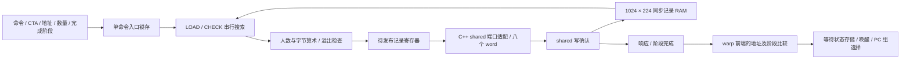

# 异步事务表、记录发布与阶段唤醒

`--timing --register-rtl --collector-rtl` 已把 MB_INIT、MB_EXPECT、MB_ARRIVE、CP_ASYNC 的字节预约/完成及 MB_WAIT 的事务查询接入 RTL。每 SM 的事务记录由同步 RAM 保存，地址查询、人数/字节算术、阶段推进、等待 shared 写确认和 CTA 回收扫描均由电路执行。warp 前端直接比较原始阶段令牌并保存、唤醒等待线程。

这是本项目自定义异步 ISA 的电路。它没有实现 NVIDIA 的完整 `cp.async`、TMA 或非阻塞 MMA 协议，也没有证明 NVIDIA 使用下面的事务表组织。DMA 片段生成、请求及返回载荷已由后续 [DMA RTL](RTL_DMA.md) 接管；发布记录的 shared 数据及 bank 仲裁现由 [shared RTL](RTL_SHARED.md) 提供；外部内存票据、不同地址的等待 lane 分组、跨实例连线仍有 C++；控制任务准入、等待计数及回收仲裁已由 [服务 RTL](RTL_ASYNC_SERVICE.md) 接管；完整 RTL GPU 尚未完成。

## 记录到底存在什么地方

`transaction_table.sv` 包含 1,024 条物理记录；`--mbarrier-slots` 的 1～1,024 配置决定本次使用的前缀额度，默认 16。容量不是无界宿主 map，也不会因请求增多而动态扩容。

| 每条记录字段 | 位数 |
|---|---:|
| CTA 标识 | 32 |
| CTA 内的 shared 地址 | 32 |
| 当前阶段 | 32 |
| 每阶段预期到达人数 | 32 |
| 尚未到达人数 | 32 |
| 尚未完成的预期字节 | 32 |
| 已发起且尚未完成的字节 | 32 |
| 合计 | **224** |

完整数据阵列为 **1,024×224 = 229,376 位，即 28 KiB**。有效位另存，不要求复位时清空 RAM 数据。Yosys 实际推断出一个单同步读、单写端口的 `$mem_v2`，RAM 外有 **1,410 个触发器位**，包含有效位和优化后的控制/输出状态。同步读输出寄存器已经合并进 RAM 读口，这一数字不把它再次算作外部触发器。

这是存储推断结果，尚未映射到具体 ASIC SRAM 宏或 FPGA BRAM。表里的 224 位记录也不是 shared 中的 32 字节不透明记录：后者还包含项目 magic 和保留 word，由发布适配层按既有布局写出。



## 有限端口和搜索过程

控制器只有一个命令入口、一个发布出口和一个响应出口，状态为 IDLE、LOAD、CHECK、PUBLISH、RESPONSE。输入命令锁存后才开始访问 RAM。LOAD 在边沿读出一条记录，CHECK 在下一拍检查有效位和 CTA/地址，因此每扫描一个槽占两拍。没有把全表查询当成免费的宿主查找。

- 普通查询或更新搜索到相同 `(CTA, address)` 即停止；全部额度扫描完还未找到则报告 `mbarrier_uninitialized`。不同 CTA 的相同 shared 地址相互独立。
- 初始化扫描全部额度，记录最低编号空槽，并检查同 CTA 是否有重叠的 32 字节记录。末尾才决定分配或报告表满，不能遇到一个空槽就忽略后面可能存在的冲突。
- 初始化验证 16 字节对齐、32 字节记录不能越过 64 KiB shared 窗口，以及 1～1,024 的到达人数。实际内存访问范围、普通 store/DMA 与记录保护的冲突，仍由现有 C++ 层检查。
- CTA 回收分两遍扫描。第一遍确认该 CTA 没有尚未完成或已发起的字节；第二遍才清除全部所属有效位并归还额度。失败的回收不会先释放一部分记录。

发布或响应受到反压时，控制器保持输出和归属，拒绝下一条命令。运行配置在接收命令时锁存；活动命令不受随后输入引脚改变影响。重置使已有记录失效；在途 shared/DMA 的复位协调仍由外部上下文销毁负责，没有声明支持外部旧响应跨复位回来。

## 字节、到达与阶段算术

`transaction_update.sv` 是独立组合运算模块，输入来自被查询的 RAM 记录，不接受宿主计算的下一状态。

1. MB_EXPECT 用 33 位加法检查非零新增字节是否超过 32 位上限，合法后增加预期字节。
2. MB_ARRIVE 先保存旧阶段作为返回令牌，再将剩余到达人数减一；零人数不能再到达。
3. CP_ASYNC 校验 1～4,096 字节长度和未预约预算，增加已发起字节。真实复制尚未在这里发生。
4. DMA 所有片段写确认后，完成命令携带原阶段和字节数；电路检查阶段匹配与两个字节计数都足够，然后同时扣减。
5. 剩余到达人数和剩余字节同时为零时，阶段加一并把到达人数重置为预期值。`UINT32_MAX` 不能回绕，错误时保留旧状态。

错误记录不会进入发布状态，也不会修改 RAM。独立算术检查使用更宽的宿主整数作为参考，包括无法通过短程序遍历到的阶段最大值；实际表测试另验证错误后的查询及后续合法命令，不能仅凭纯算术参考证明存储原子性。

## shared 发布与可见性

算术结果先保存到 PUBLISH 的待提交寄存器。此时旧 RAM 记录仍有效，新命令仍被阻止。C++ 适配层读取输出记录，把八个 word 通过普通 shared 请求端口写出；这些写操作与 DMA、普通 LDS/STS 和 Tensor 访问竞争同一 [shared RTL](RTL_SHARED.md) 的请求槽和实际 bank 端口。

只有全部 word 写确认后，适配层才拉高 `publication_ack`。该边沿将结果写入 RAM，随后进入 RESPONSE。初始化的有效位和占用数也在这个边沿改变。完成响应被软件取走后，原始地址及新阶段送到对应 CTA 的各 warp 前端。发布过程中反复读取输出或查询管理统计都不会偷偷推进电路时钟。

主机架构 map 只保存从电路取得的观察值，供转储、地址保护和已用地址管理；人数/字节/阶段不会作为运算输入回填电路。CTA 是否尚有未完成字节由硬件回收扫描判断，启用 RTL 时不使用该观察 map 的计数替代检查。

## 前端如何等待和唤醒

MB_WAIT 的相同地址 lane 共用一次表查询。地址分组仍由 C++ 执行；选中 lane 的原始令牌、地址和表返回的当前阶段进入前端专用接口。

- 令牌小于当前阶段：这一阶段已经完成，不阻塞。
- 令牌等于当前阶段：电路保存异步等待状态、完整 32 位地址和阶段。
- 任意参与 lane 的令牌大于当前阶段：给出未来阶段错误，整次查询不写入等待状态，不会先阻塞其他 lane。

等待状态在查询完成时进入前端，PC 在指令退休时推进。该 warp 的 boundary 状态在退休前阻止新发射；退休不会再把早先的等待快照写回来。这样，查询与退休之间到达的完成信号可以直接唤醒真实存储，避免丢失唤醒。

完成信号只匹配异步等待状态、完整地址和严格更新的阶段。相同地址但相同阶段不会唤醒，CTA 屏障/重聚等待者不会被误唤醒。同拍查询与更新阶段到达时，先写等待、再应用完成，结果直接参与 PC 分组选择。沿用原有前端存储，仍为每 warp **4,801 位**；新增的是比较与选择逻辑。

## 接入和剩余的软件部分

`src/rtl/transaction_table.cpp` 只驱动引脚、检查调用阶段、读取输出和统计握手。`src/timing/async_transaction.cpp` 负责命令操作数、shared 写确认、观察快照和事件路由。`async_launch.cpp` 仍管理单发起者约束和保护范围，`async_dma.cpp` 仍生成片段、提交访存并判定所有片段已经返回。

一个 SM 的事务控制任务尚有软件准入与配置延迟；硬件串行查询延迟在此基础上实际增加，没有把旧延迟替换成一个声称准确的 NVIDIA 数字。SM 的有效槽位只在 CTA 回收响应后释放，其他 CTA 的异步任务在此期间等待；普通计算和已经发出的 DMA 仍可前进。

默认 C++ 模式仍保留。启用 collector RTL 会自动选择事务表和前端专用接口；没有新增暗中回退的软件计数路径。报告 `hardware.async[].transaction_table` 包含物理容量、占用、搜索读、发布、响应、错误、阶段和反压；前端新增 `async_checked/async_blocked/async_woken`。历史外部等待写接口保留用于独立前端测试，当前集成的 CTA/事务路径不再通过它计算唤醒。

## 实际工具结果

| 对象和验证几何 | 实际结果 |
|---|---|
| 完整 1,024 条表，存储推断 | 229,376 位同步单读单写 RAM；RAM 外 1,410 FF 位；严格综合检查通过 |
| 16 条表，完整通用门映射 | 12,533 generic cells / 4,192 FF 位；实际网表四项通过 |
| 事务算术模块 | 3,192 个组合 generic cells，无 FF；实际网表两项通过 |
| 完整单 warp 前端，含两类屏障接口 | 125,662 generic cells / 4,801 FF 位；实际网表六项通过 |

**没有对完整 1,024 条 RAM 做通用门展开或网表仿真，也没有 SRAM 宏布局布线。** 16 条网表验证不代表完整表的门数；完整容量另通过 RTL 与 ASan/UBSan 覆盖最高槽位和表满行为。以上都不是等价 NAND2 门数、工艺面积、频率或两个完整 SM 的成本。

实际通过的测试：

- 独立算术两项：边界/非法输入及 20,000 组宽整数参考。
- 完整表四项：发布/响应反压、阶段令牌、全部 1,024 槽和地址别名、错误/回收原子性、2,400 个随机命令。
- 前端六项：原五项加阶段、完整地址、同拍释放、等待类型隔离和未来令牌原子拒绝。上述十二项均通过 ASan/UBSan；网表使用相同算术/前端与 16 条表几何。
- 事务适配器四项和前端适配器六项，通过联合 Release 与独立 ASan/UBSan；包括真实表到前端的阶段信号、shared 确认前不唤醒及错误后的记录保留。
- 新增实际 ISA/主机 28 项：复用 25 项异步契约和 DMA 测试，新增全部 16 记录/尾 warp/7 CTA 复用、表满/未完成退出、失败后 Graph 两次重放。
- 默认 Debug 27 套件/279 项运行，277 通过、2 跳过；联合 Release **55 套件/930 项全部通过**。本轮没有运行完整联合 sanitizer。

四类完整主机负载各两次 Graph 重放输出通过独立参考。Transformer 每次有 8 条表命令、54 次 RAM 搜索读、5 次发布和一次阶段推进，64 个线程检查/阻塞/唤醒，外部等待字段写计数为零。冷/暖两次 kernel 为 5,730/5,738 模型周期，上阶段为 5,614/5,734；端口与查询过程改变时序，不宣称 trace 或周期等价。

另两次带监控的 Transformer Graph 通过，`nvidia-smi` 经用户入口显示实际 7 MiB 分配、释放归零、退出移除，真实显卡仍共存；直接系统二进制只见实卡，见 [NVML 接入边界](NVIDIA_SMI.md)。

```sh
cmake --build build-cache-rtl -j4
ctest --test-dir build-cache-rtl --output-on-failure
python3 tools/rtl.py --build build-release --module transaction_table --out artifacts/rtl-transaction-table
python3 tools/rtl.py --module transaction_table --synth --infer-only --out artifacts/rtl-transaction-table
python3 tools/rtl.py --module transaction_table --transaction-slots 16 --synth --out artifacts/rtl-transaction-gates
python3 tools/rtl.py --build build-release --module transaction_table --transaction-slots 16 --gate-sim --out artifacts/rtl-transaction-gates
UBSAN_OPTIONS=halt_on_error=1 python3 tools/rtl.py --build build-sanitize --module transaction_table --out artifacts/rtl-transaction-sanitize
```

算术和前端分别使用 `--module transaction_update/warp_frontend`（每条命令选一个名字），独立适配器命令见 `artifacts/rtl-transaction-final/build_adapters.py` 及其产物清单。完整日志、源码/网表/二进制审计和监控证据在 `artifacts/rtl-transaction-final/`；完整负载在 `artifacts/rtl-transaction-host/`。整体剩余项仍以 [硬件计划](HARDWARE_PLAN.md) 为准。
