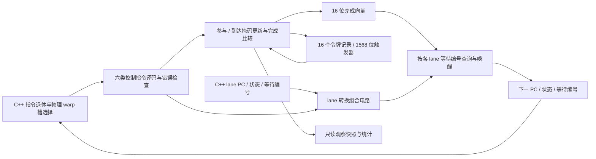

# 分支与重聚令牌电路

启用 `--timing --register-rtl --collector-rtl` 后，`EXIT/BRA/BSSY/BSYNC/BREAK/YIELD` 的控制状态转换由 `rtl/warp_control.sv` 执行。每个实际使用的物理 warp 槽拥有一个独立实例，其中的 16 个令牌记录持久保存在 RTL 触发器里。C++ 不再调用功能参考器计算这六条指令的结果，也不把 C++ 令牌副本送回电路。

这仍是混合系统：每个 lane 的 PC、运行状态和等待编号通过显式接口输入、输出，持久存储和调度仍在 C++。取指、目标指令检查、YIELD 恢复、CTA/异步事务屏障和部分访存执行尚未实现为完整 RTL。本模块实现项目自定义 ISA，不宣称复刻 NVIDIA 的分支单元或支持其 SASS 二进制。



## 存储结构和组合逻辑

| 每个令牌的字段 | 位数 | 含义 |
|---|---:|---|
| state | 2 | 未设置、已设置、参与者全部移除后解除 |
| members | 32 | 仍需等待的 lane 集合 |
| arrivals | 32 | 已到达 BSYNC 的 lane 集合 |
| target | 32 | 匹配 BSYNC 的指令索引 |
| 合计 | 98 | 每 warp 16 项，共 1,568 位 |

这些状态在本次综合中映射为带使能和同步清零的触发器，**不是 SRAM**。令牌表较小，而且 EXIT 可能同拍修改全部令牌；当前设计采用并行记录更新。PC 向量等接口各自的位宽不计入本模块存储位数，因为本模块没有保存它们的寄存器。

BSSY 保存当前 PC 组的成员和目标；BSYNC 合并到达掩码并暂挂参与 lane。BREAK 只移除一个令牌的成员，EXIT 从所有令牌中移除退出者。对受影响的已设置令牌，零成员变为解除状态；非零成员与到达掩码相等则完成并释放记录，保留 target 观察值。

完成检测输出 16 位向量。每个 lane 最多等待一个令牌，因此唤醒网络按其等待编号查询完成位，并选择对应 target+1。它不需要让 16 个令牌依次改写同一份 lane 状态。普通分支、退出、让出及 BSYNC 暂挂先生成独立的转换向量，再经过唤醒选择，组合块之间的数据依赖明确。

错误检查在状态更新之前执行：非法 opcode/令牌、被谓词修饰的 BSSY/BSYNC、覆盖活令牌、错误目标、未设置令牌、错误到达位置和成员不匹配均拒绝。拒绝时输出原 lane 状态和原令牌记录，下一时钟也不写入。无参与者的 BREAK 不检查令牌；无参与者的 BRA 不检查目标，保持功能 ISA 的既有约定。

## 接入与时钟

`WarpControl` 接口和 Verilator 适配器分别位于 `include/simt/warp_control.hpp`、`src/rtl/warp_control.cpp`。`src/timing/control.cpp` 在实际指令退休时驱动物理 warp 实例，并接收电路产生的 lane 状态；返回的令牌数组仅更新观察快照。目标是否指向匹配的 BSYNC 仍由宿主读取指令镜像后作为输入，不能算作硬件取指或译码器。

`execute()` 只设置输入并读取组合结果，不暗中推进时钟。一个实例每拍至多有一个待提交命令，第二次提交或在待提交期间清槽明确报错；全局模型拍末的 `tick()` 才提交记录并撤销输入引脚。宿主控制通路仍使用已有的一拍执行延迟和退休边界，尚未添加独立控制结果 FIFO，也没有物理频率或时序收敛结论。

CTA 派发时清除所用物理 warp 槽的令牌；实例在同一 kernel 的槽复用期间保留。空闲拍不产生状态更新边沿，统计分别记录输入 `clocks` 和 `active_clocks`。每个 kernel 的执行机器重新创建这些实例；这不改变 L1/L2 跨 kernel 保留的生命周期。

报告的 `hardware.warp_controls` 按 SM/槽列出 backend、令牌数、存储位数、时钟、有效更新、接收命令、清槽和唤醒 lane 数。接收命令总数在实际 ISA 测试中与六类指令的 `op_counts` 之和相等；失败命令不计数。实例按需创建，所以其输入时钟数可能小于整个 kernel 的模型拍数。

## 实际综合与验证

Yosys/ABC 对完整单 warp、16 令牌模块的结果为 **68,030 个 generic cells，其中 1,568 个触发器位**，没有剩余 memory 或 process。它包含 32 lane 的宽选择和更新电路；不是整 SM 门数、FPGA LUT 数或指定工艺面积。实际综合网表通过与 RTL 相同的四个行为场景。

首版按令牌优先级逐个改写 lane 向量，Yosys 长时间停留在 `PROC_DLATCH` 分析；人工停止该次综合并保存日志。改为独立 lane 转换、令牌完成向量和按编号唤醒后综合完成。没有获得首版有效面积结果，因此不报告前后面积或速度提升倍数。改动后重新运行 RTL、sanitizer、联合后端和 Graph 验证。

- 独立电路四场景：嵌套重聚、BREAK/EXIT 唤醒、解除令牌、全部 16 令牌；200 轮共 9,600 次随机令牌事务和 3,000 次随机 BRA/YIELD；错误原子性与清零。普通 RTL、ASan/UBSan 和综合网表均通过，参考来自另行实现的功能 ISA。
- 适配器四场景：无隐藏边沿、待提交命令保护、清槽与复用、两实例隔离、观察快照不影响存储、错误后撤销输入、96 位 lane 状态跨字打包。
- 实际 ISA 套件复用原九项控制流检查并新增三项：16 令牌同时存活、9 个 CTA/37 线程/1/2/4/8 分区下槽复用、最后一个令牌及各调度策略、非法描述符。确认控制计数与退休指令对应。
- 当前默认 Debug 27 套件/279 项（277 通过、2 项因未构建 RTL 跳过）；联合 Release 50 套件/880 项全部通过。完整联合后端的 sanitizer 本阶段未重跑；sanitizer 结论限定于新的独立电路与参考库。
- 新增两项持久主机测试：16 令牌、9 CTA/37 线程的 Graph 两次重放验证全部 333 个内存输出及令牌计数；错误 BSYNC 留下的私有状态不会污染下一 kernel。两项启用寄存器和 collector 后端。
- 五个可选后端同时运行四类主机负载各两次 Graph 重放，并验证独立数学结果。这四类负载对新控制单元只覆盖 EXIT，不替代前述重聚检查。额外两次监控规约验证 `nvidia-smi` 实卡共存和分配/释放/退出；这是 [NVML 管理接口](NVIDIA_SMI.md)，不提供 CUDA 计算设备枚举。

复现新模块：

```sh
python3 tools/rtl.py --build build-release --out artifacts/rtl-warp-control --module warp_control
python3 tools/rtl.py --build build-release --out artifacts/rtl-warp-control --module warp_control --synth
python3 tools/rtl.py --build build-release --out artifacts/rtl-warp-control --module warp_control --gate-sim
UBSAN_OPTIONS=halt_on_error=1 python3 tools/rtl.py --build build-sanitize \
  --out artifacts/rtl-warp-control-sanitize --module warp_control
```

`build-release` 和 `build-sanitize` 分别是普通 Release 和 ASan/UBSan 参考库，先按项目构建说明生成。联合构建沿用 [RTL 集合通路](RTL_COLLECTIVES.md) 的四个 CMake 开关；本模块随 collector 运行选项启用，无新增命令行开关。

证据位于 `artifacts/rtl-warp-control*/`、`artifacts/rtl-control-host/` 和 `artifacts/rtl-control-final/`；后者保存测试日志、监控结果和源码/网表哈希审计。完整目标保持进行中，后续仍需 PC/调度/屏障等控制硬件、其余执行与访存电路、整机 RTL、参数校准和最终审计，见 [硬件计划](HARDWARE_PLAN.md)。
