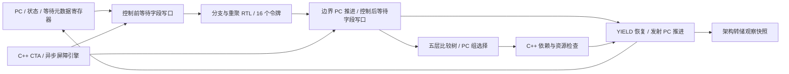

# Warp 的 PC 存储、线程状态和分组选择

`--timing --register-rtl --collector-rtl` 现在为每个使用中的物理 warp 实例化 `warp_frontend.sv`。它保存线程 PC、运行状态、等待编号与阶段，并直接连接既有 `warp_control.sv` 和新的 `warp_group.sv`。六类分支/重聚指令不再接收宿主 lane 快照；普通发射、边界退休、YIELD 恢复和 PC 组选择均操作实际 RTL 存储。

这是自定义研究架构的电路，不是 NVIDIA 公开逆向已经证明的内部实现。**跨 warp 的选择与依赖/资源判断、取指译码、CTA 屏障和异步事务计数仍有 C++**。外部屏障引擎通过明确的等待元数据写端口参与系统，不能把这个局部前端称为完整 SM 调度器。



## 存储是什么实现的

全部状态在当前通用综合中映射为带同步复位和写使能的触发器；没有声明已映射 SRAM、FPGA BRAM 或指定工艺寄存器宏。

| 状态 | 位数 |
|---|---:|
| 32 个 lane 的 PC | 1,024 |
| 32 个三位运行状态 | 96 |
| 32 个等待编号或屏障地址 | 1,024 |
| 32 个异步等待阶段 | 1,024 |
| 有效 lane 掩码 | 32 |
| 上次成功发射的 PC 与有效位 | 33 |
| lane 与选择状态合计 | **3,233** |
| 直连的 16 个重聚令牌 | **1,568** |
| 一个完整 warp 前端合计 | **4,801** |

三位运行状态区分 active、重聚等待、yielded、CTA 屏障等待、异步屏障等待和 exited。等待编号保留 32 位，因为异步屏障使用地址，不能压成四位重聚令牌编号。等待阶段同样保留完整 32 位；不从运行测试只用小编号推断实际存储位宽更小。

CTA 准入时，初始化端将有效 lane 设置为 active、其余设置为 exited，并清除 PC、等待元数据、轮转游标和全部令牌。初始化结果可以旁路到同拍第一次发射。同一 kernel 的物理 warp 槽在 CTA 复用期间保留实例，通过初始化端重新清槽；每次 kernel 建立新的前端实例。

## 怎样选出下一组线程

`warp_group.sv` 只读取来自存储和当拍退休旁路的状态。先找 active lane；若没有 active 但有 yielded，则把 yielded 作为本次候选。32 个叶节点经五层二叉树计算最小 PC、最大 PC，以及大于上次成功发射 PC 的最小后继；最后按选择出的 PC 生成全部成员掩码。

三种策略分别是最小 PC、最大 PC，以及按 PC 值轮转的后继选择；后继不存在时回绕至最小 PC。这不是按 lane 编号轮转，也不是分区内的 warp 仲裁。相同 PC 的所有候选 lane 一起发射，包括不连续成员。

查询候选不会改动轮转游标；只有成功发射才写入 last_pc。普通指令在发射时推进其 PC 组到 pc+1，边界指令则等待退休。32 位 PC 加一按项目 ISA 的 unsigned 规则回绕，随机检查包含 UINT32_MAX。

YIELD 有两个恢复时点：无 active lane 的选择机会会恢复 yielded，即使随后因依赖而未发射；已有 active lane 时，yielded 继续等待，直到同伴成功发射才全部恢复。电路实现这些状态变化，C++ 不再调用 `resume_yielded` 计算启用前端的 warp。

## 同一拍如何避免更新互相覆盖

信号处理顺序是：初始化/旧存储 → 控制前等待字段写入 → 分支/重聚 → 边界 PC 推进与控制后等待字段写入 → 选择 → 发射/YIELD 恢复 → 一个存储边沿。

两个外部写端口分别带有 state、blocked、phase 的逐 lane 写掩码。它们只服务仍由 C++ 实现的 CTA/异步屏障，**没有宿主 PC 或 last_pc 写端口**。适配器将外部计算的等待字段与实际电路观察值比较，仅驱动变化字段；同一阶段的多次软件发布合并到该拍有限端口，最后字段值生效，没有插入额外时钟。控制事务或边界推进之后的发布进入后写口，不能绕回前写口。

分支直接使用连接的 lane/令牌数据，输出继续送入选择电路；所以重聚唤醒后的线程可在同拍参与发射。控制指令与普通边界 PC 推进每 warp 每拍只能接受一种；每拍至多一次发射。初始化、重复事务、发射后的等待写入、错误选择策略和不匹配的发射组均由适配器拒绝。

`read()` 只读取含旁路的观察值，不推进时钟。`select()` 是明确的调度机会，会在无 active 时提出 YIELD 恢复；它与只读管理查询不同。`tick()` 在全局模型拍末统计稳定引脚、提交一次边沿并撤销事务。复位边沿不计入工作时钟。

这些组合路径没有内部流水级或工艺时序证明。每拍只推进一次描述模型接口和功能约束，不表示本电路能以真实 GPU 频率运行。父模块与重聚子模块共用时钟；旧 `warp_controls.active_clocks` 统计子模块状态更新使能拍，不能解释为一个独立物理时钟树的边沿数。

## C++ 的角色和实际接线

- `src/rtl/warp_frontend.cpp` 驱动引脚、读取观察值、检查调用阶段并统计实际握手；不保存 PC、令牌或轮转游标的持久副本。
- `src/timing/control.cpp` 从物理槽定位前端，执行分支、选择线程组和更新架构转储。PC 和令牌镜像不能反馈为指令操作数；等待字段仍通过明确的外部屏障接口写入。
- `src/timing/issue.cpp` 先使用电路选出的组，再进行软件依赖、容量和发射判断；成功后通知电路推进普通 PC 和游标。
- Tensor、集合及其他边界指令退休通过独立推进端更新 PC。CTA 屏障与异步屏障的等待/唤醒通过前后写端口发布。
- 未启用 collector RTL 的模式保留原 C++ 路径。新增 `hardware.warp_frontends` 报告存储位数、输入/有效时钟、发射、边界推进、外部 lane 写入和恢复数量；`warp_controls` 保留令牌统计。

## 综合结果与验证范围

Yosys/ABC 对包含控制和选择子模块的完整单 warp 前端报告 **103,263 generic cells / 4,801 FF 位**，没有残留 memory 或 process。`warp_group` 自身为 21,594 个组合单元，无触发器。数字来自实际层次网表，不是整 SM 面积、FPGA LUT 数或 NVIDIA 门数；本次没有对完整 GPU 或所有 RF/执行单元重新综合。

首轮配置中，旧版 Verilator 对同一数组内的树节点引用报告 `UNOPTFLAT`。改为每个生成节点独立命名连线后通过，未关闭告警。初始日志保留在 `artifacts/rtl-frontend-final/initial-selector-lint.log`。

实际完成的验证：

- 四项独立场景通过 RTL、ASan/UBSan 和实际综合网表：初始化/尾部 lane/首拍发射、6,000 拍随机顺序事件和三种选择策略、连接令牌后的 EXIT 唤醒与同拍发射、前后写口与错误/清零。选择参考使用独立有序容器，控制参考使用功能 ISA。
- 四项 C++ 适配器场景通过联合 Release 和独立 ASan/UBSan 构建：修改观察副本不影响存储、跨字状态打包、前后事件与发射顺序、YIELD 生命周期、调用阶段错误和保留令牌。独立 sanitizer 的精确编译/执行命令、源码和二进制哈希另存在清单中。
- 默认 Debug 27 套件/279 项（277 通过、2 项因未构建 RTL 跳过）；联合 Release 51 套件/884 项全部通过。控制 ISA 测试另核对物理前端的 issued 总数等于实际指令数。完整联合 sanitizer 未在本阶段重跑。
- 五个可选后端同时运行四种完整负载各两次 Graph 重放，通过独立数学结果；专门的 16 令牌 Graph、333 个输出和错误 kernel 隔离检查继续通过。十份常规及监控报告删除新增 `warp_frontends` 后与上一阶段全量相等，包括 trace；每次规约记录 768 个外部 lane 写事件，小 Transformer 为 2,272 个，GEMM/向量为零，不把它们误算为等待端口覆盖。
- 实际监控规约 Graph 两次通过，普通 `nvidia-smi` 验证实卡共存和 7 MiB→0 MiB→退出移除；直接系统命令仍只看到实卡。NVML 接入的含义保持 [NVIDIA_SMI.md](NVIDIA_SMI.md) 的边界。

```sh
python3 tools/rtl.py --build build-release --out artifacts/rtl-warp-frontend --module warp_frontend
python3 tools/rtl.py --build build-release --out artifacts/rtl-warp-frontend --module warp_frontend --synth
python3 tools/rtl.py --build build-release --out artifacts/rtl-warp-frontend --module warp_frontend --gate-sim
UBSAN_OPTIONS=halt_on_error=1 python3 tools/rtl.py --build build-sanitize \
  --out artifacts/rtl-warp-frontend-sanitize --module warp_frontend
```

先构建相应的普通 Release 与 sanitizer 参考库；联合执行沿用既有四个 CMake RTL 开关及 collector 运行选项。证据目录为 `artifacts/rtl-warp-frontend*/`、`artifacts/rtl-frontend-adapter-sanitize/`、`artifacts/rtl-frontend-host/` 和 `artifacts/rtl-frontend-final/`，后者保存最终审计。

完整目标仍在进行：跨 warp 发射仲裁、CTA/异步事务计数与其余执行/访存硬件、整机 RTL、参数校准、PTX 异步矩阵协议和最终硬件验收仍须继续，见 [硬件计划](HARDWARE_PLAN.md)。
