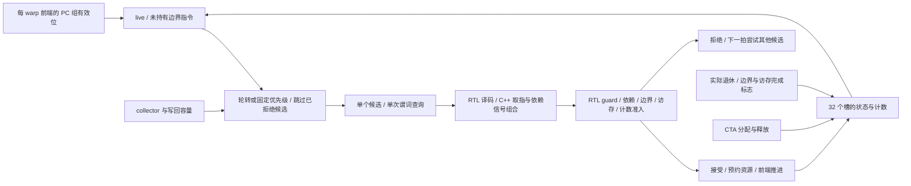

# 跨 warp 候选选择、在途状态与发射确认

`--timing --register-rtl --collector-rtl` 现在为每个 SM 分区实例化一个 `warp_scheduler`。轮转位置、候选重试集合、物理 warp 槽归属、在途指令计数、边界串行化和访存顺序标志由 RTL 保存。主机不再用 `try_issue()` 循环不断尝试同一分区的多个 warp，也不以 `TimedWarp` 的软件计数判断此后端的发射资格或 CTA 排空。

这是项目的有限端口调度器，不是 NVIDIA warp scheduler 的逆向复刻。[原始机器码与操作数译码](RTL_INSTRUCTION_DECODER.md) 已接入组合 RTL；指令存储/取指、各 scoreboard 查询的组合以及跨实例信号路由仍有 C++。本阶段解决候选选择与相关持久状态，尚未形成整 GPU RTL 顶层。

## 每个分区保存什么

| 状态 | 物理容量 | 位数 |
|---|---|---:|
| warp 槽 | 32 项，每项 live/boundary/memory 各 1 位、在途数 6 位 | 288 |
| 已拒绝的候选集合 | 32 位掩码 | 32 |
| 下一次轮转的起点 | 5 位槽号 | 5 |
| 合计 | 带同步复位及写使能的触发器 | **325** |

每项在途数合法范围为 0～32；实际运行还受该分区 32 项写回存储的共同容量限制。独立电路测试把所有 32 个槽分别加到 32，验证计数宽度和拒绝溢出；这不表示实际 SM 允许同一分区同时保有 1024 条指令。总在途观测端口为 11 位，避免独立测试中的总和截断。

每个调度实例始终含 32 个物理槽，运行前缀额度为 `32 / partitions`。1/2/4/8 分区分别启用每实例 32/16/8/4 槽，与寄存器堆的全 SM 32 个 warp 槽对应。多分区仍实例化完整控制数组，未启用的元数据槽不能分配；这里没有把控制存储和寄存器数据容量混为一谈。

最终完整实例实际综合为 **7,625 个 generic cells / 325 个触发器位**，未推断 SRAM。这个结果只描述独立调度实例，不含前端、scoreboard、寄存器堆和取指译码，也不是 NAND2 门数、整 SM 面积或工作频率。

## 一拍只检查一个候选



每个 warp 的独立前端提供自己的线程组；调度器首先排除未分配和仍持有边界指令的槽。collector 或写回容量不可用时，不产生候选，不移动轮转状态，也不查询共享谓词端口。

容量允许时，每分区每拍最多产生一个候选、完成一次 guard/依赖检查。拒绝会消耗本拍机会，不能在 C++ 中隐藏地换另一个 warp 继续发射。当前实现没有指令预取缓冲或多份并行译码器；单候选检查是明确的模型端口约束。

候选返回的 guard-ready、dependencies-ready，以及本指令是否为边界/访存指令进入 RTL。guard 未就绪优先拒绝；随后检查边界前必须无在途指令、同 warp 不能重叠两条访存指令、寄存器依赖和计数上限。当前没有把这些逐寄存器查询都直接接成统一硬件依赖矩阵，信号组合边界明确保留。

接受后才预约 collector/写回槽、登记 scoreboard 和推进前端；在本拍末的边沿更新调度器计数和状态。一个候选的决定作出后，适配器拒绝再次选择或更改分配/释放/退休事件，防止先前返回的接受结果被后续引脚变化撤销。

## 轮转和固定优先级的语义

- `--warp-policy rr`：从持久游标开始选择，完成一次检查后游标移动到该槽的下一位置，无论检查接受还是拒绝。
- `--warp-policy min/max`：分别优先低/高物理槽号。名称沿用既有接口；它们不是在不同 warp 之间比较数值 PC。warp 内 PC 组的选择由独立 `--policy` 决定。
- 拒绝的候选写入 `skipped`，当前搜索轮次优先考虑其余可运行槽。其余候选都已尝试后，可在本拍开始新一轮搜索；成功发射也清空重试集合。
- 槽释放或重新分配时清除该槽的重试位，避免新 CTA 继承旧所有者的拒绝记录。空闲和容量反压不会自行前移游标。

被依赖阻塞的高优先级 warp 因而不会一直占住候选端口。固定优先级本身仍不保证所有持续就绪 warp 的长期公平；round-robin 才提供轮转机会。它们不能被描述成 NVIDIA 的 GTO、两级 warp 调度或实卡策略辨识结果。

## 退休旁路与资源生存期

每槽有有限的退休计数输入和边界/访存完成位。软件适配层可以将同拍实际退休事件累积到这些输入引脚；它不保存权威在途数。电路先减退休数、清除退休标志，再进行本拍的候选准入，因此最后一条旧指令退休的同拍可以接受新的边界指令。

普通算术可以与同 warp 的待完成访存重叠；第二条访存必须等待前一条确认退休。控制、Tensor、自定义异步和其他 boundary 指令等待旧指令全部排空，发射后在退休前阻止本 warp 选择后续指令。寄存器 RAW/WAW/WAR 和谓词依赖仍由 scoreboard 契约约束。

非法退休计数下溢、无对应状态的完成位、带在途工作的槽释放、未释放 live 槽的重新分配以及越额度输入会拒绝整批事件。合法情况下允许同拍完成旧指令、释放槽并重新分配；没有部分提交其他槽的状态。实际 CTA 流程选择更明确的释放阶段：发出释放事件后，等下一次物理边沿提交，再归还 CTA 的 shared/寄存器/warp 资源。

这会使 CTA 排空增加明确的释放步骤。`scheduler_releasing_` 只是宿主资源回收流程的待确认标志，避免把这段等待误判为死锁；它不参与 warp 优先级或指令在途计数。失败 kernel 停止私有调度器，持久内存请求继续按已有恢复协议排空，新 kernel 获得新实例。

## 时钟、报告与剩余软件边界

构造时有初始化复位边沿；kernel 相对时钟从零计数。观察、设置引脚和组合求值不产生额外边沿，每次 `tick()` 最多推进一拍。没有事件时可以门控时钟。报告中的 `read()` 状态包含本拍合法生命周期事件的组合旁路，事件统计只在 tick 时提交。

`hardware.warp_schedulers[]` 报告实例身份、物理/可用槽数、live/边界/访存掩码、32 个计数、轮转/重试状态、输入/有效时钟、分配/释放/退休/候选/发射数及分类停顿。成功 kernel 要求计数和 live 状态归零、分配等于释放、实际发射/退休数与 ISA 事件相等。

顶层 scoreboard/boundary/memory-order/collector/completion 停顿字段在此后端汇总实际调度器事件。与旧软件扫描每拍可能检查多个 warp 的计数口径不同，不宣称原始停顿统计或逐拍 trace 完全相同。发生错误后，设备的排空周期可能继续增加，而私有调度器的时钟停止。

剩余 C++ 包括：CTA 资源分配策略、指令存储/取指、scoreboard 查询组合、实例间引脚路由、异步后台服务次序，以及尚未落实为电路的 SFU/访存部分。[跨分区执行仲裁](RTL_EXECUTION_ARBITER.md) 已负责 Tensor/异步候选轮转、Tensor 持有和发射间隔。寄存器和前端的权威数据分别见 [寄存器 RTL](RTL_REGISTERS.md) 与 [warp 前端](RTL_WARP_FRONTEND.md)。整个硬件目标继续以 [总计划](HARDWARE_PLAN.md) 为准。

## 验证与复现

```sh
cmake --build build-cache-rtl -j4
ctest --test-dir build-cache-rtl --output-on-failure
python3 tools/rtl.py --build build-release --module warp_scheduler --out artifacts/rtl-scheduler-final
python3 tools/rtl.py --module warp_scheduler --synth --out artifacts/rtl-scheduler-final
python3 tools/rtl.py --build build-release --module warp_scheduler --gate-sim --out artifacts/rtl-scheduler-final
python3 tools/rtl.py --build build-sanitize --module warp_scheduler --out artifacts/rtl-scheduler-sanitize
python3 artifacts/rtl-scheduler-final/build_adapter.py
```

独立五项电路检查覆盖完整容量、三种选择策略、反压、拒绝轮次、访存/边界串行化、同拍退休旁路、原子拒绝、槽替换和复位，以及 12,000 拍随机生命周期/决定。适配器四项另外检查显式时钟、快照隔离、输入阶段、实例隔离、拒绝恢复和硬件事件计数。

新增五项 ISA/主机检查覆盖全部 32 warp、1/2/4/8 分区、阻塞的最高优先级 warp、实际访存与 FENCE 顺序、尾 warp、7 个 CTA 重用、查询不推进状态和失败后再启动。每个成功报告都核对每拍检查次数上限、占用归零、分配/释放和发射/退休事件。

完整主机负载、Graph、NVML、实际综合网表与 sanitizer 结果、初始失败及其修复详见 [验证记录](VALIDATION.md)。原始日志和源码/网表/二进制审计在 `artifacts/rtl-scheduler-final/`。本阶段未重新运行全部历史独立 RTL 模块、完整联合 sanitizer 或整 GPU 综合。
