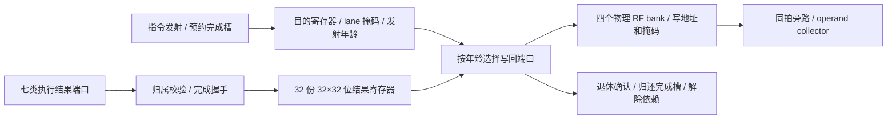

# 有限完成存储、写回仲裁与寄存器直连

启用 `--timing --register-rtl --collector-rtl` 时，执行结果现在经过 `writeback_unit.sv`，再直接写入 `register_file.sv`。不增加另一个可被忘记打开的后端选项。每个分区有 32 个完成槽；该容量是本项目的硬件设计选择，并非 NVIDIA 的逆向参数。



## 状态和接口

| 结构 | 每分区的实现 |
|---|---|
| 完成槽 | 32 项；发射时预约，退休确认时释放；不是执行结束后才无限追加的软件结果队列 |
| 结果存储 | 每项 32 lane × 32 位，共 32,768 个数据寄存器位；`writeback_payload.sv` 保存真实结果 |
| 槽元数据 | occupied、finished、物理 warp 槽号、生产端口、目的类型、寄存器号、写掩码、相对年龄 |
| 生产端口 | INT、FP、SFU、memory、control、tensor、async 共七个，每端口每拍最多一次完成 |
| 普通寄存器写端口 | 四个物理 bank，可配置为 1、2、4 个共享端口组；每组每拍最多一个结果 |
| 谓词结果 | 一个退休端口；32 个 lane 的谓词位装在载荷的第一个 32 位字中 |
| 无写入指令 | 仍预约、完成和退休，但不消耗 RF 或谓词端口；mask=0、R63 写入归入此类 |

每条当前自定义指令最多写一个普通寄存器或一个谓词。非法类型、P7 写入和不匹配的生产端口会被拒绝；不声称支持 NVIDIA 原生多目的指令。结果数据不在复位时清空，由 occupied/finished 保证旧数据不可见。

相对年龄在**发射**时建立，退休后扣除已退休的较老项数。新指令可以同拍复用刚释放的低编号物理槽，但年龄仍在队尾。仲裁只比较已经完成的结果；未完成的老指令不阻塞不相关的年轻结果。

完成端口检查槽已被预约、生产端口一致且尚未完成。重复完成不能覆盖已保存的载荷。新完成数据可在本拍直接进入退休总线；未退休的结果在下一上升沿保存到该槽，生产端口随后可服务其他结果。等待中的结果不要求生产者反复提供数据。

## 写回和时钟

同一周期先提交所有执行结果，再封闭完成输入，随后按电路授权退休。确认某条结果不会在这一相位中重新仲裁并开启第二次同端口写入。未被选中的结果保持完成状态，下一拍再参与。

RTL 退休输出直接连接 RF 的地址、lane mask 和 1,024 位向量数据。C++ 只采样退休总线更新架构转储；它不调用普通 `RegisterFile::write()` 回填硬件。执行入口的结果副本在成功提交后清除，退休时重新取得实际 RTL 数据。scoreboard 的写者依赖只在退休成功后释放。

集合指令的数值部分在执行阶段计算并进入同一个完成通路；PC、屏障和等待状态的改变仍在退休时发生。因此 SHFL/VOTE/ELECT 的结果不会在提交后绕开 RTL 再计算一次。

集成寄存器模块通过 `SHARED_CLOCK=1` 与写回控制器共用源时钟，各 lane 仍使用实际写使能。不能用同拍会变化的仲裁输出直接与时钟相与：首次联调中，此错误允许旁路读到新结果，却丢失持久存储写入；下一拍重新读取的回归测试发现了它。独立 RF 模块保留宿主引脚在高电平稳定时的原门控方式。集成模式的 `register_files.active_clocks` 表示有写入或清槽需求的周期，不代表完成了工艺时钟门控单元映射。

## 执行模型的边界

完成槽满会阻止新指令发射，计入 `completion_stalls`。同一生产端口当拍已有结果时，其他同类完成结果仍留在其执行状态，后续再提交。整数和浮点端现已由 [整数 RTL](RTL_INTEGER.md) 与 [浮点 RTL](RTL_FLOATING.md) 的有限队列直接提供端口 0、1 输入；其余端口仍由软件提交。**其余执行流水线和部分输入选择尚有 C++ 实现**，不能把写回电路描述为完整 SM RTL。

七个完成输入、RF 和谓词端口的冲突由本电路处理。谓词退休端现已直接连接 [谓词存储 RTL](RTL_PREDICATES.md)，提供实际 warp/P 号、mask 和 32 位结果，不只返回宿主镜像。SFU/控制/访存执行、整数算术内部流水级、跨分区 Tensor/异步单元仲裁、整机连接和参数校准仍需继续。新容量及生产端口限制可能改变原软件模型的周期；数值正确不代表与 NVIDIA 的时序相同。

## 验证入口

```sh
cmake --build build-cache-rtl -j4
ctest --test-dir build-cache-rtl --output-on-failure -j4
python3 tools/rtl.py --module writeback --out artifacts/rtl-writeback
python3 tools/rtl.py --module writeback --synth --infer-only --out artifacts/rtl-writeback
python3 tools/rtl.py --module writeback --synth --collector-entries 4 --out artifacts/rtl-writeback-small
python3 tools/rtl.py --module writeback --gate-sim --collector-entries 4 --out artifacts/rtl-writeback-small
python3 tools/rtl.py --module operand_unit --out artifacts/rtl-writeback-connected
```

独立电路包含五个检查，其中一个用单调发射编号作独立参考，运行 3,000 个随机周期，覆盖 1/2/4 端口组、乱序完成、部分确认、槽复用、无写入指令和数据保持；另一个同时提交七类结果。适配器另有三个检查，覆盖四种分区几何下真实 RF 写入、后续读取与同拍 collector 旁路。原 collector 执行套件检查每个成功 kernel 的 `reserved == completed == retired == issued`（按分区求和），并新增实际 40 条长延迟独立指令耗尽 32 槽、停发射后恢复的测试。

完整 32 槽和 4 槽配置均已完成 Yosys 0.40 / ABC generic-cell 综合和实际网表测试，数据路径及控制均包含在计数中：

| 配置（warp 槽数均为 8） | generic cells | 触发器位 |
|---|---:|---:|
| 4 个完成槽 | 88,869 | 4,312 |
| 32 个完成槽 | 739,485 | 34,496 |

完整配置包含 32,768 位结果、1,664 位描述符和年龄，以及 64 位 occupied/finished。宽向量输入和输出选择网络占较大组合成本；这里没有把它描述成经过面积或频率优化的实现。没有工艺库、时序约束和布局布线，这些数值不证明整卡门数或可达到的频率。

四种主机负载各两次 Graph 重放，加两次单独监控的 GEMM，完成数值验证。与上一阶段相比，十份报告的架构状态、总周期及其他统计相同，仅规约每次重放新增 3 次完成端口等待。对应的三个 LDS 原本与同分区另一条 LDS 同拍完成，现在晚一拍退休，未延长整个 kernel；事件证据见 `artifacts/rtl-writeback-history/host-state-differences.json`。先汇集完成输入再退休也改变了一些同拍事件的记录顺序，不能声称原始 trace 全量相等。

当前运行结果、失败记录及综合范围见 [验证记录](VALIDATION.md)；不能用小配置网表测试冒充完整 32 槽网表验证，也不能把 generic cells 换称为 NAND2 等效门数。
