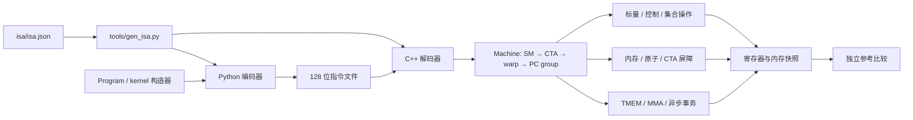
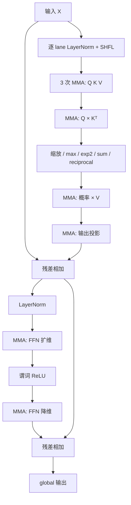

# 从示例读懂模拟器

先运行 `python3 examples/run_workloads.py`，再对照生成的 `artifacts/examples/<名称>/kernel.asm` 和 `state.json` 阅读。每个示例都保存机器码、原始输入镜像、启动参数、最终状态与验证结果；设备输出不是在 Python 中预先算好再写入的。

## 整体路径



`Machine::execute` 保留旧 warp 快照，逐模块分派一条指令，最后提交新状态。各模块用短函数分别负责校验、计算和状态变化，入口 `main` 只调用应用流程。

## 四个组合示例

| 示例 | 设备组织 | 主要数据通路 | 默认输入的验收结果 |
|---|---|---|---|
| vector | 5 CTA，每 CTA 64 线程，2 SM | 两个 global load → FADD → global store，长度 257 的尾部谓词 | 257 个值，误差 0 |
| reduction | 3 CTA，每 CTA 160 线程，2 SM | 137 个有效值 → warp SHFL 归约 → shared 部分和 → CTA 屏障 → leader 汇总 | 3 个整数和，完全一致 |
| gemm | 3 CTA，每 CTA 32 线程，2 SM | FP16 A/B → 4×8×16 MMA → TMEM → global；合成 12×8 输出 | 96 个值，最大绝对误差约 2.98e-7 |
| transformer | 1 CTA，64 线程，设备配置 2 SM | 异步输入 → LN → QKV → QKᵀ → softmax → AV → 投影/残差 → LN → FFN/残差 | 32 个值，最大绝对误差约 1.07e-7 |

表中误差来自当前环境下的默认输入运行结果，不代表所有形状的误差界限或性能。Transformer 只有一个 CTA，会使用一个 SM；向量、规约和分块 GEMM 验证双 SM 的实际派发。

Transformer 是长度 4、隐藏维 8、FFN 维 16、单注意力头的 pre-norm block，使用 ReLU、无 dropout、无注意力 mask，LayerNorm 仿射系数固定 gamma=1、beta=0。它是组合验证工作负载，不是完整推理框架或某个现成模型的兼容实现。



上述路径实际执行 8 个 MMA tile。`op_counts.MMA=16` 是两个 warp 经过的指令组数，其中 8 组因 leader 谓词为空而没有矩阵副作用。所有 instruction_steps/op_counts 都是功能诊断计数，不是硬件周期或吞吐。

## 推荐阅读顺序

1. `python/simt_lab/program.py`、`isa/isa.json`：一条指令如何编码，标签如何变成 PC。
2. `src/module.cpp`、`src/machine.cpp`：从二进制装载到双 SM 调度，旧状态/新状态怎样提交。
3. `src/control.cpp`、`src/collective.cpp`：每 lane PC、重聚 token 和成员掩码。
4. `src/memory.cpp`、`src/barrier.cpp`：分离地址空间、逐线程 CTA 到达；对照 reduction 示例。
5. `src/matrix_descriptor.cpp`、`src/matrix.cpp`、`src/tensor_numeric.cpp`：描述符、数值运算、稀疏 K 还原；对照 GEMM 示例。
6. `src/async.cpp`、`src/async_copy.cpp`：区分线程到达与搬运字节完成。
7. `python/simt_lab/transformer.py`、`kernels.py`：短指令序列怎样组合成完整计算路径。
8. `tests/numeric_reference.py` 与其他测试：哪些性质逐位比较，哪些比较容差，哪些必须报告错误。

## 复现与修改

```sh
python3 examples/run_workloads.py --workload transformer
python3 examples/run_workloads.py --workload gemm --policy max
git log --oneline --reverse
```

示例的 `launch.json` 保存参数数组，包含精确输入路径；`kernel.asm` 可按指令索引定位错误。修改 kernel 后先比较正确性，再观察分歧、原子旧值分配或工作量变化。这里没有 cache/timing 模型，不能把步数下降直接解释为真实 GPU 加速。

下一步若继续做深度项目，可以在此功能参考之上实现一个模块的 RTL，逐指令比较 RTL 的提交状态与此 ISS，而不必一开始搭建完整 GPU。Tensor Core 延迟、bank conflict、scoreboard 或资源竞争也应作为独立 timing 层添加，并保留当前功能参考作为验证基准。
